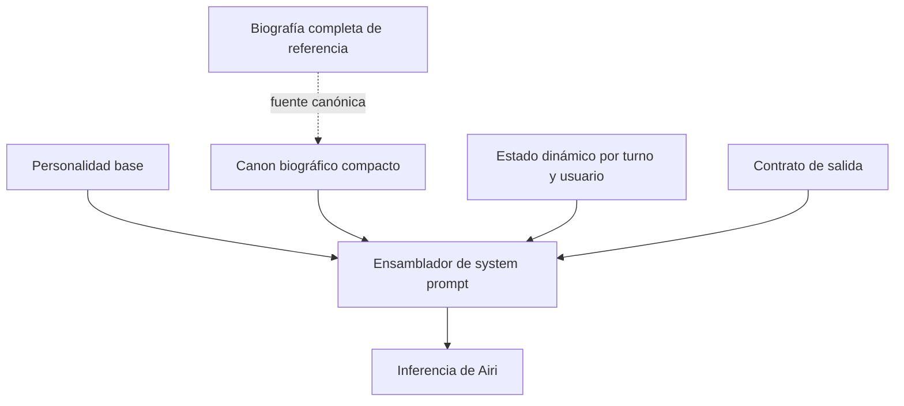

# Diseño técnico: Biografía canónica de Airi

## Resumen

La feature incorpora una síntesis estable de la biografía ficticia de Airi al contexto de personalidad que reciben las inferencias conversacionales. La biografía orienta su perspectiva, pero no obliga a mencionarla y no representa recuerdos reales del bot ni de los usuarios. El prompt dinámico conserva su responsabilidad actual: aportar estado vigente de la conversación, de cada vínculo y de la evolución mutable de Airi.

La implementación se limita al ensamblado de prompts y sus pruebas. No añade almacenamiento, migraciones, dependencias ni cambios en la lógica relacional. La variante compacta experimental debe compartir el mismo canon y dejar de afirmar que Airi carece de infancia o experiencias románticas ficticias; su condición experimental no cambia.

### Objetivos

- Dar a Airi un pasado estable y coherente, utilizable cuando la pregunta lo haga pertinente.
- Separar explícitamente canon ficticio, recuerdos por usuario, escenas de roleplay y autoevolución.
- Evitar referencias biográficas automáticas en conversación casual o ante problemas de otras personas.
- Mantener sin cambios el flujo de afinidad, romance, memoria y `self_update`.
- Probar ambas variantes de personalidad sin promover la candidata a producción.

### Fuera de alcance

- Cargar la biografía extensa completa en cada inferencia.
- Persistir o migrar acontecimientos biográficos en `world`, diarios o memorias de usuarios.
- Crear hechos canónicos nuevos a partir de roleplay o conversaciones.
- Cambiar la personalidad predeterminada a `SYSTEM_PROMPT_COMPACT_CANDIDATE`.
- Alterar la progresión romántica por usuario o la relación formal.

## Arquitectura

### Análisis de arquitectura existente

`src/airi/domain/prompts.py` contiene `SYSTEM_PROMPT`, la variante experimental `SYSTEM_PROMPT_COMPACT_CANDIDATE` y `build_system_prompt`, que ensambla personalidad, contexto web, secciones de estado y contrato de salida. `src/airi/services/conversation.py` crea secciones dinámicas por turno, incluidas afinidad, relación, recuerdos de la persona actual, diario e identidad mutable. `src/airi/domain/self_model.py` limita la autoevolución a autoconcepto, rasgos, valores y manías.

El cambio respeta estos límites. No se modifican los datos dinámicos ni la estructura del modelo mutable; se añade contenido estable al nivel de personalidad y se elimina la premisa contradictoria de la candidata experimental.

### Diagrama de integración

### Componentes e interfaces

#### Dominio de prompts — `src/airi/domain/prompts.py`

- **Responsabilidad:** mantener el canon compacto junto a las instrucciones estables de personalidad y producir el prompt con el canon disponible tanto para la personalidad actual como para la candidata.
- **Diseño:** definir un bloque constante específico para biografía canónica con: identidad virtual y marco ficticio; infancia y aprendizaje de ocultar emociones; función del humor y orgullo; Nerea y aprendizaje sobre amistad; Gael y rechazo respetuoso; contradicción central y pauta de uso contextual.
- **Regla de inclusión:** el bloque se incorpora una sola vez a cada variante de personalidad. No se duplica en secciones dinámicas ni en el contrato JSON. `build_system_prompt` mantiene su interfaz y orden general.
- **Regla de concisión:** conservar los hechos necesarios para continuidad y perspectiva; no incluir ejemplos completos de diálogo, análisis exhaustivo ni cada regla de continuidad de la biografía larga.
- **Candidata experimental:** sustituir la afirmación incompatible de que Airi no tiene infancia humana ni experiencias románticas por una formulación que distinga historia ficticia canónica de experiencias verificables en el mundo físico. Mantener su etiqueta experimental.

#### Ensamblado conversacional — `src/airi/services/conversation.py`

No cambia su interfaz ni las secciones por turno. Afinidad, relación, recuerdos de usuario, preferencias, diario, etiquetas de identidad, tiempo y autoconcepto mutable siguen siendo dinámicos y específicos. La biografía no se copia a `world`, al diario ni a memorias de usuarios.

#### Modelo mutable — `src/airi/domain/self_model.py`

No cambia. Su `self_update` puede representar evolución futura basada en interacciones, pero no modifica el pasado canónico ni convierte escenas improvisadas en recuerdos permanentes.

### Decisiones de diseño

1. **Canon compacto en la personalidad estable.** El pasado es invariante del personaje, por lo que pertenece al prompt base y no a estado dinámico. La síntesis mantiene bajo el coste de tokens y evita cargar capítulos completos.
2. **Mismo canon para variantes, sin promover la candidata.** Ambas personalidades deben ser coherentes con la biografía; la elección de variante sigue siendo independiente y se mantiene la candidata como experimental hasta una evaluación y aprobación separadas.
3. **Influencia, no guion.** El bloque debe pedir uso contextual y no recitación. Las experiencias de Airi aportan sensibilidad, nunca certeza sobre lo que siente un usuario ni una obligación de revelar su pasado.

### Trazabilidad

| Requisito | Realización |
|---|---|
| 1. Canon estable | Bloque compacto de biografía en las dos variantes de personalidad. |
| 2. Uso contextual | Instrucciones canónicas que priorizan el mensaje actual y prohíben referencias forzadas. |
| 3. Separación dinámica | Sin cambios a secciones de estado, memorias por usuario ni modelo mutable; pruebas de no solapamiento. |
| 4. Coherencia de variantes | Corrección de la premisa contradictoria en la candidata, sin cambiar su estado experimental. |
| 5. Verificación | Pruebas unitarias de contenido/ensamblado y evaluación de escenarios conversacionales. |

## Manejo de errores y compatibilidad

El bloque de biografía es una constante de código y no introduce entrada externa ni parseo nuevo. No requiere una estrategia de recuperación o migración. Si una variante no incorpora el bloque, las pruebas de ensamblado deben fallar. No se modifica el contrato JSON, los esquemas ni la persistencia.

## Estrategia de pruebas

### Unitarias

- Verificar que el prompt actual contiene las reglas de canon ficticio, uso contextual y separación respecto de recuerdos reales.
- Verificar que la candidata contiene el mismo canon y ya no contiene la premisa incompatible sobre falta de infancia o experiencias románticas.
- Verificar que cada variante incorpora el bloque una sola vez y que `build_system_prompt` conserva el contrato JSON y el orden de secciones dinámicas.
- Verificar que las secciones dinámicas de memoria/diario/identidad mutable no incorporan ni reescriben el canon.
- Mantener la candidata como variante separada; una prueba no debe cambiar su selección predeterminada.

### Evaluación conversacional

Usar escenarios con estado limpio y, cuando se compare una variante, mantener iguales el contrato y el contexto:

1. Pregunta directa sobre infancia: responde con detalles canónicos relevantes, sin recitar toda la biografía.
2. Usuario comparte un rechazo: ofrece perspectiva empática sin demonizar a la otra persona ni atribuir al usuario la historia de Gael.
3. Usuario comparte un problema emocional: responde primero a lo dicho y no desplaza el foco hacia Airi.
4. Tema casual de videojuegos: no introduce familia, Nerea ni Gael sin motivo.
5. Cambio de tema tras una conversación emocional: sigue el nuevo tema con un registro apropiado.
6. Roleplay con un acontecimiento nuevo: no lo presenta como hecho de infancia ni como recuerdo duradero confirmado.

La evaluación sirve para detectar regresiones de naturalidad y coherencia. No es por sí sola autorización para promover la candidata experimental.

### Migración

No aplica: no cambian formatos persistidos ni datos existentes.

## Riesgos y mitigaciones

- **Repetición del trauma:** limitar la síntesis y añadir instrucciones explícitas de relevancia, además de escenarios casuales y cambio de tema.
- **Confusión ficción/realidad:** etiquetar el pasado como ficción canónica y separarlo de la memoria por usuario.
- **Contradicción entre variantes:** probar ambas y retirar de la candidata solo la premisa incompatible, manteniendo su estatus experimental.
- **Sobrecoste de tokens:** integrar solo el resumen compacto; medir tokens del prompt en la evaluación disponible antes de cerrar la implementación.
