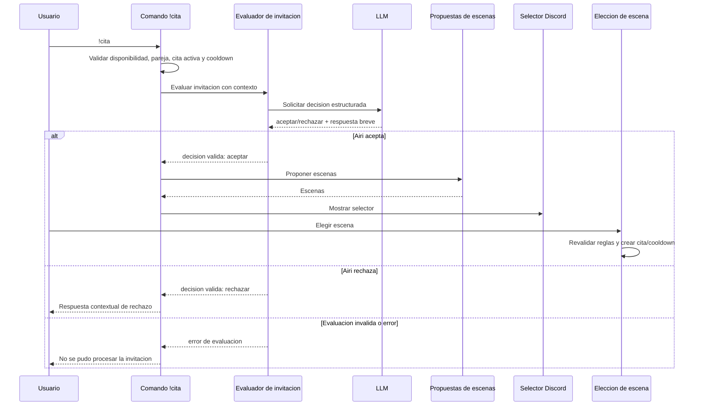

# Diseño técnico: decisión de invitaciones a citas

## Resumen

El flujo `!cita` dejará de bloquear invitaciones por un mínimo de afinidad. Después de aplicar las restricciones de disponibilidad y relación que ya existen, Airi evaluará la invitación con el modelo y el contexto del usuario. Solo una aceptación válida permitirá mostrar escenas; la cita y su cooldown seguirán creándose al elegir una escena, como ocurre actualmente.

El cambio es una extensión pequeña del flujo Discord existente. No modifica la máquina de estados de una cita ya iniciada ni sus reglas de afinidad, crisis o cierre.

### Objetivos
- Permitir invitaciones en cualquier nivel de afinidad.
- Dejar la aceptación/rechazo en manos de una evaluación contextual de Airi.
- No cambiar estado, afinidad ni cooldown si se rechaza la invitación o falla la evaluación.
- Mantener las restricciones de pareja, exclusividad y cooldown.

### Fuera de alcance
- Cambiar los deltas de afinidad o los desenlaces de citas existentes.
- Cambiar duración, turnos o pregunta decisiva de la cita.
- Rediseñar el selector de escenas o añadir botones de aceptar/rechazar.

## Arquitectura

### Análisis de la arquitectura existente

`commands/dates.py::handle` valida si Airi está ocupada, comprueba las reglas de pareja, valida afinidad, cooldown y cita ya activa, y finalmente solicita propuestas de escenas mediante `ctx.propose_scenes`. La elección de escena llega a `turn.py::handle_scene_choice`, que vuelve a comprobar afinidad y cooldown; solo ahí crea `new_date_session`, actualiza `last_date` y persiste ambos estados. Por lo tanto, el cooldown no se consume al abrir el selector: se consume al confirmar una escena.

La propuesta de escenas vive en `client.py::propose_scenes` y dispone de fallback para fallos del modelo. La nueva decisión no debe reutilizar ese fallback: un fallo al decidir no equivale a una aceptación. `Context` inyecta estas operaciones a los comandos, conservando el patrón de dependencias existente.

No se encontraron documentos de steering en `.kiro/steering/`.

### Flujo de invitación

### Decisiones de diseño

1. **La invitación se decide antes de proponer escenas.** Esto impide presentar opciones como si la cita ya estuviera aceptada. La sesión no se crea hasta la elección de escena, conservando el límite transaccional actual.
2. **El LLM recibe afinidad como contexto, nunca como umbral.** La decisión estructurada acepta únicamente `accept` o `reject` y una respuesta corta. El prompt pedirá valorar relación e historial disponible sin reglas deterministas por rangos.
3. **La decisión falla cerrada.** Respuesta inválida, timeout o error de proveedor produce un aviso de fallo y no invita a proponer escenas. No se interpreta como rechazo emocional ni como aceptación; no se muta estado.
4. **Se mantienen validaciones en ambos puntos.** El comando comprueba elegibilidad previa a llamar al LLM y la elección de escena vuelve a comprobar cooldown, pareja y cita activa, evitando carreras durante el selector. Se elimina únicamente la validación `can_date` de ambos sitios.

## Componentes e interfaces

### Comando Discord — `commands/dates.py`
- Conserva validaciones de disponibilidad, pareja, cooldown y cita activa.
- Elimina el rechazo por nivel de afinidad.
- Solicita la decisión contextual antes de llamar a `propose_scenes`.
- En rechazo, publica la respuesta y retorna sin abrir selector.
- En fallo técnico, publica un mensaje neutral de reintento y retorna sin mutación.

### Contexto de bot — `discord_bot/context.py`
- Añade una dependencia inyectable `evaluate_date_invitation` con una firma asíncrona equivalente a `(session, user) -> DateInvitationDecision`.
- El resultado es un valor explícito y validado: decisión (`accept`/`reject`) y texto de respuesta.
- En pruebas, la dependencia se sustituye por un fake determinista.

### Evaluador — `discord_bot/client.py`
- Implementa `evaluate_date_invitation` siguiendo el patrón de `propose_scenes` y el helper de petición al LLM.
- Construye contexto con nombre, puntos/nivel de afinidad e información relacional disponible, evitando inyectar datos no necesarios.
- Valida el JSON estructurado. No tiene fallback afirmativo.
- Mantiene separada esta operación de la propuesta de escenas para asegurar el orden de decisión.

### Inicio de cita — `turn.py::handle_scene_choice`
- Quita el segundo filtro de afinidad.
- Mantiene las revalidaciones de cita activa, pareja y cooldown.
- Sigue creando sesión, registrando `last_date` y persistiendo solo cuando el usuario confirma escena.

## Contrato de decisión

Resultado lógico:

| Campo | Tipo | Regla |
|---|---|---|
| `decision` | cadena enumerada | `accept` o `reject`; otros valores son inválidos |
| `reply` | cadena | Respuesta breve de Airi; se normaliza y limita antes de publicar |

El adaptador traduce errores del proveedor, timeout y respuesta estructuralmente inválida a fallo de evaluación. El comando no debe exponer detalles internos del proveedor.

## Manejo de errores y consistencia

- Fallo del LLM: respuesta neutral indicando que no pudo decidir ahora; no selector, sesión, cooldown ni cambio de afinidad.
- Payload inválido: misma salida segura que el fallo del LLM; registrar error técnico en log sin publicar contenido interno.
- El rechazo solo publica el texto de decisión; no guarda `last_date`.
- Si el usuario tarda en elegir y otra cita/regla cambia mientras el selector está abierto, las validaciones existentes al elegir escena rechazan la selección sin crear sesión.
- La disponibilidad global y cooldown siguen siendo restricciones del comando; la decisión solo se consulta cuando la invitación es elegible.

## Estrategia de pruebas

### Unitarias
- Validación/normalización del contrato `accept` y `reject`; rechazo de payload inválido.
- Prompt/serialización del evaluador incluyendo contexto de afinidad sin umbral prescriptivo.
- Verificar que un error del evaluador nunca se convierte en aceptación.

### Integración
- `!cita` con afinidad baja y resultado accept muestra escenas; con afinidad alta y resultado reject no las muestra.
- Cubrir ambos resultados en rangos bajos y altos mediante respuestas del evaluador controladas, sin asumir que el rango determina la respuesta.
- Rechazo no crea sesión, no cambia `last_date` ni afinidad y no persiste el estado de cita.
- Aceptación tampoco crea sesión ni consume cooldown antes de seleccionar escena; selección crea sesión y registra cooldown.
- Error/timeout de evaluación no cambia estado ni muestra escenas.
- Mantener pruebas para cooldown, pareja, cita activa y revalidación al elegir escena.

## Trazabilidad

| Requisito | Realización |
|---|---|
| 1.1, 1.2 | `commands/dates.py` elimina umbral y conserva reglas separadas. |
| 2.1–2.6 | `evaluate_date_invitation`, su contrato y el orden del comando. |
| 3.1–3.4 | Decisión sin mutación; `handle_scene_choice` conserva el punto de commit y restricciones. |
| 4.1–4.4 | Pruebas unitarias e integración del comando, evaluador y elección de escena. |
