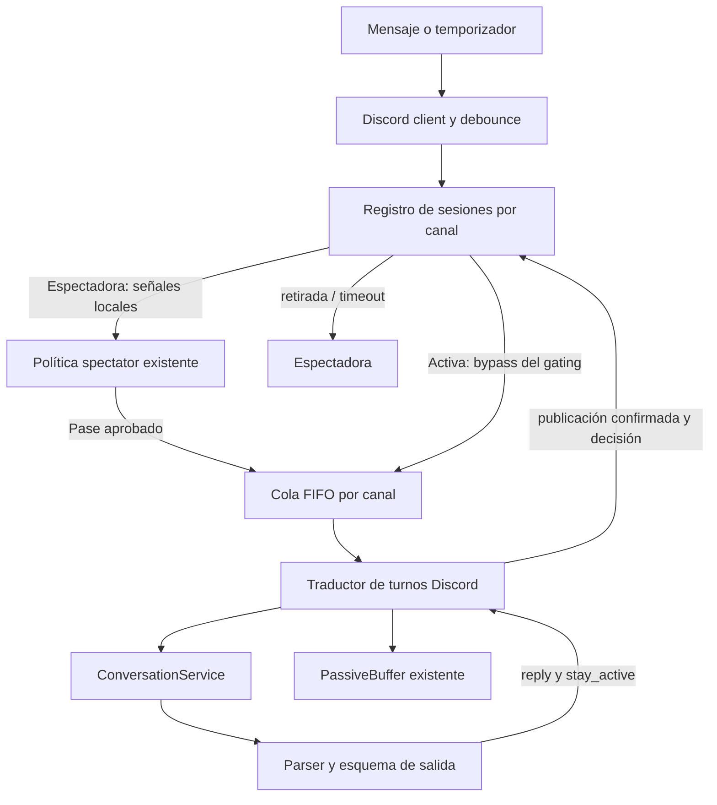
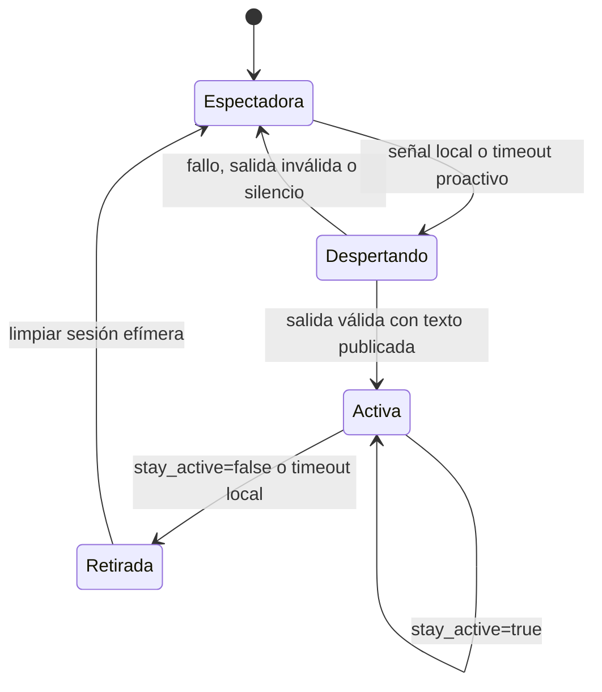
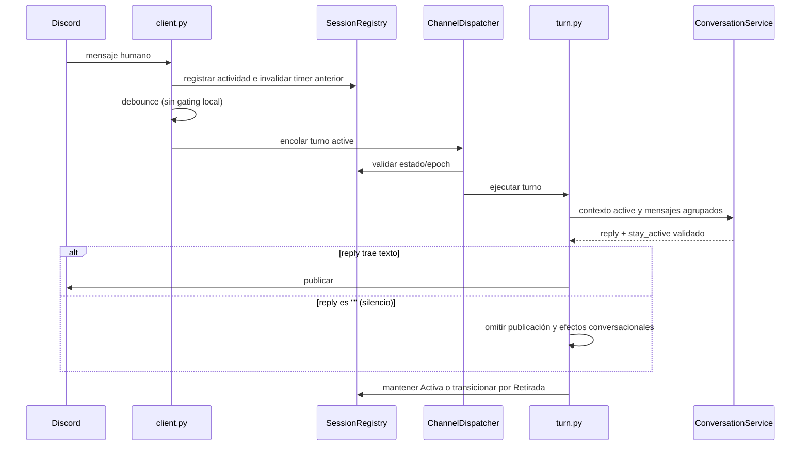
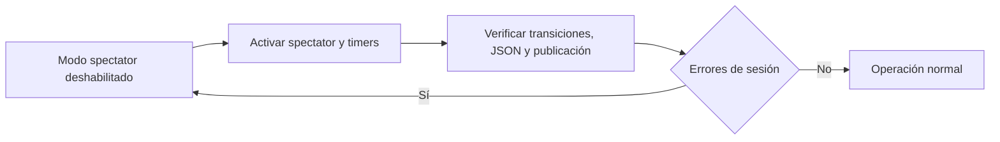

# Diseño técnico: conversación activa dirigida por el LLM

## Overview

La feature extiende el modo espectador existente con un ciclo de vida conversacional volátil por canal. El sistema conserva la responsabilidad de filtrar, agrupar, serializar y aplicar límites temporales; el LLM recibe el control semántico de responder, guardar silencio y continuar o cerrar una conversación una vez que Airi ha despertado.

La implementación reutiliza `PassiveBuffer`, `ActivitiesCooldown`, `ChannelDispatcher`, el snapshot de spectator y `ConversationService`. Añade un registro en memoria de sesiones, temporizadores de inactividad en la capa Discord y un contrato de salida estricto específico para turnos spectator/activos. El estado no se persiste. La activación solo se confirma después de una publicación exitosa; los fallos no dejan sesiones activas huérfanas.

### Goals
- Mantener los filtros locales actuales mientras el canal está en Espectadora y omitirlos en Activa.
- Hacer explícitos y testeables los estados Espectadora, Despertando, Activa y Retirada.
- Permitir respuestas, silencio y decisión de continuidad mediante salida estructurada validada.
- Retirar localmente sesiones activas inactivas y permitir un despertar proactivo configurable.
- Mantener el orden FIFO por canal, la compatibilidad del modo normal y la privacidad del buffer pasivo.

### Non-Goals
- Cambiar los criterios, probabilidades o umbrales actuales de mención, handoff, tema o afinidad.
- Persistir el estado de sesión, los temporizadores o los mensajes observados pasivamente.
- Reemplazar el historial canónico de conversación del canal ni borrar ese historial al retirarse.
- Reutilizar `disconnect`, que representa la desconexión global del cliente.
- Añadir dependencias externas o ejecutar inferencias periódicas mientras no haya vencido un temporizador.

## Architecture

### Existing Architecture Analysis

- `discord_bot/client.py` filtra entradas, ejecuta comandos, aplica debounce por canal/autor, evalúa spectator y envía turnos a `ChannelDispatcher`.
- `services/passive_buffer.py` mantiene observaciones efímeras por canal, con FIFO, TTL, snapshot y consumo posterior a publicación.
- `services/spectator_policy.py` y `domain/spectator.py` componen cooldown, handoff y señales locales. El comportamiento actual finaliza tras un único turno spectator.
- `discord_bot/turn.py` convierte turnos a Discord, trata como fallo cualquier `TurnResult` sin `reply` y finaliza el buffer/cooldown de un turno spectator tras publicar.
- `services/conversation.py` inyecta el snapshot spectator en el prompt sin guardarlo en el historial persistido; `domain/llm_output.py` valida un esquema estricto que actualmente exige `reply` no vacío.
- `ChannelDispatcher` ya serializa trabajos por canal. El historial canónico se conserva en `AppState` y no equivale al estado efímero de sesión.

### High-Level Architecture



**Architecture Integration**
- Se mantienen la arquitectura hexagonal, el debounce por autor, el dispatcher FIFO, las APIs de Discord y el historial canónico existentes.
- El nuevo `SpectatorSessionRegistry` (en `services/`) es dueño únicamente del estado de ciclo de vida por canal y de versiones de temporizador.
- `client.py` conserva la orquestación asíncrona y los timers; el dominio/servicio de sesión no importa Discord ni crea tareas asyncio.
- `ConversationService` recibe el modo conversacional y el motivo como contexto del turno; el snapshot pasivo sigue siendo solo de prompt/traza.
- No se introduce una librería nueva. Los umbrales y relojes siguen siendo inyectables.

### Technology Alignment

Python 3.11+, `discord.py`, `asyncio`, arquitectura hexagonal y configuración por variables de entorno ya existentes. Se agregan constantes/política para `AIRI_SPECTATOR_ACTIVE_IDLE_SECONDS` (default 300 s) y `AIRI_SPECTATOR_PROACTIVE_IDLE_SECONDS` (default 21600 s); valor cero deshabilita el timer correspondiente. La política se mantiene deshabilitada cuando `AIRI_SPECTATOR_ENABLED` es falso. Los relojes de sesión usan tiempo monotónico; el TTL del buffer conserva su reloj de expiración actual.

### Key Design Decisions

1. **Decisión: sesión volátil independiente del historial del canal.**
   - **Contexto:** el historial canónico se conserva para coherencia y persistencia; no debe confundirse con el estado temporal Activo.
   - **Alternativas:** borrar `state.histories[channel_id]` al retirarse; persistir una marca Activa; guardar una conversación paralela permanente.
   - **Seleccionado:** almacenar estado/época/actividad en un registro en memoria y limpiar solo esos datos al retirarse. No borrar ni duplicar el historial canónico.
   - **Rationale:** mantiene el comportamiento actual de memoria del canal, evita pérdida de conversación y garantiza que la sesión Activa no sobreviva a reinicios.
   - **Trade-offs:** el LLM aún puede ver historial canónico previo al modo activo; la instrucción del prompt debe marcar el estado actual y no interpretar historial antiguo como una sesión abierta.

2. **Decisión: esquema estructurado separado para turnos spectator/activos, sin tipos unión.**
   - **Contexto:** el esquema regular exige texto y `ConversationService` regenera una respuesta vacía; ese comportamiento no permite silencio intencional. Además, los motores de generación guiada locales (GBNF/Outlines en llama.cpp, vLLM, Ollama) son frágiles con uniones estrictas `String | Null` y pueden bloquearse o producir JSON inválido.
   - **Alternativas:** modificar globalmente todas las respuestas para permitir `null`; codificar silencio como palabra reservada en prompt (propensa a filtrarse como texto visible); crear un contrato dedicado con tipos únicos.
   - **Seleccionado:** crear un esquema estricto para turnos spectator/activos que añade `stay_active` booleano y representa el silencio deliberado con `reply` string vacío (`""`), conservando tipos únicos. El parser devuelve una decisión normalizada con `silent` y `stay_active`; los turnos regulares siguen usando el contrato actual.
   - **Rationale:** limita el cambio de comportamiento, evita que un sentinel se publique como texto y elimina el riesgo de unión de tipos en la gramática del motor; el string es aceptado por todas las gramáticas locales.
   - **Trade-offs:** el validador debe distinguir entre silencio intencional (`""`) y fallo real (claves ausentes o tipos inválidos). Se amplían `TurnContext`, `ModelOutput`/`TurnResult` y las pruebas del esquema; el prompt debe indicar explícitamente que `""` es la única forma válida de guardar silencio.

3. **Decisión: temporizadores asíncronos con generación/versionado y comprobación en cola.**
   - **Contexto:** los mensajes, los turnos largos y los timers pueden competir por cambiar el estado.
   - **Alternativas:** depender solo de comprobaciones en cada mensaje; mantener un poller global; cancelar sin validar timers antiguos.
   - **Seleccionado:** `client.py` mantiene una tarea cancelable por canal/tipo y una generación monotónica en el registro. Cada callback verifica generación, estado y actividad vigente antes de encolar; el job revalida dentro de la cola FIFO antes de actuar.
   - **Rationale:** permite retirar en ausencia de mensajes y hace inocuos los timers vencidos o rearmados.
   - **Trade-offs:** requiere cancelar y recolectar tareas al cerrar el cliente y controlar los timers con reloj/scheduler falsos en tests.
10. **Registro de mensajes respondidos y arranque (`services/pending_message.py`).**
   - **Decisión:** el arranque (`on_ready_extra` → `seed_last_human_activity`) lee el historial reciente, localiza el último mensaje humano no respondido dentro de `AIRI_SPECTATOR_PENDING_MAX_AGE_SECONDS`, responde solo a él y entra en Activa; sin candidato entra en Espectadora. `PendingMessageTracker` persiste los IDs respondidos en `state.world['answered_message_ids']` (con `save_world()` de mejor esfuerzo) soportando tanto `entry.channel_id` (fakes de tests) como `entry.channel.id` (discord.Message). El marcado (`mark_answered`) ocurre solo dentro del publisher tras `_publish_result` exitoso. `resume_pending`/`PublicationResumer` reanuda respuestas confirmadas no entregadas tras reinicio.
   - **Rationale:** el último mensaje humano no basta; hay que verificar pendencia real frente al registro de respuestas (I2/I3), y Discord+registro no son una transacción atómica: la garantía es registro persistente + reconciliación, no ausencia absoluta de duplicados.
   - **Trade-offs:** la ventana de pérdida persiste entre envío y confirmación (semitransacción); se mitiga con conciliación al arrancar, no con garantías de exactamente-una-vez.

## System Flows

### State Machine



### Turn Flow

1. `on_message` conserva el filtrado de bots/canal/contenido y despacho de comandos. Registra actividad humana y rearma el timer de inactividad.
2. Si el canal está Activo, acumula el mensaje en el debounce y encola un turno `active`; no añade el mensaje al buffer pasivo ni llama a los filtros probabilísticos de despertar.
3. Si está Espectadora, conserva el flujo actual: añade al buffer, agrupa por debounce, evalúa mención/handoff/tema/afinidad y, si procede, encola un turno `spectator` con snapshot y motivo.
4. El job marca `Despertando` antes de ejecutar el turno. El prompt spectator/activo exige JSON estricto y comunica modo, motivo, snapshot y `stay_active`.
5. El resultado se valida antes de mutar estado. Un texto spectator se publica y solo tras publicación exitosa cambia a Activa si `stay_active` es true; si es false pasa por Retirada a Espectadora. Un despertar silencioso (`reply=""`) aborta SIEMPRE la sesión, ignora stay_active: vuelve a Espectadora, arma el cooldown de spectator y marca el snapshot como consumido, de modo que el contexto acumulado NO pueda repetir señales ni provocar falsos despertares en bucle; solo mensajes nuevos pueden volver a cruzar los umbrales.
6. En estado Activo, texto válido se publica antes de aplicar la transición de salida. Silencio válido no se publica y sí puede mantener o retirar la sesión conforme a `stay_active`.
7. Un error de generación/JSON/publicación deja la sesión en el estado seguro previo; el timeout local sigue siendo el salvavidas. El timer de actividad expirada cambia Activa → Retirada → Espectadora dentro de la serialización del canal. Entrar en Retirada NO purga la cola del dispatcher: los jobs pendientes se revalidan al llegar a cabeza; un job `active` que encuentre el canal Espectadora se reclasifica como turno spectator con sus propios mensajes como detonante y snapshot del buffer, evitando contextos inconexos. La retirada rearma el cooldown de spectator para bloquear cualquier reactivación inmediata por mensajes del hilo recién cerrado; solo mención directa o handoff pueden romper ese bloqueo.
8. El timer proactivo marca una sola tentativa por periodo de inactividad y encola un turno sintético de grupo, sin atribuir afinidad, memoria, diario ni acciones relacionales a la última persona que habló. Al entrar un mensaje humano se invalida la tentativa/timer anterior. El rearmado del timer proactivo exige `last_human_activity > last_proactive_attempt`: si el bot habló primero y nadie respondió, no puede volver a intentarlo hasta que un humano escriba de nuevo. Esto elimina la espiral de hablar solo cada N horas en un canal muerto.
9. Mensajes que llegan mientras el canal está en Despertando se aplican al debounce y se encolan como jobs `active` SIN añadirse al buffer pasivo y SIN exigir nuevas señales. Al completarse la transición, si el canal pasa a Activa, los jobs pendientes se procesan como turnos activos con todo el contexto acumulado antes de evaluar señales; si el despertar falló, esos jobs se reclasifican al camino spectator normal.

### Sequence: active turn and timer safety



## Requirements Traceability

| Requirement | Componentes | Realización |
|---|---|---|
| 1.1–1.5 | `client.py`, `PassiveBuffer`, `spectator_policy`, `turn.py` | Reutiliza buffer, señales, snapshot y motivo; timer proactivo usa la misma ruta de dispatch. |
| 2.1–2.5 | `SpectatorSessionRegistry`, `client.py`, `turn.py` | Estado volátil por canal; confirmación solo después de publicación; sin restauración en disco. |
| 3.1–3.7 | `client.py`, `TurnContext`, `ConversationService`, `llm_output`, `turn.py` | Modo `active`, contrato con silencio por cadena vacía, salida normalizada y rama de silencio sin publicación. |
| 4.1–4.5 | `client.py`, `SpectatorSessionRegistry`, `ChannelDispatcher` | Timers por canal versionados, cancelables y revalidados en FIFO. |
| 5.1–5.2 | `SpectatorSessionRegistry`, `turn.py` | Retirada local; `disconnect` permanece reservado al cierre global. |
| 6.1–6.4 | `SpectatorSessionRegistry`, observabilidad, tests | Estado efímero, logs sin contenido, reloj inyectable y pruebas de ciclo completo. |

## Components and Interfaces

### `services/SpectatorSessionRegistry`

**Responsabilidad y límites:** dueño del estado de ciclo de vida por `channel_id`; no conoce Discord ni lanza tareas.

**Modelo de datos:**
- `ConversationState`: `SPECTATING`, `WAKING`, `ACTIVE`, `RETIRING`.
- `ChannelSession`: `state`, `generation`, `last_human_activity`, `last_proactive_attempt`, `active_since`.
- Las marcas temporales son monotónicas. La sesión vacía equivale a Espectadora.

**Contrato conceptual (Python):**
- `state(channel_id) -> ConversationState`
- `record_human_activity(channel_id, now) -> int` — actualiza actividad e incrementa generación; devuelve token para los timers.
- `begin_waking(channel_id, expected_generation) -> bool` — transición compare-and-set desde Espectadora; falla inmediatamente si la generación no coincide, sin excepción ni mutación colateral.
- `finish_waking(channel_id, published, stay_active) -> ConversationState` — activa solo con texto publicado y decisión positiva; en otro caso limpia el despertar. Regla dura del dominio: SIEMPRE que el wake acabe sin texto publicado (`published=False`, que cubre silencio, salida inválida y fallo de publicación) el resultado es "limpiar despertar" y el ejecutor rearma el cooldown de spectator; el flag `stay_active` es irrelevante en este estado y NO puede abrir una sesión con silencio.
- `finish_active_turn(channel_id, stay_active, published) -> ConversationState` — conserva Activa o ejecuta Retirada; una respuesta de salida requiere publicación exitosa. La retirada rearma el cooldown courtesy de spectator (el registro delega en `ActivitiesCooldown` inyectado).
- `retire_if_idle(channel_id, expected_generation, now, timeout) -> bool` — transiciona solo si estado/generación/plazo siguen vigentes.
- `should_fire_proactive(channel_id, now) -> bool` — True solo si canal Espectadora, hueco de inactividad vencido y `last_human_activity > last_proactive_attempt`; al consumir intento marca `last_proactive_attempt = now`.
- `clear(channel_id) -> None` — retorna el canal a estado implícito Espectadora y elimina marcas efímeras.

**Contracto de generación/token (reglas explícitas):**
1. Cada mutación de sesión (`record_human_activity`, `begin_waking`) produce un nuevo token.
2. Todo callback diferido (timer) captura el token al rearmarse y lo entrega al job; el job rechaza el trabajo si el token no coincide con la generación actual del canal al llegar a cabeza de cola.
3. Los jobs del dispatcher, al llegar a cabeza de cola, vuelven a validar estado y token con el mismo predicado usado por los timers (`assert_head`).
4. Ningún método muta si el estado/la generación no coinciden: las condiciones se resuelven de forma granular y los casos de carencia no generan excepciones del controlador.

**Invariantes:** una única transición de despertar por canal; Retirada es transitorio; los timers no pueden reactivar ni retirar una generación posterior; no hay persistencia; el timer proactivo requiere actividad humana más reciente que la última tentativa; la retirada y el despertar silencioso siempre arman el cooldown de spectator; ningún despertar puede abrir una sesión Activa sin texto publicado.

### `discord_bot/client.py`

**Responsabilidad:** aplicar routing, actividad, debounce, políticas y scheduling asíncrono.

**Cambios de integración:**
- Mantiene el `SpectatorSessionRegistry` compartido, como hoy mantiene buffer/gate compartidos.
- Selecciona `spectator`/`active` antes de evaluar señales. Los comandos y filtros de entrada conservan su precedencia.
- Rearma un timer activo de 300 s y el timer proactivo de 21600 s mediante constantes configurables; valores cero los deshabilitan.
- El callback de timer invalida/valida tokens y encola trabajo al `ChannelDispatcher`; comprueba estado de nuevo cuando el job llega a cabeza de cola.
- El trabajo proactivo resuelve el canal desde Discord, usa un principal sintético de grupo y un contexto `proactive`; no representa una respuesta dirigida a la última persona.
- Cancela y espera las tareas del canal en cierre del cliente. Los errores de fetch/canal se registran y no alteran el estado a Activa.

**Precedencia:** filtros de autorización/bot/contenido → comandos → actividad/timer → debounce → dispatch según estado. Durante Activa se omite únicamente el gating spectator local, no los filtros de seguridad ni las reglas de Discord.

### `discord_bot/turn.py`

**Responsabilidad:** traducir el turno y confirmar la transición después de la publicación.

**Cambios de integración:** introduce `kind="active"` y `kind="proactive"`, entrega contexto de conversación y `stay_active`, y maneja explícitamente resultado silencioso sin enviar embed de fallo. En un turno de despertar, la salida silenciosa (`reply=""`) aborta la sesión: no hay activación, se rearma el cooldown de spectator y se marca el snapshot como consumido (junto a los mensajes detonantes). El turno de despertar con texto conserva la finalización existente del buffer/cooldown, adaptada para consumir snapshot solo tras publicación. La retirada no invoca `request_shutdown`.

**Transacción y publicación:** la transición de sesión no se confirma antes de que `_publish_result` termine. Para silencio válido se registra el resultado/telemetría del turno sin marcador Discord ni publicación durable pendiente. Una respuesta textual que falle al publicarse no completa la transición solicitada por el LLM.

### `services/conversation.py` y `domain/llm_output.py`

**Responsabilidad:** construir el contexto prompt, solicitar la salida adecuada y validar el contrato.

**Contrato de salida de sesión:** respuesta spectator/activa usa un esquema separado, derivado sin mutar el esquema normal. Todos los campos son de tipo único (sin uniones String | Null por incompatibilidad práctica con las gramáticas GBNF/Outlines de los servidores locales):

```json
{
  "reply": "texto o cadena vacía para silencio",
  "stay_active": true
}
```

El esquema completo conserva las propiedades de respuesta existentes para turnos con texto; `stay_active` es obligatorio en modo de sesión. El parser dedicado normaliza un resultado como `(reply: str, silent: bool, stay_active: bool)` donde `silent` es exactamente `reply == ""`, y rechaza claves ausentes o tipos inválidos como fallo de contrato (nunca como silencio). El parser común y el comportamiento de reparación de respuestas normales permanecen sin cambios.

**Interpretación contextual del silencio:** la combinación `reply=""` + `stay_active=true` es válida SOLO en estado Activo (escucha deliberada sin interrumpir). En estado Despertando es siempre un aborto: la sesión no se abre sin texto inicial, se ignora `stay_active`, se rearma el cooldown y se consume el snapshot. Esta regla perteneece al dominio del turno, no a la heurística de cliente.

**Prompt:** el modo `spectator` incluye motivo y snapshot pasivo; `active` pide evaluar el hilo de grupo y puede guardar silencio devolviendo `""` cuando sea más natural, siendo esta la única forma válida de callarse; `proactive` pide iniciar un tema sin fingir que un usuario lo preguntó. El estado de conversación es una instrucción de sistema, nunca un texto de usuario no confiable.

**Silencio y efectos:** `reply=""` es una decisión intencional, no una respuesta vacía reparable. No publica, no aplica cambios de afinidad/memoria/diario/relación y no añade una respuesta vacía al historial. Aun así produce resultado de turno y traza con decisión de silencio. Los turnos proactivos tienen el principal sintético de grupo y no aplican efectos ligados a usuario; su texto publicado se agrega al historial canónico con una entrada fiable para consumidores downstream (ver Data Models).

### `BotContext` y política spectator

`BotContext` expone el registro y configuración efectiva de tiempos como dependencias inyectadas. `AiriSpectatorPolicy` incorpora duraciones de inactividad; `load_policy` lee variables de entorno y valida enteros no negativos. La feature queda completamente inactiva cuando `enabled=false`.

## Data Models

No se modifica el esquema persistido de `AppState`. Estado en memoria:

| Campo | Tipo | Uso |
|---|---|---|
| `channel_id` | `str` | Clave del registro por canal |
| `state` | enum | Estado actual de la sesión |
| `generation` | `int` | Invalida callbacks de timers obsoletos |
| `last_human_activity` | `float` monotónico | Deadline de retirada/proactividad |
| `last_proactive_attempt` | `float \| None` | Evita repetir dentro del mismo periodo o tras silencio |
| `active_since` | `float \| None` | Diagnóstico y ciclo activo |

Los textos pasivos permanecen exclusivamente en el `PassiveBuffer` ya existente, con TTL. No se copia el buffer al registro de sesión. El historial canónico de canal continúa sujeto a la política existente y no se borra al retirarse.

**Entrada de historial para turnos proactivos:** la respuesta del turno sintético entra al `state.histories[channel_id]` con una firma estable que los consumidores deben tolerar:

```json
{
  "role": "assistant",
  "content": "…",
  "author_id": "",
  "author_name": "",
  "system_generated": true
}
```

- `author_id`/`author_name` son SIEMPRE strings vacíos, no claves ausentes: `build_inference_history`, etiquetado de afinidad, known users, chequeo de mixtura de turno rápido y variación interpreta ese vacío como "Airi/initiativa de sistema" y no como una persona.
- El sistema sintético no entra en `state.users`, memorias, afinidad, diario ni rankings; no emite `romantic_update`, `relationship_action` ni `self_update` ligado a persona.
- Los consumidores actuales que asumen `author_id` presente no se rompen: la validación muestra una vista neutral en lugar de resolver una afinidad/persona inexistente.

## Error Handling

- **JSON inválido, `stay_active` ausente/no booleano o `reply` no string:** rechazo como decisión de sesión. No inferir salida ni retirada; se conserva el estado seguro y el timer local puede retirarlo.
- **`reply=""`:** válido únicamente en el contrato de sesión; se trata como silencio deliberado y no como fallo ni como motivo de reparación. El esquema estricto usa tipos únicos; si el servidor cae a modo JSON sin gramática, la validación local de tipos sigue aplicando.
- **Timeout/LLM no disponible:** no se confirma activación ni retirada del LLM. Un canal activo permanece hasta timeout local; los mensajes se pueden reintentar en un turno posterior según el flujo normal.
- **Fallo al publicar texto:** no confirmar una transición que dependa de esa publicación; no consumir el snapshot de despertar no publicado.
- **Despertar silencioso (`reply=""` en Despertando):** regla dura del dominio: aborta la sesión ignorando `stay_active`, rearma el cooldown de spectator y consume el snapshot para que el mismo contexto no re-dispare una señal y vuelva a despertar (evita el bucle de falsos despertares).
- **Timer cancelado/obsoleto:** generación y estado no coincidentes hacen que el callback termine sin mutaciones.
- **Job desalineado en cola:** un job `active` cuyo canal ya no está Activo al llegar a cabeza no se ejecuta; se reclasifica con las señales spectator locales (y cooldown vigente). Un job de retirada/timer con token obsoleto se descarta sin mutar.
- **Mensajes in-flight durante Despertando:** nunca entran al buffer pasivo; se encolan como jobs `active` y se resuelven con la regla de reclasificación de cabeza de cola (Activa → turno activo; Espectadora → camino spectator).
- **Canal no disponible para proactividad:** registrar fallo sin alterar historial, afinidad o estado de sesión; la tentativa queda consumida en el periodo para evitar reintentos en bucle.
- **Desconexión global:** conserva el camino actual `disconnect` → `request_shutdown`; una retirada local no llama a esa API.

### Monitoring

Emitir eventos estructurados con canal, estado previo/nuevo, motivo (`mention`, `handoff`, `topic`, `affinity`, `proactive_idle`, `llm_retire`, `active_idle_timeout`, `silent_wake`, `invalid_output`, `publish_failed`) y generación. No incluir contenido, nombres ni IDs de autores en el evento de transición; la traza estándar de turno mantiene sus propias reglas existentes.

## Testing Strategy

### Unit Tests
- Transiciones permitidas/prohibidas del registro, generación de timer y retorno de Retirada a Espectadora; `begin_waking`/`retire_if_idle` con token desalineado rechazan sin mutar.
- `should_fire_proactive`: primera ventana, desactivación por cero, reintentos sin actividad humana nueva (invariante `last_human_activity > last_proactive_attempt`) y consumo de la tentativa.
- La retirada rearma el cooldown de cortesía de spectator; igual que el cooldown existente, solo mención/handoff lo perforan.
- Despertar silencioso en dominio: `reply=""` en Despertando aborta la sesión sin importar `stay_active`, rearma cooldown y consume snapshot; el mismo contexto de snapshot no puede re-despertar, y solo mensajes nuevos reevalúan señales.
- Timers activo/proactivo: reinicio, deshabilitación con cero, expiración exacta, tarea obsoleta y reloj falso.
- Esquema dedicado: `reply` string (texto o `""`), booleano `stay_active`, claves requeridas y rechazo de tipos inválidos; sin uniones `String | Null` en el esquema; compatibilidad del esquema normal.
- Parser: silencio intencional (`reply == ""`) no entra en reparación de respuesta vacía; salida inválida (claves ausentes/tipos erróneos) no produce una decisión de retirada ni de silencio.
- Entrada de historial system-generated: consumidores (`build_inference_history`, etiquetas de afinidad, known users, mixtura de turno rápido) toleran `author_id`/`author_name` vacíos y `system_generated: true`.
- Política de entorno: defaults y valores inválidos/no positivos.

### Integration Tests
- Espectadora sin señal no llama al LLM; señal actual inicia despertar con snapshot y motivo.
- Mensajes in-flight durante Despertando: tras activarse, el siguiente turno activo consume esos mensajes (sin nuevas señales); si el despertar falló, se reclasifican por señales spectator y no se añaden al buffer.
- Publicación del primer texto activa; error de LLM/publicación o silencio no deja el canal activo y no consume el snapshot. El despertar silencioso es la excepción: aborta, rearma cooldown y SÍ consume el snapshot, repitiéndose el ciclo únicamente con contexto nuevo (verificación anti-bucle de despertares silenciosos).
- Activa envía mensajes a LLM pese a ausencia de señales, respeta debounce/cola y no añade esos mensajes al buffer pasivo.
- `stay_active=true` sigue activo; `stay_active=false` responde/publica si procede y se retira; silencio no genera publicación, ni efectos de usuario, ni ninguna cadena vacía publicada.
- Retirada con jobs pendientes: los mensajes rezagados se reclasifican (no disparan un despertar inmediato gracias al cooldown rearmado, salvo mención/handoff), evitando tratar el clímax como contexto inconexo.
- Timeout local retira sin LLM; actividad nueva invalida el timeout antiguo.
- Espiral proactiva: el rompehielos que nadie responde no genera segundas tentativas hasta que un humano escriba (válido también tras una retirada por timeout).
- Timer proactivo genera una única intervención por ventana sin atribuir afinidad/memoria a la última persona; la entrada sintética de historial no rompe vistas afines ni rankings; un mensaje nuevo cancela/rearma la ventana.
- Aislamiento de sesiones entre canales y modo espectador deshabilitado mantiene el flujo normal.
- Retirada nunca cierra Discord; `disconnect` global sigue cubierto por sus pruebas existentes.

## Security Considerations

- Los mensajes de usuarios y el snapshot son datos no confiables; las instrucciones que definen modo/estado se inyectan como contenido de sistema separado.
- No se registra el contenido pasivo en los eventos de transición ni se persiste el estado efímero.
- El principal sintético proactivo no puede mapearse a un usuario Discord real ni recibir efectos relacionales/de afinidad.
- El parser valida tanto estructura como valores; el LLM no ejecuta directamente transiciones, timers ni acciones Discord.

## Performance & Scalability

El coste en reposo son hasta dos tareas cancelables por canal habilitado, sin polling global ni llamadas al LLM antes del vencimiento. Las tareas se reemplazan al recibir actividad y se cancelan al cierre. La cola existente limita a un turno a la vez por canal. TTL y máximo del buffer siguen acotando el contexto pasivo; el snapshot enviado al modelo conserva el límite existente.

## Migration Strategy

La feature se despliega detrás de `AIRI_SPECTATOR_ENABLED`; deshabilitada, el comportamiento de conversación normal no cambia. No requiere migración de datos persistidos, ya que la sesión y timers son volátiles. En un reinicio, todos los canales vuelven a Espectadora. El rollback consiste en deshabilitar la variable o revertir el código; no hay datos de sesión que limpiar.


