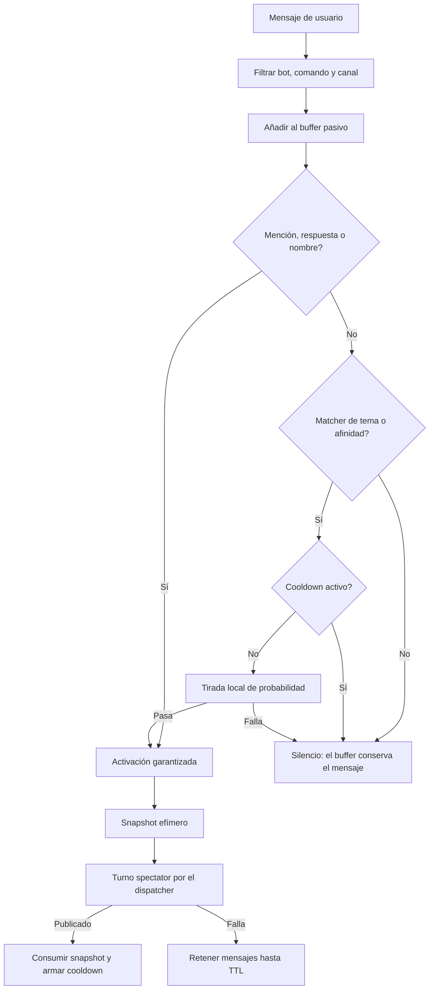
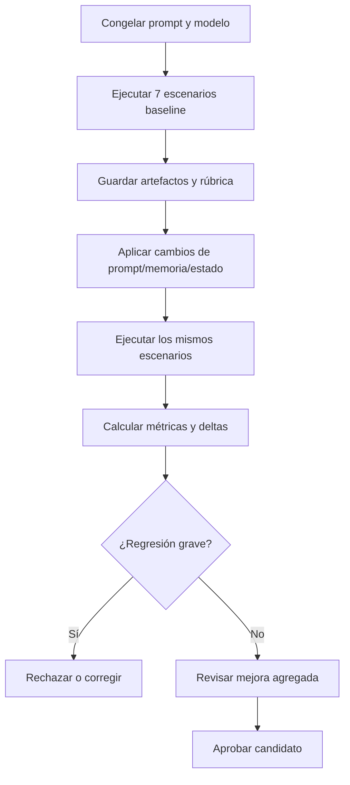

# Design Document — airi-interaccion-natural

## Overview

**Purpose**: Mejorar la naturalidad conversacional de Airi sin perder la base de
escucha pasiva ya implementada. La fase 1 permite que Airi escuche el canal y
decida localmente cuándo intervenir; la fase 2 mejora cómo responde, cómo usa su
memoria y cómo mantiene coherentes el texto y el estado del bot.

**Users**: Los miembros del canal autorizado perciben una Airi más directa, menos
repetitiva y con opiniones propias. Los desarrolladores disponen de escenarios,
métricas y artefactos de evaluación para comparar cambios sin depender de
impresiones aisladas.

**Impact**: Se extiende el prompt de personalidad, la memoria de usuario y la
observabilidad del estado. No se cambia el contrato de los turnos ni la
arquitectura de persistencia salvo campos aditivos y una política de
consolidación de memoria compatible con los datos existentes.

### Fases

- **Fase 1 — Escucha pasiva (`R1-R6`)**: implementada. Buffer efímero, matcher
  local, activación por mención/tema/afinidad, probabilidad y cooldown.
- **Fase 2 — Naturalidad y coherencia (`R7-R12`)**: pendiente. Intención,
  naturalidad narrativa, personalidad observable, memoria consolidada, coherencia
  de estado y evaluación reproducible.

### Goals

- Responder primero a la intención del mensaje, sin evasivas ni preguntas
  automáticas.
- Reducir acotaciones repetitivas y cierres prefabricados.
- Convertir los rasgos de personalidad en decisiones observables.
- Consolidar memoria y respetar correcciones explícitas.
- Mantener coherencia entre texto, `disconnect`, `stay_active` y persistencia.
- Medir mejoras con baseline/candidato y una rúbrica fija.

### Non-Goals

- Retirada ante hostilidad, mediación/DM y retorno tras episodio.
- Disparadores por inactividad o picos de actividad.
- Cambiar el modelo local, el sistema de citas o la lógica de romance.
- Introducir un juez automático de subjetividad como única fuente de verdad.
- Garantizar un porcentaje de "humanidad" medible.

## Architecture

### Existing Architecture Analysis

Flujo actual:

1. `on_message` (`src/airi/discord_bot/client.py`) valida apagado, bot, canal y
   contenido; expira citas; despacha comandos; detecta cita activa; aplica
   debounce por `(canal, autor)` y encola `turn.run_user_turn(...)` en
   `ChannelDispatcher`.
2. `turn.run_user_turn` (`src/airi/discord_bot/turn.py`) construye
   `TurnContext(kind=...)`, genera con `ConversationService.generate_turn`,
   confirma con `TurnCoordinator` y publica el resultado. Los turnos de sesión
   (`spectator`, `active`, `proactive`) usan `stay_active`.
3. `ConversationService` (`src/airi/services/conversation.py`) compone el prompt
   con secciones fijas y ejecuta la llamada al LLM. El historial por canal vive
   en `state.histories[channel_id]`.
4. `TurnEvent` (`src/airi/observability/events.py`) registra `kind`, mensajes,
   historial, notas y snapshots. Los campos nuevos son aditivos.
5. `src/airi/evaluation/narrative.py` y `tools/narrative_eval.py` ya evalúan
   riesgos románticos, pero no cubren naturalidad conversacional ni la rúbrica de
   siete escenarios.

### Verification Status

| Afirmación | Estado | Evidencia |
|---|---|---|
| `stay_active` no existe en el esquema normal | Verificada | `RESPONSE_SCHEMA` en `domain/llm_output.py` |
| `stay_active` es obligatorio en modo sesión | Verificada | `SESSION_RESPONSE_SCHEMA` y `parse_session_output` |
| En modo normal se fuerza `stay_active=True` | Verificada | `ConversationService._generate` |
| Existe reparación de cierre con pregunta | Verificada | `QUESTION_CLOSE_REPAIR_PROMPT` y `strip_trailing_question` |
| Existe nota prioritaria de corrección | Verificada | `ConversationService.generate_turn` |
| La memoria deduplica textos exactos o casi exactos | Verificada | `domain/memories.py` |
| `last_shutdown` guarda motivo, origen y estado | Verificada | `_wire_shutdown` en `discord_bot/client.py` |
| `last_shutdown` guarda timestamps y correlación | Verificada | `requested_at`, `updated_at`, `origin`, `correlation_id` en cierres normal y manual |
| La traza guarda `disconnect`, `stay_active` y `shutdown_request` | Verificada | `TurnEvent` y `ConversationService.apply_turn` |
| La matriz `disconnect`/`stay_active` está cubierta | Verificada | tests de sesión y de cierre en `tests/integration/` |
| La traza `88f9f88c0ee0` era normal o de sesión | Pendiente de inspección | Requiere revisar `kind`, timestamps y origen del cierre |
| La discrepancia `disconnect.leave=false` + `stay_active=false` es un bug | No confirmada | Puede ser un turno normal, un cierre manual o un estado previo |

No se debe presentar una hipótesis derivada de una traza como fallo confirmado.
La fase 2 exige trazabilidad suficiente para resolverla con evidencia.

## Fase 1 — Escucha pasiva

### High-Level Flow



### Key Decisions

**Decisión 1 — Contexto efímero, no historial persistente.**
El buffer pasivo se guarda en memoria por canal y no se vuelca a
`state.histories`. Al activar un turno se construye un snapshot con el mensaje
activador y una ventana reciente, con autor y sin duplicados. Al publicar con
éxito se consumen solo los IDs del snapshot; si falla, se conservan hasta su TTL.

**Decisión 2 — Matcher local y determinista.**
`domain/spectator.py` normaliza texto, compila expresiones con límites de palabra
y usa el perfil canónico de gustos del estado. No hay llamada al LLM para decidir
si un mensaje coincide con un tema. Los alias deben estar declarados
explícitamente.

**Decisión 3 — Probabilidad y cooldown inyectables.**
La secuencia es: evaluar señales → comprobar cooldown → tirada local → turno LLM.
La tirada fallida no consume cooldown. El cooldown se arma solo tras publicar con
éxito. Reloj y azar son inyectables para tests reproducibles.

### Data Models (fase 1)

```python
@dataclass
class BufferEntry:
    channel_id: str
    author_id: str
    author_name: str
    content: str
    message_id: str
    ts: float

@dataclass(frozen=True)
class AiriSpectatorPolicy:
    enabled: bool = False
    affinity_threshold: int = AIRI_SPECTATOR_AFFINITY_POINTS
    probability_topic: float = AIRI_SPECTATOR_PROB_TOPIC
    probability_affinity: float = AIRI_SPECTATOR_PROB_AFFINITY
    cooldown_seconds: int = AIRI_SPECTATOR_COOLDOWN_SECONDS
    snapshot_max_messages: int = AIRI_SPECTATOR_SNAPSHOT_MAX
    buffer_max: int = AIRI_SPECTATOR_BUFFER_MAX
    ttl_seconds: int = AIRI_SPECTATOR_TTL_SECONDS
    handoff_seconds: int = AIRI_SPECTATOR_HANDOFF_SECONDS
    active_idle_seconds: int = AIRI_SPECTATOR_ACTIVE_IDLE_SECONDS
    proactive_idle_seconds: int = AIRI_SPECTATOR_PROACTIVE_IDLE_SECONDS

@dataclass(frozen=True)
class ActivationDecision:
    proceed: bool
    reason: str | None = None
    guaranteed: bool = False
    probability: float = 0.0
    roll: float = 0.0
```

El snapshot es una tupla de `BufferEntry` y no se persiste como entidad propia
en la implementación actual. La política toma sus valores por defecto de
`AIRI_SPECTATOR_*` en `domain/constants.py`.

### Error Handling (fase 1)

- Generación fallida: snapshot retenido, sin cooldown.
- Publicación fallida: no se consume el snapshot, sin cooldown.
- Buffer vacío o expirado: no se evalúa el tema, se conserva el silencio.
- Apagado en curso: `on_message` no evalúa señales.
- Modo espectador desactivado: se omite todo el flujo de activación.

## Fase 2 — Naturalidad y coherencia

### Decisión 4 — Secciones de prompt explícitas y versionables

Se añadirán bloques separados en `src/airi/domain/prompts.py` para poder
probarlos y ajustarlos sin reescribir todo el prompt:

```python
INTENT_PRIORITY_PROMPT
NARRATIVE_NATURALNESS_PROMPT
OBSERVABLE_PERSONALITY_PROMPT
OWN_OPINIONS_PROMPT
MEMORY_USAGE_PROMPT
FAREWELL_PROMPT
```

Orden recomendado dentro del prompt:

1. Identidad y vínculos existentes.
2. Diálogo.
3. **Prioridad de intención conversacional**.
4. **Naturalidad narrativa**.
5. **Personalidad observable**.
6. **Opiniones y preferencias propias**.
7. Idioma.
8. Contexto y memoria + **Uso inteligente de la memoria**.
9. **Despedidas y cierres naturales**.
10. Honestidad, reglas finales y formato JSON.

No se reescribe el prompt completo. Se conservan las reglas de afinidad,
romance, evidencia, honestidad y formato.

### Decisión 12 — Traits dinámicos como única fuente de intensidad de personalidad

La identidad narrativa estable describe quién es Airi y no fija la intensidad de
los seis rasgos mutables. Los valores actuales de `traits` (1–5), renderizados por
`render_self_section`, son la única fuente para decidir cuánto se manifiestan la
expresividad, timidez, actitud juguetona, celos, sarcasmo y curiosidad. Los bloques
de personalidad pueden explicar límites y adecuación contextual, pero no repetir
esos rasgos como adjetivos o mandatos permanentes.

La variante `SYSTEM_PROMPT_COMPACT_CANDIDATE` debe respetar el mismo contrato que
`SYSTEM_PROMPT`; no puede reintroducir cualidades fijas eliminadas de la variante
actual. Las pruebas cubrirán ambas variantes, valores dinámicos en la sección de
self y ausencia de una segunda fuente estática. Se preservan como reglas generales
la naturalidad, el respeto, la honestidad y la prioridad de la intención.

### Decisión 5 — Intención y corrección sin una llamada extra al LLM

La intención se resuelve en el prompt; no se añade un clasificador LLM previo.
La corrección explícita ya dispone de una nota prioritaria determinista en
`ConversationService.generate_turn`; se conserva y se cubre con tests.

Flujo:

1. Se detecta el mensaje actual y, si aplica, una corrección explícita.
2. Se añade `=== CORRECCIÓN DEL USUARIO (PRIORIDAD) ===` al prompt.
3. El prompt de intención exige responder primero y elegir una postura cuando se
   pide una opinión.
4. Si el cierre vuelve a ser una pregunta en charla casual, se mantiene la red de
   seguridad `QUESTION_CLOSE_REPAIR_PROMPT` y el recorte determinista existente.
5. No se prohíben las preguntas: solo se impide que sustituyan la respuesta.

La reparación de cierre con pregunta no se aplica a citas, donde la pregunta
puede formar parte del flujo.

### Decisión 6 — Naturalidad medible, no solo declarada

La fase 2 no se limita a pedir "sé natural". Se registran señales objetivas por
turno para detectar:

- proporción de respuestas con acotaciones;
- gestos acumulados en una misma respuesta;
- aperturas o cierres repetidos;
- preguntas finales consecutivas;
- fórmulas de despedida prefabricadas;
- repetición de n-gramas entre turnos;
- respuestas que solo son una pregunta;
- longitud desproporcionada respecto al mensaje del usuario.

Estas señales no sustituyen la rúbrica humana. Sirven para detectar regresiones
evidentes y priorizar la revisión.

### Decisión 7 — Memoria consolidada y con precedencia

La memoria actual guarda `{"text", "created_at"}` y deduplica textos exactos o
casi exactos. La fase 2 añade una capa compatible:

```python
@dataclass
class MemoryEntry:
    text: str
    created_at: float
    updated_at: float | None = None
    source: str = "model"        # model | correction | canonical
    status: str = "active"       # active | superseded
    confidence: str = "inferred" # explicit | inferred
    scope: str = "user"          # user | world
    topic: str = ""
```

Los registros antiguos se normalizan al leerlos: `source="model"`,
`status="active"`, `confidence="inferred"`, `scope="user"` y `topic=""`.

Reglas:

1. Duplicado exacto o casi exacto: se conserva una entrada, se actualiza el texto
   y `updated_at`; no se crea otra.
2. Corrección explícita: se guarda con `source="correction"` y
   `confidence="explicit"`. Las entradas anteriores del mismo ámbito y tema se
   marcan `superseded` cuando el tema puede identificarse; si no, la corrección
   se muestra primero y el prompt prohíbe usar la versión anterior.
3. Inferencia: `confidence="inferred"`. No se presenta como hecho confirmado.
4. Contradicción sin tema identificable: no se borra información a ciegas; se
   evita afirmar el dato dudoso y se prioriza la entrada más reciente y explícita.
5. `memories_prompt_section` muestra solo entradas activas, con correcciones
   primero y sin exponer metadatos internos.
6. Las preferencias de Airi no se guardan en la memoria de usuario: viven en
   `world["preferences"]`, con `AIRI_PROFILE` como fuente canónica cuando está
   definida. `self_model` no puede mutar `tastes.*`.

La consolidación es conservadora: no usa embeddings ni un LLM adicional. La
similitud se basa en normalización de texto y solapamiento de tokens, con umbral
documentado y tests de aislamiento entre usuarios.

### Decisión 8 — Contrato de estado explícito

Contrato real:

| Modo | Esquema | `stay_active` | Efecto |
|---|---|---|---|
| Normal | `RESPONSE_SCHEMA` | No existe; se fuerza `True` | No cambia el estado de sesión |
| Sesión (`spectator`, `active`, `proactive`) | `SESSION_RESPONSE_SCHEMA` | Obligatorio, booleano | Decide si la sesión sigue activa |

`disconnect` se interpreta así:

- `leave=true` + `reason` no vacío: Airi solicita apagado después de publicar y
  persistir el turno.
- `leave=false` o sin motivo: no hay apagado; el texto no debe despedirse como si
  se fuera.
- `disconnect_claim_problem` y `DISCONNECT_REPAIR_PROMPT` reparan la
  contradicción entre texto y decisión.
- `last_shutdown` guarda `kind`, `reason`, `user_id`, `status` y
  `context_delivered`. El contexto de la última desconexión se entrega una sola
  vez y no es una orden para volver a irse.

Una despedida a una persona no implica un apagado global. El apagado global solo
se solicita cuando el turno lo decide o cuando una acción manual lo provoca.

### Decisión 9 — Evaluación de interacción separada de la evaluación romántica

Se añadirá `src/airi/evaluation/interaction.py` y `tools/interaction_eval.py`.
La evaluación romántica existente (`narrative.py`) se mantiene intacta.

El CLI tendrá dos entradas: `--run` para analizar JSONL ya generados y
`--live` para generar los siete escenarios contra el LLM configurado. El modo
live usa `build_llm` y `ConversationService` con `notifier`, `gifs` y `search`
desactivados, no publica en Discord y no persiste estado real. Por defecto lee
`LLM_BASE_URL` (`http://127.0.0.1:7000`) y `LLM_MODEL`, y permite fijarlos con
`--base-url` y `--model`. `--out` guarda los registros generados y `--repeat`
repite cada turno para escenarios no deterministas. El baseline se captura con
`--live` antes de modificar el prompt.

Componentes:

```python
@dataclass(frozen=True)
class InteractionScenario:
    id: str
    category: str
    description: str
    turns: tuple[str, ...]

@dataclass
class InteractionMetrics:
    turns: int
    question_only_replies: int
    repeated_closings: int
    gesture_density: float
    stacked_gestures: int
    prefab_farewells: int
    schema_failures: int
    state_contradictions: int
    rubric_total: int
```

`evaluate_interaction(records)` calcula señales objetivas y agrega la rúbrica
cuando los registros incluyen puntuaciones. `compare_interactions(baseline,
candidate)` devuelve deltas y marca regresión si empeora una métrica crítica o
si la rúbrica cae por debajo del umbral acordado.

La rúbrica se cumplimenta con revisión humana o con un evaluador externo
explícito; no se presenta como una verdad automática.

### Escenarios de evaluación

| ID | Categoría | Turnos | Qué comprueba |
|---|---|---|---|
| `pregunta_directa` | `direct_question` | 1 | Elige personaje/opinión y explica antes de preguntar |
| `correccion` | `correction` | 2 | Reconoce la evasión y responde la pregunta original |
| `saludo_breve` | `brief_greeting` | 1 | Respuesta breve sin actuación innecesaria |
| `preferencia_corregida` | `corrected_preference` | 3 | Usa la preferencia vigente y no revive la corregida |
| `desacuerdo` | `disagreement` | 2 | Discrepa con argumentos sin atacar ni ceder automáticamente |
| `charla_casual` | `casual` | 2 | Reacciona sin convertir el turno en entrevista |
| `despedida` | `farewell` | 2 | Cierra con naturalidad sin afirmar un apagado falso |

Los nombres concretos de usuarios, animes o apodos son fixtures de evaluación;
no se hardcodean en la lógica de producción.

### Artefactos de evaluación

Cada ejecución guarda, en una ruta configurable:

- `scenario_id`, `turn`, `user_input`, `reply`, `category`;
- modelo, versión o hash del prompt, plantilla y parámetros;
- contexto efectivo y prompt enviado;
- salida original, `finish_reason` y resultado de parseo;
- `disconnect`, `stay_active`, estado persistido y discrepancias;
- puntuaciones de rúbrica por criterio y total;
- marcas temporales y versión del código.

El baseline se captura antes de modificar el prompt. Las salidas grandes no se
versionan; se conservan en el directorio de artefactos acordado.

### Flujo de comparación



## Testing Strategy

### Unitarias

- Prompt: las secciones nuevas existen y contienen las reglas clave.
- Intención: los escenarios de pregunta directa y corrección no terminan en
  evasiva; la red anti-interrogatorio sigue funcionando.
- Naturalidad: métricas de acotaciones, gestos acumulados, cierres repetidos y
  fórmulas prefabricadas.
- Memoria: duplicados, corrección, precedencia, aislamiento entre usuarios y
  preferencias canónicas.
- Estado: matriz de `disconnect`/`stay_active`, esquema normal vs. sesión y
  campos desconocidos.
- Evaluación: escenarios, rúbrica, agregación y comparación baseline/candidato.

### Integración

- Turno con `FakeLLM` y `FakeNotifier`: respuesta directa, corrección y aviso de
  memoria.
- Preferencia corregida: el prompt y la memoria usan la versión vigente.
- Despedida: el texto y `disconnect` coinciden; no se cierra la sesión global si
  solo se despide de una persona.
- Recepción de mensajes después de un apagado y recuperación del contexto.
- Evaluación con fakes, sin red ni Discord real.

### Regresión

- Mantener la suite existente y los tests de fase 1.
- Ejecutar `airi-replay` determinista para parser/estado.
- Ejecutar el runner real o `--live` para la comparación narrativa.
- Revisar explícitamente regresiones graves en coherencia, privacidad, estado y
  formato de salida.

## Requirements Traceability

| Requisito | Componente principal | Pruebas |
|---|---|---|
| `R1-R6` | `client.py`, `turn.py`, `domain/spectator.py`, `services/passive_buffer.py`, `services/spectator_policy.py`, `services/spectator_session.py` | suite de fase 1 |
| `R7` | `domain/prompts.py`, `services/conversation.py` | prompt, corrección, cierre con pregunta |
| `R8` | `domain/prompts.py`, `evaluation/interaction.py` | métricas de naturalidad, saludo y despedida |
| `R9` | `domain/prompts.py` | opinión, desacuerdo, rasgos observables |
| `R10` | `domain/memories.py`, `services/state.py`, `domain/prompts.py` | corrección, duplicados, aislamiento, preferencias canónicas |
| `R11` | `domain/llm_output.py`, `services/conversation.py`, `discord_bot/turn.py`, `discord_bot/client.py` | matriz de estado, despedida, apagado |
| `R12` | `evaluation/interaction.py`, `tools/interaction_eval.py` | escenarios, rúbrica, baseline/candidato |

## Risks and Open Questions

- **Detección semántica de duplicados**: sin embeddings, la consolidación puede
  no detectar paráfrasis lejanas. Se prioriza precisión y se documenta el límite.
- **Prompt largo**: añadir seis bloques puede diluir instrucciones. Se usarán
  bloques compactos y tests de presencia/orden.
- **Subjetividad de la rúbrica**: se mitiga con criterios fijos, revisión
  explícita y comparación baseline/candidato; no se automatiza como verdad.
- **Discrepancia de estado observada**: debe verificarse el modo del turno y el
  origen del cierre antes de atribuir un bug.
- **Muestreo del LLM local**: las variaciones se registran y se repiten cuando
  sea posible; no se comparan ejecuciones únicas como si fueran deterministas.

## Closure Criteria

El diseño estará listo para aprobación cuando:

1. Los requisitos `R7-R12` estén revisados y aprobados.
2. Las interfaces y archivos citados coincidan con el código real.
3. Exista un baseline capturado antes de los cambios de prompt.
4. Las pruebas de memoria, estado y evaluación cubran los casos críticos.
5. La comparación candidata no presente regresiones graves.
6. `spec.json` refleje el estado real de aprobación, sin declarar
   `ready_for_implementation` antes de tiempo.

## Extensión de diseño — identidad narrativa y eficiencia

### Decisión 10 — Identidad narrativa compacta y no recitable (`R13`)

La identidad estable se añadirá como un bloque compacto y versionable en
`src/airi/domain/prompts.py`, sin reemplazar las reglas existentes de personalidad,
afinidad, honestidad o memoria. Definirá una premisa virtual ficticia, preferencias con
motivos y contradicciones moderadas, y separará explícitamente:

1. identidad estable del personaje;
2. acontecimientos confirmados en conversaciones;
3. escenas de ficción improvisadas en roleplay.

La identidad es contexto para decidir qué opina Airi, no texto que deba recitar. No se
guardará la biografía en la memoria del usuario ni se atribuirán acciones ocurridas entre
turnos si el sistema no las realizó. Se mantiene la decisión de no usar una personalidad
tsundere. La candidata se evaluará frente al prompt actual antes de considerar cambiar
el prompt predeterminado.

### Decisión 11 — Rendimiento como experimento independiente (`R14`)

La evaluación narrativa mantendrá constantes modelo, thinking, muestreo, historial,
contrato de salida y límites. La latencia, tokens, `finish_reason`, truncamiento y
reparaciones se informarán aparte de la rúbrica narrativa.

Un experimento posterior podrá comparar thinking desactivado y límites de salida
alternativos, siempre comprobando el contrato activo: `RESPONSE_SCHEMA` en modo normal y
`SESSION_RESPONSE_SCHEMA` en modo sesión. `stay_active` es obligatorio solo en este
último modo. No se cambiará configuración de producción por el resultado de una sola
traza; cualquier perfil deberá mantener JSON válido y no empeorar la calidad esencial.

### Pruebas y trazabilidad añadidas

- Identidad: verificar separación entre premisa, recuerdos confirmados y roleplay; la
  candidata no recita su historia ni presenta ficción como experiencia real.
- Rendimiento: informar por separado métricas narrativas y técnicas; verificar el schema
  según el modo y registrar truncamiento/reparación sin inferir datos ausentes.
- `R13`: `domain/prompts.py`, evaluación de interacción y pruebas de honestidad/continuidad.
- `R14`: `services/conversation.py`, observabilidad y runner de evaluación.
