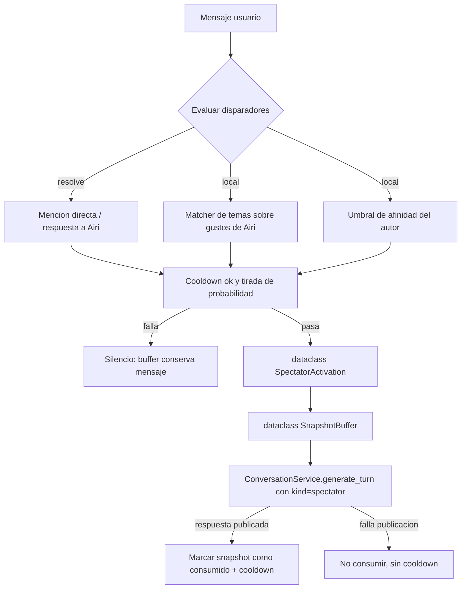
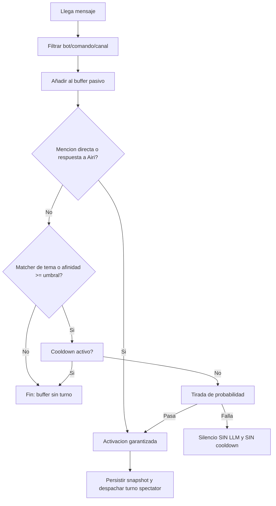
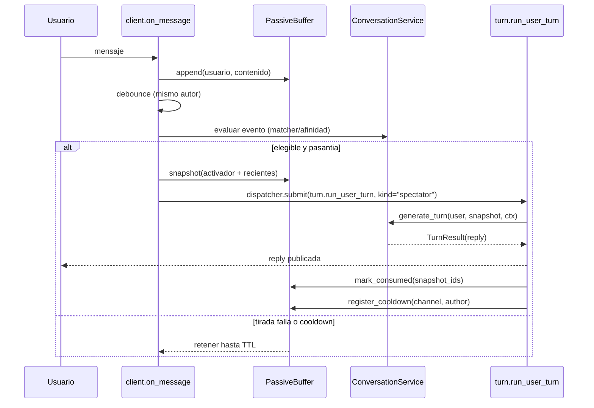
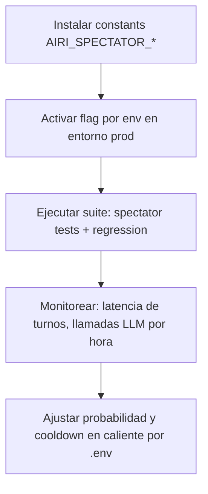

# Design Document — airi-interaccion-natural (modo espectador, fase 1)

## Overview

**Purpose**: Añadir a Airi una capa de escucha pasiva por canal con activación local de
turnos, para que participe de forma natural sin gastar llamadas al LLM mientras escucha.

**Users**: Los miembros del canal autorizado verán que Airi se suma a la conversación
cuando la mencionan o cuando un mensaje toca un gusto suyo proviene de alguien de afinidad
alta; los desarrolladores y el dueño del bot disponen de configuración y trazas para
regular y auditar ese comportamiento.

**Impact**: Extiende el flujo de entrada (`on_message`) y el servicio de conversación sin
cambiar su contrato: se añade un buffer pasivo efímero en memoria, un evaluador de
disparadores, una概率 de intervención con tirada local previa al LLM y un cooldown por
canal/autor. Persistencia de usuario/estado, comandos, citas y replay no cambian salvo
campos observables nuevos en `TurnEvent`.

### Goals

- Cero llamadas al LLM para mensajes sin disparador.
- Un único turno por eventos elegibles, respetando debounce/queue y cooldown.
- Interés (matcher local sobre gustos) y afinidad alta como señales independientes.
- Contexto reciente del canal inyectado como contexto efímero sin mezclar con el historial
  persistido de turnos.
- Comportamiento reproducible y testable (reloj/azar inyectables).

### Non-Goals

- Retirada ante hostilidad, mediación/DM, retorno tras episodio (fase posterior).
- Disparadores por inactividad o picos de actividad.
- Cambiar el modelo local de LLM, el romance/afinidad o el sistema de citas.
- Resúmenes de contexto largo: en esta fase siempre se recorta el snapshot del buffer.

## Architecture

### Existing Architecture Analysis

Flujo actual respetado:

1. `on_message` (src/airi/discord_bot/client.py): valida apagado/bot/canal/contenido,
   expira citas, despacha comandos, detecta cita activa, hace debounce por
   `(canal, autor)` y encola en `ChannelDispatcher.submit(...)` el turno
   `turn.run_user_turn(...)`.
2. `turn.run_user_turn` (src/airi/discord_bot/turn.py): construye `TurnContext(kind=...),
   chat con `ConversationService.generate_turn` vía `TurnCoordinator` (journal +
   persistence con `publisher`), y publica el resultado; `run_turn` es equivalente sin
   journal.
3. `ConversationService._generate` (src/airi/services/conversation.py): compone el prompt
   con secciones fijas (afinidad, relación, gustos via `preferences_prompt_section`, etc.)
   y ejecuta la llamada al LLM; el historial por canal vive en
   `state.histories[channel_id]`.
4. `TurnEvent` (src/airi/observability/events.py): ya enumera `kind`, `messages_in`,
   `history_in`, `notes` y snapshots; ampliable sin romper replay (versionación por `v`).

**Integración**: El modo espectador se insterta sobre el mismo pipeline de turnos
(`TurnContext.kind="spectator"`), reutilizando debounce, dispatcher FIFO y
`TurnCoordinator`. El buffer NO entra en `state.histories` ni en disco: es un contexto
volátil por canal en memoria. `TurnJournal` no cambia (los IDs pasivos no se reclaman
durablemente, solo se consume de buffer).

### High-Level Architecture



**Architectural Integration**:
- Se conserva el dispatcher FIFO por canal: el turno espontáneo se encola igual.
- Se añade `SpectatorPolicy`/`PassiveBuffer` como servicios en `services/` y el
  matcher/evaluador puro en `domain/` (sin I/O).
- `TurnEvent` recibe campos `spectator_*` aditivos y `kind="spectator"`.
- No se introducen dependencias externas.

### Key Design Decisions

**Decision 1 — Contexto efímero, no fusión con historial.**
- Context: Hay un buffer pasivo separado y hay que resentir al LLM sin persistir nada en
  `state.histories` ni NASCAR a largo plazo.
- Alternatives: (a) Volcar el buffer al final del historial del canal; (b) Enviar solo el
  último mensaje; (c) Snapshots epheḿeros hasta publicar.
- Selected: (c) `SpectatorSnapshot` incluye el mensaje activador exacto 1 vez + ventana
  reciente con autor; se envía como una pseudo-historial inyectable en el prompt; al
  publicar con éxito se marca solo como consumidos los IDs de ese snapshot; si falla se
  conservan hasta TTL.
- Rationale: El historial persistido conserva la regla actual (conversaciones dentro de
  turnos); los pasivos no lo contaminan y el TTL acota memoria.
- Trade-offs: Airi puede reaccionar sin recordar por siempre ese hilo; el snapshot
 engeance el prompt un poco más largo pero acotado.

**Decision 2 — Matcher puro y determinista en `domain/`.**
- Context: La detección de interés debe coste casi cero y ser testable sin red.
- Alternatives: LLM para interpretar; keyword embedding; solo afinidad.
- Selected: `domain/spectator.py`: normalizador Unicode/casefold, formas word-boundary
  (regex precompilada) y alias list derivados de `world["self"]["tastes"]` refrescados si
  el perfil cambia por hash de contenido.
- Rationale: Coherente con las reglas de arquitectura (pureza, coste O(n) sobre el buffer),
  reutiliza el modelo mutable de identidad para no duplicar lista de temas.
- Trade-offs: No detecta lenguaje figurado; los alias deben declararse explícitos por
  configuración si se quiere cubrir variantes.

**Decision 3 — Probabilidad y cooldown como política inyectable.**
- Context: La feature se probó en conversación natural; sin política, Airi responde a
  cada eligible, y un cooldown fallido no debería penalizar.
- Alternatives: (a) Siempre responder; (b) Probabilidad + cooldown académico; chaleco;
  (c) tirada tras la petición HTTP.
- Selected: Orden: evaluador → cooldown check → tirada local (con creador de
  uniforme inyectable; por defecto `random.random`) → turno LLM; el cooldown se marca
  solo al confirmar publicación con éxito; la tirada fallida NO inicia cooldown.
- Rationale: Coincide con “apruebo” tras discusión; el ahorro de LLM sea previsible.
- Trade-offs: No garantiza respuesta aun si el contenido es muy relevante; el cooldown
  espontáneo no bloquea menciones directas.

## System Flows

### Flow: Decisión de activación



### Flow: Ciclo del snapshot



## Data Models

### buffer pasivo (memoria volátil)

```python
# (No es contrato de I/O; es in-memory dataclass snapshot)
@dataclass
class PassiveEntry:
    author_id: str        # str(author.id)
    author_name: str      # display_name
    content: str          # texto limpio
    ts: float             # clock() al añadir

@dataclass
class SpectatorSnapshot:
    trigger_message_id: str | None   # id del mensaje que activó
    entries: list[PassiveEntry]      # ventana reciente en orden cronológico
    reason: str                      # "mention" | "reply" | "name" | "topic" | "affinity"
```

Invariantes:
- Máximo `AIRI_SPECTATOR_BUFFER_MAX` entradas por canal (default 20).
- TTL: entradas con `ts < now - AIRI_SPECTATOR_TTL_SECONDS` se eliminan al leer o añadir.
- No persiste en `state.json`; se pierde al reiniciar (aceptable y deseado).

### Política de activación

```python
@dataclass(frozen=True)
class AiriSpectatorPolicy:
    enabled: bool = True
    affinity_threshold: int = 20     # puntos umbral (env AIRI_SPECTATOR_AFFINITY_POINTS)
    probability_topic: float = 0.55  # AIRI_SPECTATOR_PROB_TOPIC
    probability_affinity: float = 0.35
    cooldown_seconds: int = 300      # AIRI_SPECTATOR_COOLDOWN_SECONDS
    snapshot_max_messages: int = 12
```

Los valores por defecto son conservadores y permiten apagar el modo en pruebas sin tocar
código (ensemble con `AIRI_SPECTATOR_ENABLED=0`).

### Fields nuevos en TurnEvent (aditivos)

| Campo | Tipo | Propósito |
|---|---|---|
| `spectator_reason` | str | Motivo del despertar (`""` si no aplica) |
| `spectator_snapshot` | list | Ventana instantánea de buffer enviada al LLM |
| `spectator_probability_rolled` | float | Tirada local ejecutada (0 si no hubo) |

## Components and Interfaces

### domain/spectator.py (nuevo, puro)

**Responsibility & Boundaries**
- **Primary Responsibility**: Evaluar señales y generar el matcher de temas; sin I/O.
- **Domain Boundary**: `airi.domain` — puro, importable desde servicios.
- **Data Ownership**: Ninguna (funciones puras).

**Contract (Python, tipo explícito)**

```python
def build_topic_matcher(tastes: dict) -> re.Pattern | None:
    """Regex precompilada con límites de palabra + alias declarados. None si sin datos."""

def mention_signals(content: str, airi_id: str, airi_name: str, is_reply_to_airi: bool) -> bool:
    """True si mención directa (<@id>), respuesta a Airi o nombre exacto casefold."""

def affinity_eligible(points: int, threshold: int) -> bool:
    """True si puntos superan el umbral configurable."""

def topic_eligible(pattern: re.Pattern | None, text: str) -> bool:
    """True si el texto cruza el matcher. Sin pattern => False."""

def decide_activation(*, mentions: bool, topic: bool, affinity: bool,
                      random_value: float, policy: AiriSpectatorPolicy) -> ActivationDecision:
    """Composición pura: mention => garantizada; topic/affinity => probabilidad por frecuencia."""
```

### services/passive_buffer.py (nuevo)

**Responsability**
- Buffer en memoria por canal, TTL y límite, snapshot, `mark_consumed`.
- No persiste; thread/asyncio-safe dentro del event loop.

### services/spectator_policy.py (nuevo)

- Encapsula cooldown por canal/autor y tirada local (inyectable clock/random).
- Ejecutado en `client.py` antes de abrir un turno, tras debounce.

### Modificaciones punt aiming

| Archivo | Cambio |
|---|---|
| `discord_bot/client.py` | Añadir `SpectatorPolicy`/`PassiveBuffer`, evaluar señales tras debounce antes del dispatcher; `kind="spectator"` |
| `discord_bot/turn.py` | `run_user_turn(... kind="spectator")`: acepta snapshot; al publicar con éxito, marca consumidos y cooldown |
| `services/conversation.py` | `_generate` recibe `ctx.kind=="spectator"` y anexa `history_in` efímero con etiqueta interna clara pero sin revelar mecanística |
| `observability/events.py` | Campos `spectator_*` thighs arriba |
| `domain/constants.py` | Constantes `AIRI_SPECTATOR_*` con `env_*` |

## Error Handling

- **Generación fallida → snapshot retenido**: los mensajes no se marcan como consumidos;
  caducarán por TTL. Sin cooldown.
- **Publicación fallida (`publish_error`)**: cyan op CANAL; cooldown no aplicado.
- **Buffer vacío (por TTL/reinicio)**: evento de topic no evaluable; se emite sin snapshot.
- **Sluit down (`shutdown["started"]`)**: `on_message` ya retorna antes de evaluar.
- Modo espectador desactivado por `AIRI_SPECTATOR_ENABLED=0`: TODO el flujo de espectador
  se omite; comportamiento igual al actual excepto por las menciones/respuesta/bot con
  turns ya garantizadas por `on_message` normal.

## Testing Strategy

### Unit Tests (`tests/unit/test_spectator.py`)

1. `build_topic_matcher` genera patrón válido para gustos; `None` para sin gustos.
2. `mention_signals` detecta `<@id>`, reply, nombre; ignorado en contenido largo pollution.
3. `affinity_eligible` respeta el umbral configurable.
4. `decide_activation`: mention garantizada; topic/affinity dependen de tirada; tirada
   fallida devuelve sin cooldown.
5. `PassiveBuffer`: TTL y límite FIFO; snapshot incluye activador una sola vez.

### Integration Tests (`tests/integration/`)

1. `test_spectator_pipeline.py`: flujo completo con `FakeLLM` y reloj inyectado: mensaje
   topic (roll ok) genera exactamente 1 llamada al LLM; el snapshot aparece en
   `trace.spectator_snapshot`; cooldown سبsecuente bloquea reintentos.
2. `test_spectator_cooldown_policy.py`: tirada fallida no llama al LLM ni armar cooldown;
   el siguiente mensaje reintenta.
3. `test_spectator_mixed_signals.py`: mencion + topic coexisten: un solo turno.
4. Compatibilidad: modo espectador desactivado mantiene comportamiento previo.

### E2E/Regression

- `tests/regression`: transcripts existentes no cambian: spectator `kind` solo aparece
  cuando el modo está habilitado explícitamente (default on pero tests previos usan env
  para desactivarlo en transmission).
  - `AIRI_SPECTATOR_ENABLED=0` en fixtures de tests antiguos si fueran a romperse por
    turnos espontáneos nuevos.

## Performance & Scalability

- Coste O(n) por mensaje entrante; n acotado (<= buffer max). NO LLM en silencio.
- Snapshot acotado (<= `snapshot_max_messages`),/configuration evita prompt largos.
- Concurrency: toda la política corre en el event loop del dispatcher; no tiene locks
  adicionales más allá de los ya existentes (commit_lock persistencia).

## Migration Strategy



Rollback: `AIRI_SPECTATOR_ENABLED=0` desactiva toda la feature sin cambiar código.

## Requirements Traceability

| Req | Resumen | Componente(s) | Prueba(es) |
|---|---|---|---|
| 1.1-1.4 | Buffer por canal con límite/TTL/vacía reset | `PassiveBuffer` | unit 5 |
| 1.5 | Modo off => comportamiento previo | `SpectatorPolicy.enabled` | integration 4 |
| 2.1 | Mention/reply/nombre garantizada | `mention_signals` | unit 2, integration 4, 1 |
| 2.2-2.4 | Interés O afinidad independientes | `decide_activation` | unit 4, integration 1,2 |
| 2.5 | Sin señal => sin turno | composition | unit 4, integration 1 |
| 2.6-2.9 | Fuente canónica + matcher determinista | `build_topic_matcher` | unit 1 |
| 3.1-3.8 | Snapshot efímero, sin duplicados, sin revelación | generate_turn + snapshot | integration 1,3 |
| 4.1-4.7 | Cooldown solo al publicar; roll antes del LLM | `SpectatorPolicy` | unit 4, integration 2 |
| 5.1-5.8 | Pruebas y compatibilidad | suite nueva + Brett | integration |
