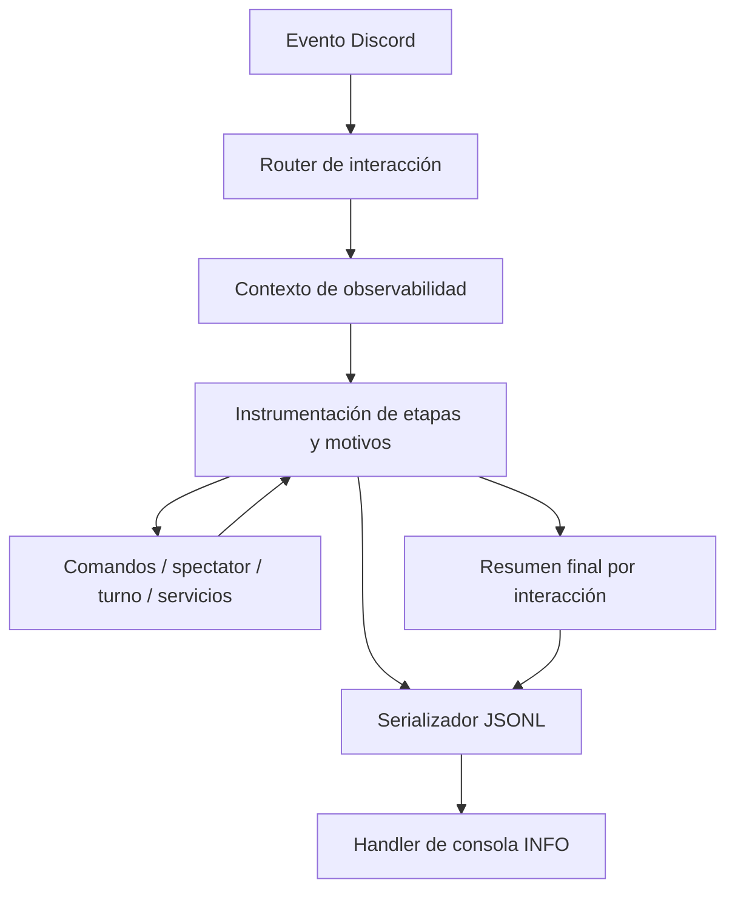
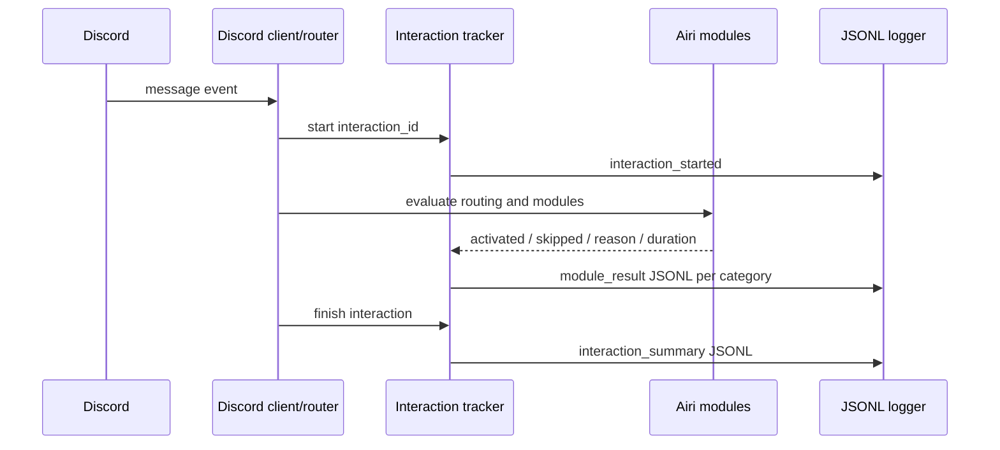

# Diseño: observabilidad de interacciones de Airi

## Visión general

La funcionalidad agrega un registro JSONL en nivel INFO para explicar el recorrido de cada interacción de Discord. Cada interacción comparte un identificador de correlación y produce eventos por etapa, incluso cuando una etapa no se ejecuta. Un resumen final condensa el resultado y los módulos considerados, de modo que la salida pueda revisarse en consola o copiarse a una IA para diagnóstico.

La solución extiende el logging y el flujo de eventos existentes; no introduce servicios externos ni cambia el comportamiento conversacional. El registro debe ser seguro para compartir: no contiene texto completo de mensajes, respuestas, prompts ni credenciales.

### Objetivos

- Hacer explícita la activación, omisión, deshabilitación, no aplicabilidad o falla de cada categoría funcional.
- Mantener un contrato JSONL versionado y consistente, correlacionado con el `correlation_id` de turno existente.
- Dar suficiente información para reconstruir rápidamente una ruta normal, ignorada, fallida o atendida por comando.

### Fuera de alcance

- Registrar cada llamada interna de Python o cada evento de bajo nivel de Discord.py.
- Almacenar logs de forma persistente, añadir una interfaz de consulta o cambiar las trazas/replay existentes.
- Incluir contenido completo de entrada/salida, prompts, secretos o datos personales en los logs.

## Arquitectura

### Análisis de la arquitectura existente

- `airi.discord_bot.client.create_client` recibe `on_ready` y `on_message`, filtra mensajes, despacha comandos, aplica spectator/debounce y enruta hacia el turno.
- `airi.discord_bot.turn` ejecuta el turno Discord y el ciclo de respuesta/publicación.
- `airi.services.conversation.ConversationService` coordina búsqueda, LLM, parsing, relaciones, memoria y resultados del turno; ya genera logs selectivos.
- `airi.logging_setup` instala formato con `correlation_id` mediante `ContextVar`; actualmente el formato es texto y depende de configuración del handler raíz.
- `airi.observability.events.TurnEvent` y `TraceStore` guardan trazas por turno para inspección/replay, no un stream JSONL de estados de módulos.
- `commands.build_registry` registra handlers instrumentados y varios comandos pueden terminar el flujo conversacional normal.

Se conserva la arquitectura por capas y se añaden puntos de instrumentación en los límites de decisión existentes. No se requiere una refactorización de los dominios ni una nueva dependencia.

### Arquitectura de alto nivel



### Alineación tecnológica

- Se reutiliza `logging` de la biblioteca estándar, el `ContextVar` de correlación existente y los puntos de decisión del flujo actual.
- La salida de los eventos diagnósticos usa un serializador JSON determinista por línea; no se añade una biblioteca externa.
- Las trazas `TurnEvent` siguen siendo el mecanismo separado para reproducibilidad detallada y replay.

### Decisiones principales

1. **Contrato JSONL dedicado para eventos de interacción.** Cada registro es un objeto JSON completo por línea, en vez de texto libre o JSON multilínea. Esto permite lectura humana, `jq` y análisis directo por IA.
2. **Estados explícitos y códigos de motivo estables.** Cada etapa del catálogo se cierra con un resultado `activated`, `skipped`, `disabled`, `not_applicable` o `failed`; la ruta temprana registra también las etapas posteriores que no se ejecutaron.
3. **Instrumentación en los límites de decisión.** La observabilidad se ubica donde ya se decide filtrar, enrutar o llamar un servicio. No se añaden logs indiscriminados a cada función ni se duplican trazas completas.

## Flujo de interacción



Las decisiones de entrada deben cubrir también mensajes ignorados en el canal configurado (por ejemplo, autor bot, contenido vacío, comando reconocido, debounce reemplazado, spectator no procede). Un mensaje ajeno al canal autorizado no debe producir contenido que revele actividad de otros canales; si se instrumenta, solo se registra una razón mínima sin identificadores sensibles.

## Componentes e interfaces

### Capa de logging

#### InteractionEventLogger

- **Responsabilidad:** aceptar eventos estructurados de interacción y emitirlos como INFO en una única línea JSON válida.
- **Dependencias:** `logging` estándar, formato/correlation existentes.
- **Contrato conceptual:** `emit(event: InteractionLogEvent) -> None`.
- **Invariantes:** no debe lanzar una excepción que interrumpa la interacción; la serialización fallida se reporta con mecanismo seguro y no recursivo.

#### InteractionTracker

- **Responsabilidad:** mantener el identificador, catálogo esperado de etapas y resultados de una interacción; emitir inicio, resultados por módulo y resumen final.
- **Dependencias:** `InteractionEventLogger`; se integra desde router/turno y servicios mediante llamadas explícitas.
- **Contrato conceptual:** `start(context)`, `record_module(name, status, reason_code, duration_ms, details)`, `finish(outcome, duration_ms)`.
- **Invariantes:** cada módulo del catálogo recibe un resultado terminal para una interacción; un resultado de una ruta omitida no se confunde con error.

#### Instrumentación de flujo

- **Responsabilidad:** reportar decisiones y resultados en los puntos de enrutamiento/ejecución ya existentes.
- **Puntos iniciales:** `discord_bot/client.py` para filtros y dispatch; `discord_bot/turn.py` para turno/publicación; `services/conversation.py` para búsqueda, LLM, parsing, relación, memoria y resultados; handlers de comandos/citas/regalos según el camino.
- **Límite:** el catálogo refleja capacidades de dominio, no cada archivo Python. Las categorías incluyen entrada Discord, comandos, cola/debounce, spectator, citas, regalos, conversación, búsqueda, LLM, parsing/grounding/reparación, relación/afinidad, memorias, diario/reflexión, GIF, persistencia/journal, publicación y trazas.

## Contrato de datos

Todos los eventos incluyen `schema`, `ts`, `level`, `interaction_id`, `event` y `module` cuando aplique. `ts` se expresa en UTC ISO-8601. Un evento de módulo incluye `status`, `reason_code` cuando no se ejecuta, y `duration_ms` cuando se mide.

```json
{"schema":"airi.log.v1","ts":"2026-10-23T16:32:13Z","level":"INFO","interaction_id":"def456","event":"module_result","module":"web_search","status":"skipped","reason_code":"not_requested","duration_ms":0}
```

El evento final `interaction_summary` contiene el resultado global, duración, y un mapa con todos los nombres del catálogo y sus estados/motivos. Los códigos de evento, módulo, estado y motivo son identificadores estables en `snake_case`; el campo humano opcional `reason` puede describirlos sin sustituir al código.

## Manejo de errores y privacidad

- Una falla de módulo se registra como `failed` con `error_type` y mensaje redactado; la excepción conserva traceback en el mecanismo diagnóstico existente solo si resulta necesario y seguro.
- La escritura de logs es best-effort: un error del logger no debe fallar el procesamiento del mensaje ni originar un bucle de logging.
- No se registran tokens, API keys, prompts, contenido integral de mensajes/respuestas, ni excepciones sin sanear que puedan contenerlos.
- Los identificadores de Discord se minimizan; el diseño debe decidir si conservarlos en claro o usar representación segura. El `interaction_id` aleatorio/correlation ID es obligatorio para agrupar.
- En rutas que terminan anticipadamente, los módulos restantes reciben `skipped` con un motivo común específico de ruta (`command_handled`, `spectator_not_proceeding`, `message_filtered`, etc.).

## Estrategia de pruebas

### Unitarias

- Serialización: cada evento produce un JSON válido en una sola línea y contiene campos requeridos.
- Tracker: cada módulo del catálogo aparece exactamente una vez en el resumen con estado y motivo coherentes.
- Estados y códigos: validar `activated`, `skipped`, `disabled`, `not_applicable`, `failed` y sus motivos.
- Privacidad: verificar que datos sensibles conocidos se omiten o redactan.
- Best-effort: un fallo del handler/serializador no interrumpe el flujo de Airi.

### Integración

- Mensaje normal sin comando: se registra el flujo hasta publicación y los módulos condicionales omitidos.
- Comando reconocido: se registra dispatch del comando y omisión explícita de conversación/LLM.
- Spectator no procede, mensaje filtrado y debounce reemplazado: el resumen explica la terminación y etapas no ejecutadas.
- Búsqueda web solicitada/no solicitada y fallos de LLM/publicación: estados, motivos, errores y duraciones correctos.
- Correlación: todas las líneas de una interacción comparten `interaction_id`, incluyendo trabajo asíncrono asociado cuando aplique.

## Trazabilidad

| Requisito | Componentes principales |
|---|---|
| 1. Recorrido de interacción | Router, InteractionTracker, logger JSONL |
| 2. Estados de todos los módulos | Catálogo, instrumentación de flujo, resumen final |
| 3. Eventos estructurados para IA | Contrato `airi.log.v1`, serializador, pruebas de esquema |
| 4. Privacidad | Redacción/allowlist de campos y pruebas de seguridad |
| 5. INFO útil | Handler de consola INFO y límites de instrumentación |
