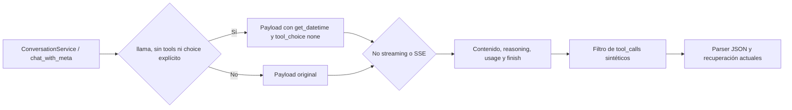

# Diseño técnico: integración de tool-template para llama.cpp

## Visión general

El cliente HTTP compartido declara `get_datetime` y `tool_choice="none"` automáticamente para solicitudes elegibles de `llama`. La herramienta es solo metadato de plantilla: no tiene implementación ni efectos laterales. `schema` y `strict_schema` no se serializan en el payload HTTP actual: el prompt pide JSON y el servicio valida la respuesta después. Por ello no excluyen la declaración sintética; esta debe respetar el parser y las reparaciones existentes.

No hay variable de entorno ni toggle de producción. La optimización no modifica mensajes, prompts, historial, personalidad, thinking, topes de generación ni parámetros de muestreo. Los proveedores distintos de llama y los caminos con herramientas reales o `tool_choice` explícito conservan su contrato actual. Streaming mantiene el mismo ensamblado SSE y descarta de forma segura cualquier señal de tool call inesperada.

### Objetivos

- Aplicar la declaración por defecto solo a llamadas elegibles de llama.cpp, incluso si el servicio usa `schema` o `strict_schema`, sin depender del entorno.
- Aislar la declaración ficticia de las herramientas ejecutables existentes.
- Medir latencia, tokens, respuesta visible y calidad con prompts y escenarios emparejados.

### Fuera de alcance

- Cambiar prompts, personalidad, memoria, historial, límites de razonamiento o `max_tokens`.
- Ejecutar `get_datetime`, implementar herramientas nuevas o cambiar las políticas de herramientas reales.
- Declarar estabilidad general basándose únicamente en un par piloto; documentar sus límites y conservar pruebas automatizadas y evaluación ampliada pendiente.

## Arquitectura

### Arquitectura existente

El proyecto usa arquitectura hexagonal. `LlmConfig.from_env()` y `build_llm()` construyen `HttpLlmClient`; `chat_with_meta()` crea el payload y bifurca entre HTTP normal y SSE. El cliente ya gestiona `reasoning_content`, `content`, `finish_reason`, `usage`, tiempos hasta primer token/contenido, validación upstream y captura opt-in sin prompts en logs normales. Los llamadores pueden pasar herramientas reales o un esquema de salida; el servicio de búsqueda consume `LLMMeta.tool_calls`.

### Integración

Se conserva la propiedad del payload en el adaptador. No se introduce un nuevo servicio en dominio ni se altera el puerto `LLMClient`.

### Decisiones

1. **Integración sin variable de entorno.** Eliminar el flag de `LlmConfig`, el parámetro experimental de la fábrica/cliente y su documentación. El gate se limita al perfil `llama`; el estado real de aplicación sigue visible por llamada en `LLMMeta`. Los tests A/B crean clientes de prueba con comportamiento anterior mediante un mecanismo de harness, no con configuración de producción.
2. **Elegibilidad para JSON de conversación.** Inyectar si no se pasaron herramientas reales ni `tool_choice` explícito; `schema` y `strict_schema` no excluyen la solicitud. No se reemplazan herramientas ni se cambian roles, mensajes, límites o validadores. Las llamadas con herramientas reales conservan su ruta; las respuestas JSON inválidas conservan recuperación existente. Si llama-server rechaza el payload, propagar el error existente en lugar de ejecutar la herramienta o silenciarlo.
3. **Streaming soportado sin ejecutar ni propagar la herramienta ficticia.** Se mantiene la validación que prohíbe herramientas reales en streaming, pero la declaración sintética puede ir en el payload SSE. La lectura SSE detecta presencia de `delta.tool_calls`, registra una advertencia acotada sin argumentos y descarta el dato; no acumula ni entrega llamadas sintéticas a `LLMMeta` o a servicios. El ensamblado de contenido, reasoning, `finish_reason`, usage y latencias sigue su ruta actual.
4. **Instrumentación en metadatos de llamada y evaluación aislada.** Conservar `LLMMeta` y la traza por llamada como fuente del estado *aplicado*; no etiquetar una muestra ON si ninguna llamada relevante recibió la declaración. Para A/B, un cliente controlado por el harness permite comparar el payload anterior con el integrado sin introducir una variable en producción. El informe agregado no guarda prompts/respuestas completos por defecto.

### Alineación tecnológica

- Python 3.11+, `aiohttp`, pytest y arquitectura ports/adapters ya existentes; no se añaden dependencias.
- Eliminar la variable experimental de `.env.example` y documentar el alcance y limitaciones en README.
- Se mantiene captura de payload y respuesta bajo opt-in existente, con sus controles de privacidad.

## Componentes e interfaces

### `LlmConfig` / `build_llm` — `src/airi/adapters/http_llm.py`

- Eliminar el booleano de configuración y la lectura de `LLM_TOOL_TEMPLATE_OPTIMIZATION`.
- `build_llm()` construye clientes `llama` con gate automático, sin parámetro configurable de producción. La evaluación A/B utiliza un cliente de prueba que suprime la inyección en OFF.
- No se altera la configuración de proveedores ni la activación de thinking.

### `HttpLlmClient.chat_with_meta()`

- Constante privada e inmutable con la definición exacta de la herramienta experimental.
- Una función de elegibilidad/resolución compone la declaración si el cliente es `llama` y no hay tools ni tool_choice explícito, incluso con esquema/validación estructurada.
- En elegible se copia el payload de tools solo si hace falta; no se muta la lista del llamador ni `messages`.
- Distinguir `synthetic_tool_template` de `real_tools` para conservar el rechazo de tools reales en streaming.

### Parser de respuestas

- Respuesta no streaming: si aparece una llamada a `get_datetime` solo en una petición marcada sintética, registrar anomalía y no devolverla como `meta.tool_calls`.
- Streaming: detectar campo `tool_calls` en cualquier delta para solicitudes sintéticas; no interpretar argumentos parciales ni hacerlos visibles. El contenido visible se procesa como hasta ahora.
- Las solicitudes con herramientas reales mantienen la normalización actual y no atraviesan el filtro sintético.
- Respuestas vacías, fallos SSE, `[DONE]`, validadores y reintentos permanecen intactos.

### Benchmark de comparación

- Añadir capacidad de A/B a la evaluación existente o un entry point pequeño reutilizando `build_llm`, escenarios fijos y las métricas de `LLMMeta`.
- Comparación emparejada: mismo modelo, mensajes, schema/strict_schema, seed si está soportada y configuración salvo la declaración sintética.
- Piloto: dos ejecuciones de `ConversationService`, saludo OFF/ON, con verificación de declaración en llamada primaria, parser y respuesta visible. Ya ejecutado mediante gate temporal en memoria; ambos modos acabaron en `stop`, `parse_ok=true` y respuesta visible.
- Evaluación ampliada pendiente: saludo, casual/cumplido, factual, emocional, historial largo y multiusuario; al menos cinco repeticiones por modo/escenario antes de afirmar estabilidad general.
- Informe JSON agregado: request id local, proveedor/modelo, aplicación real, count de tools, prompt/completion/reasoning tokens disponibles, caracteres de reasoning, TTFT, primer contenido visible, duración total, finish reason, tool calls inesperados y resultado de validación/calidad. No guardar prompt/respuesta crudos por defecto.

## Manejo de errores y seguridad

- Fallo del proveedor sigue los errores HTTP existentes; no hay reintento especial ni cambio de generación.
- Tool call inesperado se trata como anomalía no ejecutable, se registra solo nombre/cantidad y correlación local, y se conserva el flujo seguro existente para respuesta vacía/inválida.
- No escribir contenido del prompt, razonamiento, argumentos de tool call o respuesta en logs ordinarios.
- `schema` y `strict_schema` mantienen el parser y validadores existentes; comprobar regresión de JSON válido/inválido, respuesta vacía, reparaciones y herramientas inesperadas en la ruta integrada.

## Estrategia de pruebas

### Unitarias

- Llama elegible añade exactamente la herramienta y `tool_choice="none"` sin variable; comprobar igualdad de mensajes, límites y `chat_template_kwargs` con el baseline.
- Proveedores remotos no reciben campos experimentales.
- Herramientas reales y nombres existentes se preservan sin duplicar o reemplazar; `tool_choice` explícito se conserva.
- `schema`/`strict_schema` no omiten la herramienta en llama sin tools; comprobar que parser, validadores y reparaciones no cambian.
- Respuesta no-stream con llamada sintética nunca expone tool calls; llamada real mantiene parsing habitual.
- SSE optimizado conserva reasoning/content/finish/usage/TTFT y descarta/loguea tool-call delta sin ejecución.
- JSON del flujo actual, respuesta vacía, errores SSE y mecanismos de validación/reintento no cambian.

### Integración y evaluación live

- Tests con fakes cubren construcción y transporte sin red.
- Benchmark live requiere `LLM_BASE_URL` local y el modelo de Airi disponible; no se considera satisfecho por fixtures.
- El piloto fiel de un saludo OFF/ON se completó con `ConversationService` y una sobreescritura temporal del gate en el cliente ON; no reemplaza la evaluación ampliada.
- Ejecutar cinco o más pares por escenario en una evaluación ampliada posterior si se pretende afirmar reproducibilidad; inspeccionar parsing JSON, coherencia/persona, visibilidad, fin de generación, errores y llamadas de herramienta.

## Riesgos y mitigaciones

| Riesgo | Mitigación |
|---|---|
| La plantilla altera el formato JSON | Probar en `ConversationService` con JSON real, mantener validación y reparación, bloquear despliegue si aparece regresión atribuible. |
| `tool_choice="none"` se ignora | Filtrar tool calls sintéticas antes de `LLMMeta`/ejecutores y registrar anomalía. |
| Cambios en streaming de llama.cpp | Fakes SSE para fragmentación y metadatos; test live en versión desplegada antes de estabilidad. |
| La señal de latencia no equivale a calidad | Evaluación con rubric de coherencia/persona y revisión humana de muestras, sin guardar contenido por defecto. |
| Comparaciones no reproducibles | Pares con mensajes/modelo/config idénticos, repeticiones múltiples y semilla si disponible. |

## Trazabilidad

| Requisito | Realización |
|---|---|
| 1 | Eliminar flag de `LlmConfig`/fábrica; gate por perfil y pruebas de no-regresión para otros proveedores. |
| 2 | Declaración fija, resolución de elegibilidad y filtro de anomalías en parser. |
| 3 | Composición aditiva incluso con schema/strict_schema; exclusión de tools reales y choice explícito; igualdad de messages y parámetros. |
| 4 | Tests de parser no-stream/SSE, formatos vacíos, errores y validación existente. |
| 5 | Métricas opt-in y runner A/B con escenarios/repeticiones, salida agregada privada. |
