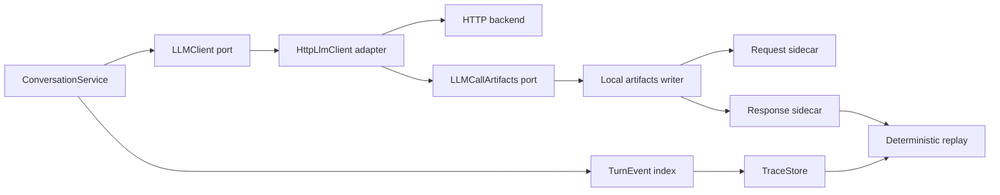

# Diseño técnico: artefactos auditables de llamadas LLM

## Overview

Cuando se habilita la captura local, Airi guardará request y response completos como artefactos separados por llamada. La traza principal será el índice del turno: conservará resultado final, estado, timings, metadatos y referencias con hashes, pero omitirá `raw_llm` inline cuando exista response sidecar válido.

El adaptador captura el request efectivo justo antes del POST y la salida completa de aplicación justo antes de devolverla a Airi. El response sidecar conserva el texto exacto que Airi usaría en parsing y los metadatos normalizados devueltos por el adaptador, incluidas tool calls; no intenta guardar framing SSE. `airi-replay` puede cargar esa salida local y mantener el replay determinista sin invocar LLM/red. La captura permanece opt-in y los archivos son locales.

### Goals
- Capturar requests después de resolver valores y extensiones del proveedor.
- Capturar responses de aplicación antes de redacción/recorte al persistir trazas.
- Enlazar ambas piezas por correlation ID, índice y propósito, con SHA-256 independiente.
- Mantener compacta la traza y compatible el replay de formatos viejos y nuevos.
- Conservar el comportamiento actual al dejar captura desactivada.

### Non-Goals
- Persistir URL, cabeceras HTTP, API keys o secrets.
- Guardar eventos SSE verbatim o reconstruir la respuesta HTTP del proveedor fuera del contrato de aplicación.
- Reenviar automáticamente la llamada al backend.
- Alterar prompt, política o resultado visible del turno.

## Architecture

### Existing Architecture Analysis

`ConversationService` usa el puerto `LLMClient`; `HttpLlmClient` prepara y envía JSON con rutas streaming/no-streaming y devuelve contenido más `LLMMeta`. `TurnEvent` registra metadatos por llamada en `llm_calls`, mientras `events.py` serializa la traza. `raw_llm` es necesario en memoria para aplicar parsing y para el replay histórico; el cambio solo condiciona su persistencia cuando una response capturada verificable está enlazada.

### High-Level Architecture



- Se preserva la arquitectura hexagonal: el adaptador usa un puerto de artefactos; la implementación de disco vive en observabilidad.
- `LLMCallContext` transporta correlation ID, call index, purpose, model/provider y referencias de captura; no se añade al JSON HTTP.
- El adaptador completa request artifact antes del POST y response artifact después de normalizar la salida de proveedor pero antes de retornar a servicio.
- La traza recibe referencias de ambas capturas a través del contexto/metadata. El writer no depende de `ConversationService`.

### Technology Alignment

Python 3.11, dataclasses/Protocols, JSON stdlib, SHA-256 y escritura atómica local; sin dependencias nuevas. La configuración canónica será `AIRI_TRACE_LLM_ARTIFACTS_DIR`, con alias `TRACE_LLM_ARTIFACTS_DIR`; se aceptan los nombres históricos `AIRI_TRACE_LLM_PAYLOAD_DIR` y `TRACE_LLM_PAYLOAD_DIR` para transición. Vacío/desactivado no crea artefactos.

### Key Design Decisions

1. **Separación de registro y contenido.** La traza guarda resumen/referencias; request y response completos permanecen en sidecars. Esto evita duplicación y facilita auditar piezas por separado.
2. **Response de aplicación, no bytes del transporte.** Se guarda el string exacto devuelto por el adaptador y metadata `LLMMeta` relevante. Para streaming, el string se forma concatenando en orden los deltas de contenido que recibe Airi; no se guarda framing SSE.
3. **Compatibilidad de replay.** Las trazas históricas siguen usando `raw_llm` inline. En capturas nuevas, el serializador omite `raw_llm` solo si hay una response sidecar válida referenciada; replay carga esa respuesta como `raw_llm` de entrada.
4. **Captura best-effort.** Una escritura fallida nunca impide POST, parsing ni publicación. La traza distingue captura fallida/ausente de respuesta del modelo.

## System Flow

```mermaid
sequenceDiagram
    participant S as ConversationService
    participant A as HttpLLMClient
    participant C as LLMCallArtifacts
    participant F as Sidecars locales
    participant M as llama-server
    participant T as Trace/replay
    S->>A: chat_with_meta(messages, call_context)
    A->>A: construir request efectivo
    opt Captura activada
        A->>C: capture_request(context, body)
        C->>F: request.json + SHA-256
    end
    A->>M: POST body
    M-->>A: resultado del modelo
    A->>A: normalizar content + LLMMeta
    opt Captura activada
        A->>C: capture_response(context, output)
        C->>F: response.json + SHA-256
    end
    A-->>S: content + LLMMeta
    S->>T: llm_calls references; raw_llm kept in memory
    T->>T: persist trace without raw_llm when response ref valid
    T->>F: on deterministic replay, load/check response sidecar
```

## Components and Interfaces

### `ports/llm.py`

- `LLMCallContext` contiene correlation ID, purpose, índice, model/provider y resultados separados de request/response capture.
- `LLMMeta` puede transportar referencias/resultados de captura en camino exitoso; el contexto es la fuente en error HTTP.
- `LLMClient` recibe contexto opcional, manteniendo compatibilidad de clientes no instrumentados.

### Puerto e implementación de artefactos

- `LLMCallArtifacts` ofrece `capture_request(context, body)` y `capture_response(context, output)`; devuelve estado, referencia relativa y SHA-256 independiente.
- Request sidecar: schema `airi.llm-request.v1`, identidad de llamada y objeto JSON completo que fue argumento del POST.
- Response sidecar: schema `airi.llm-response.v1`, identidad compartida y objeto `output` con `content` exacto retornado a Airi, `reasoning_content` opcional separado y metadata normalizada disponible (`finish_reason`, usage/timings, tool calls); no incluye API key ni framing SSE.
- El output response conserva `content` íntegro incluso si excede el límite de `raw_llm` inline actual. A la hora de replay se comprueba el hash antes de usarlo.
- Cada artefacto se serializa en UTF-8, con checksum sobre bytes persistidos y escritura temporal atómica sin reemplazo. Nombres únicos impiden colisiones.
- `artifact_ref` es relativa a `AIRI_TRACE_LLM_ARTIFACTS_DIR`; no se guarda URL ni ruta absoluta.

### `HttpLlmClient`

- El helper común captura request final antes de `session.post` en streaming y no-streaming.
- Response se captura después de extraer/ensamblar content y reasoning, antes de retornar. `reasoning_content` se conserva separado: desde el campo del mensaje en no-streaming y concatenando deltas en orden en streaming. Incluye tool_calls normalizadas que forman parte de la salida de aplicación.
- Fallo de captura se convierte en metadata `failed` sin incluir contenido en error ni detener transporte.
- El contexto se completa antes de cada frontera I/O para conservar request artifact ante fallo HTTP; si no hay resultado del modelo, response status queda `not_produced`.

### `TurnEvent`, persistencia y replay

- `llm_calls` lleva `artifacts.request` y `artifacts.response`, cada una con status/ref/hash, y conserva purpose/model/provider.
- `TurnEvent` conserva `raw_llm` en memoria durante el turno. En `to_dict`, si hay response artifact `captured` y su referencia/checksum están asociados, omite `raw_llm` completo; conserva `final_reply` y demás resumen.
- `reproducible` es true si hay `raw_llm` inline o una response artifact capturada. `from_dict` sigue admitiendo trazas antiguas.
- `airi-replay` usa `raw_llm` histórico cuando está presente. Si no está y hay response artifact, valida identidad/hash y suministra `output.content` al fake LLM determinista. No usa red. Si falta el sidecar, reporta no reproducible con motivo claro.

### Configuración y composition root

- `Settings`/factory lee `AIRI_TRACE_LLM_ARTIFACTS_DIR` y `TRACE_LLM_ARTIFACTS_DIR`; luego aliases antiguos payload-dir. La variable canónica vacía significa off.
- El directorio del sidecar no se mezcla con `TRACE_DIR`; la referencia es relativa al root de artefactos. Cambiar root requiere migrar/copy manual o mantener el path anterior para resolver trazas antiguas.
- Nombre recomendado local: `private-llm-artifacts/`, con subdirectorios por `correlation_id` y artefactos por llamada/rol.

## Data Models

### Metadatos por llamada en la traza

```json
{
  "purpose": "primary",
  "model": "...",
  "provider": "llama",
  "artifacts": {
    "request": {
      "status": "captured",
      "artifact_ref": "<cid>/call-0001.request.json",
      "sha256": "<hex>"
    },
    "response": {
      "status": "captured",
      "artifact_ref": "<cid>/call-0001.response.json",
      "sha256": "<hex>"
    }
  }
}
```

### Request sidecar `airi.llm-request.v1`

Contiene schema, correlation ID, call index, purpose, model/provider y el JSON efectivo del POST.

### Response sidecar `airi.llm-response.v1`

Contiene schema, la misma identidad y `output.content` íntegro, `output.reasoning_content` opcional íntegro y separado, más metadata normalizada de salida disponible. No contiene framing SSE ni cabeceras de transporte.

## Error Handling

- Captura off: no sidecars ni referencias nuevas; serialización conserva el comportamiento actual.
- Request capture fallida: continuar POST; response puede capturarse si la llamada tiene éxito; registrar estados por separado.
- Error HTTP después del request: request permanece disponible y response se marca `not_produced`/`failed`; preservar la excepción original.
- Error al guardar response: el turno sigue; la traza conserva raw_llm inline como fallback de replay, junto al estado response capture failed.
- Artefacto ausente, ilegible, identidad/hash inválidos: loader/replay devuelve error controlado sin volcar contenido. Replay histórico inline sigue funcionando.
- Error de carga durante replay de traza nueva sin inline: reportar no reproducible, sin fallback live.

## Security Considerations

- La captura de ambos artefactos está apagada por defecto y requiere configurar el directorio local.
- Capturar contenido de conversación íntegro; excluir URL/cabeceras/credenciales. No imprimir contenido en errores.
- Sidecars locales fuera de la traza principal; no hay transferencia externa automática. La política de retención/eliminación es local.
- Escritura atómica sin reemplazo accidental; no se exige modo POSIX restrictivo.

## Testing Strategy

### Unit Tests
- Request body coincide con JSON efectivo; response sidecar preserva content completo y metadata/tool calls.
- Streaming y no-streaming capturan la misma salida que el adaptador retorna.
- Hash/identidad/ref independientes para request y response; tampering, falta e ilegibilidad.
- Errores de escritura no bloquean LLM y no filtran datos; response no producido en error HTTP.
- Serialización omite `raw_llm` solo al existir response ref capturada; conserva respuesta inline si sidecar falla o captura off.

### Integration Tests
- Un turno con múltiples llamadas liga cada pareja request/response a purpose, index, model/provider y correlation ID.
- Traza persistida omite raw_llm completo al tener response artifact, conserva final_reply y metadatos.
- Replay determinista carga solo `output.content` desde response sidecar sin LLM/red; ignora `reasoning_content`. Replay de trazas legacy sigue leyendo raw_llm inline.
- Falta/hash incorrecto de response sidecar marca replay no reproducible sin fallback externo.
- Ambas rutas streaming y no-streaming, HTTP error después del request y captura off.

### Regression
- Ejecutar `test_http_llm`, tests de metadatos y trace serialization, `airi-replay`, transcripts/regression y suite completa.
- Añadir fixture sintética sin contenido privado para esquema dual sidecar.

## Migration Strategy

No se reescriben trazas existentes: las que ya tienen `raw_llm` siguen reproduciéndose inline. Las trazas nuevas con captura completa enlazan response artifact y omiten raw_llm inline; el replay hidrata desde ese artefacto. La configuración canónica pasa a `TRACE_LLM_ARTIFACTS_DIR`/`AIRI_TRACE_LLM_ARTIFACTS_DIR`; los aliases `*_PAYLOAD_DIR` se aceptan durante la transición. El nombre de carpeta recomendado es `private-llm-artifacts/`.
