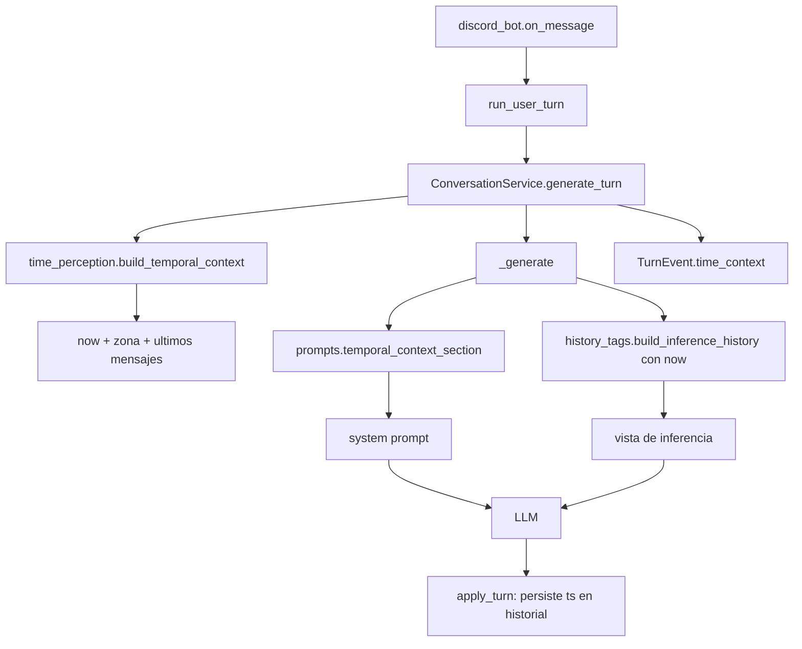
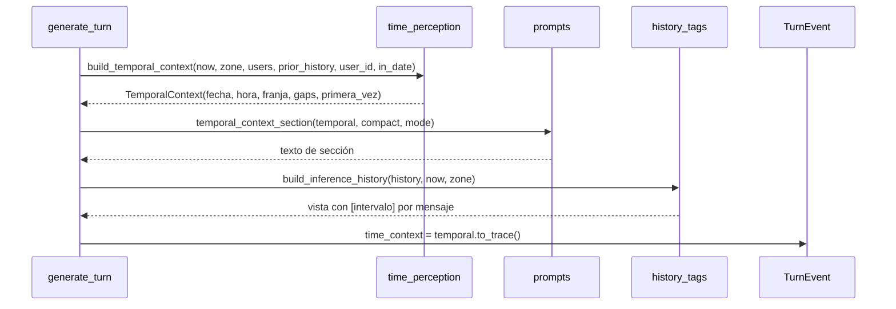
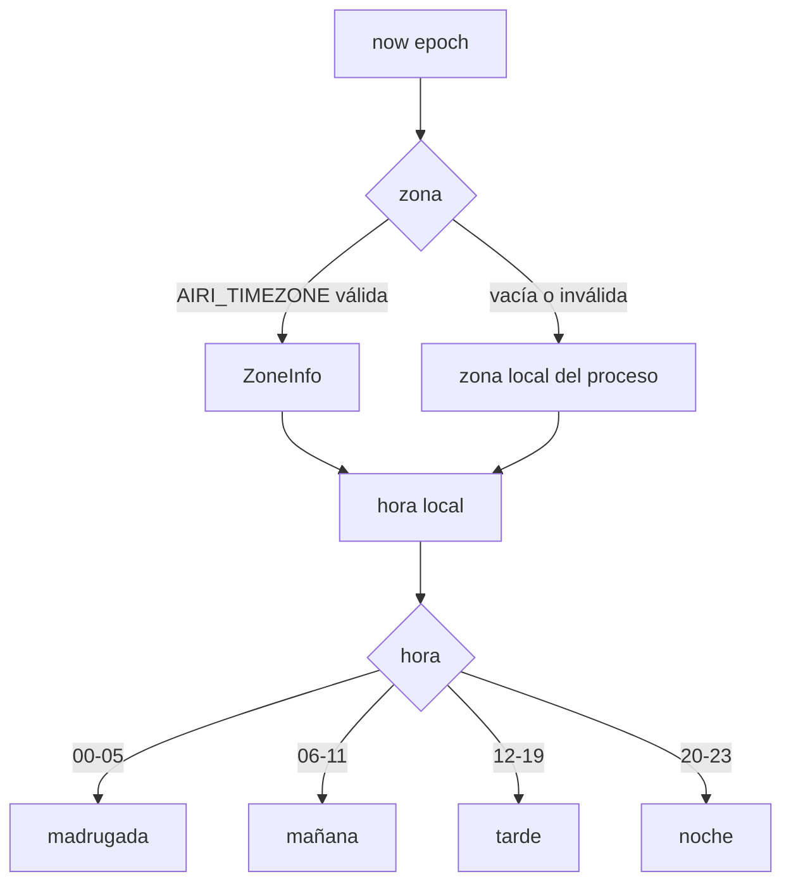
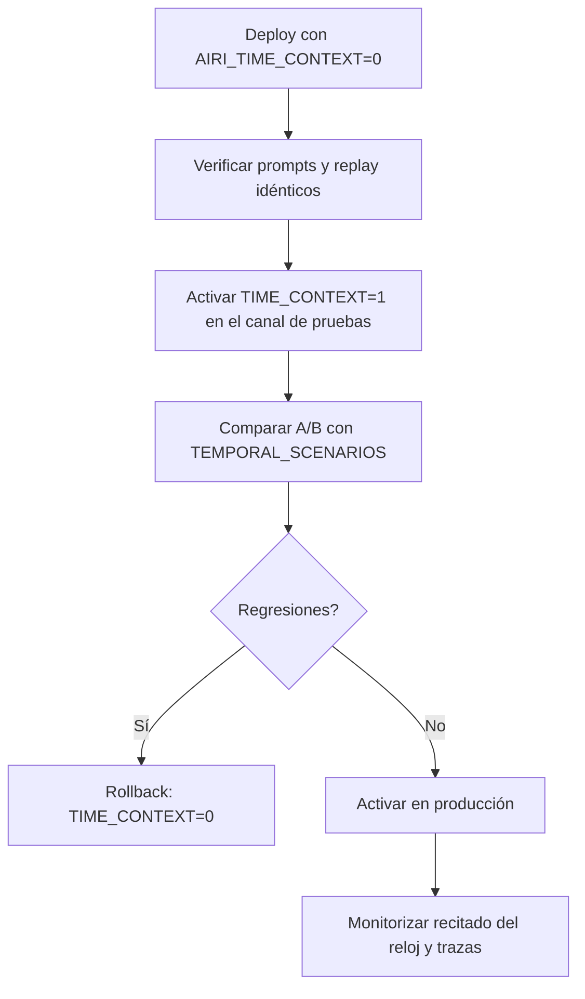

# Design Document

## Overview

**Purpose**: Dotar a Airi de percepción del tiempo —fecha, hora, franja del día, silencio desde la última interacción y cadencia del historial— para que su conversación encaje con el momento real, sin recitar nunca el reloj.

**Users**: quien conversa con Airi en el canal de Discord, y el operador del bot que necesita activar, medir y revertir la feature.

**Impact**: se añade una sección al prompt de sistema, marcas temporales efímeras en la vista de inferencia y un campo nuevo opcional (`ts`) en los mensajes del historial persistido. No cambia el contrato JSON de salida, ni la afinidad, ni las citas, ni la relación, ni el esquema de estado.

### Goals

- L1: fecha, hora y franja del día en todos los modos conversacionales, derivadas de `now`.
- L2: intervalo desde el último mensaje de la persona y desde la última actividad del canal, con formatos naturales y sin valores negativos.
- L3: etiqueta de tiempo relativo por intervención en la vista de inferencia, efímera e idempotente.
- Determinismo total: mismo estado + mismo `now` ⇒ mismo prompt, byte a byte.
- Rollback y A/B sin desplegar código (`AIRI_TIME_CONTEXT`), zona del sistema con override (`AIRI_TIMEZONE`).

### Non-Goals

- Cronómetro interno: Airi no percibe la duración de sus propias respuestas ni la latencia del modelo.
- Calendario laboral, festivos, cumpleaños o efemérides.
- Cambios en `DATE_MAX_SECONDS`, cooldowns, decay de afinidad o temporadas.
- Scheduler de mensajes por hora del día (la iniciativa proactiva sigue gobernada por `SpectatorSessionRegistry`).
- Historial con marcas absolutas visibles (`2026-10-27T02:14Z`); solo se muestran formas relativas.

## Architecture

### Existing Architecture Analysis

El flujo actual de un turno es `discord_bot.on_message` → `run_user_turn` → `ConversationService.generate_turn` → `_generate` (prompt) → LLM → `apply_turn` (mutaciones y persistencia). Restricciones que la feature debe respetar:

- **Dominio puro**: `domain/` no hace I/O ni lee el reloj del sistema; todo entra por parámetros (`now`, `clock`). `services/conversation.py` es quien inyecta `clock` (por defecto `time.time`, en replay `lambda: ev.started_at`).
- **Etiquetas de vista reconstruidas, nunca persistidas**: `domain/history_tags.py` ya impone esa regla para la identidad y la afinidad; L3 debe seguirla.
- **Persistencia aditiva**: `domain/state_schema.py` valida el agregado por tipo de clave (`histories: dict`) y no restringe las claves internas de cada mensaje, por lo que añadir `ts` es compatible sin subir `schema_version`.
- **Trazas forward-compatible**: `TurnEvent.from_dict` ignora claves desconocidas y usa defaults; añadir un campo es seguro para trazas antiguas.
- **Replay**: `observability/replay.py` reconstruye el estado desde `state_snapshot_*` y `history_in`, y compara salidas, no prompts. `history_in` es copia de los dicts del historial, así que un `ts` nuevo viaja en la traza y el replay lo conserva.
- **Configuración**: `airi.config.Settings.from_env()` es el patrón vigente para entorno leído en tiempo de ejecución (frente a constantes leídas al importar).

### High-Level Architecture



**Architecture Integration**:

- Patrones preservados: dominio puro, puertos/adaptadores, etiquetas de vista reconstruidas, `clock` inyectable, `Settings.from_env()`.
- Componentes nuevos: `domain/time_perception.py` (cálculo puro) y una función de sección en `domain/prompts.py`.
- Tecnología: solo stdlib (`zoneinfo`, `datetime`, `time`); sin dependencias nuevas.
- Steering: respeta `structure.md` (dominio puro, servicios orquestan, sin I/O en dominio), `tech.md` (stdlib, sin red para instalar) y `product.md` (personalidad natural, sin exponer mecánica interna).

### Technology Alignment

- **`zoneinfo`** (Python ≥3.11, ya en `pyproject.toml`): resuelve `AIRI_TIMEZONE` con reglas DST reales.
- **Zona del sistema**: cuando no hay override, la conversión se hace con la zona local del proceso (`datetime.fromtimestamp(now)`), lo que hereda el `TZ` del contenedor y aplica DST en ese instante.
- **Sin nuevas dependencias**: ni `pytz` ni `dateutil`.

### Key Design Decisions

#### Decisión 1: el tiempo entra al prompt como *contexto*, no como dato

- **Decision**: una única sección `=== TU PERCEPCIÓN DEL TIEMPO ===` insertada como primera sección dinámica (justo después de la personalidad base), con regla explícita de no recitar la hora ni mencionar el reloj.
- **Context**: R1.7–R1.9. Sin la regla, el modelo tiende a abrir con "son las 3:12".
- **Alternatives**: (a) inyectar la hora como mensaje de usuario del sistema; (b) etiquetar cada mensaje solo con L3; (c) no inyectar hora y deducirla del historial.
- **Selected Approach**: sección de sistema estable, primera en el orden, con formatos humanos y una instrucción de uso discriminada ("si encaja", "si preguntan").
- **Rationale**: el estado del sistema es el canal correcto para hechos del entorno; un mensaje de usuario falso contamina el historial y el modelo puede citarlo como si alguien lo hubiera dicho.
- **Trade-offs**: ~70–90 tokens por turno (~25 en `quick`); a cambio, Airi no puede confundir el dato con contenido del usuario.

#### Decisión 2: persistir `ts` por mensaje y reconstruir las etiquetas (L3)

- **Decision**: los mensajes nuevos del historial llevan `ts` (epoch). La vista de inferencia antepone `[<intervalo>]` recalculado contra el `now` del turno **solo en las intervenciones de usuario y de espectador**; los turnos de Airi conservan su JSON intacto. El historial canónico nunca guarda la etiqueta.
- **Context**: R3.1–R3.8. Hoy `histories` no tiene marcas temporales y `build_inference_history` solo añade identidad. Los turnos de Airi se guardan como objeto JSON (`assistant_history_content`) precisamente para reforzar el contrato de salida.
- **Alternatives**: (a) derivar el tiempo de `turn_records`/`message_index`; (b) enviar marcas absolutas ISO; (c) guardar la etiqueta relativa ya renderizada; (d) etiquetar también los turnos de Airi anteponiendo texto al JSON.
- **Selected Approach**: `ts` opcional por mensaje + etiqueta relativa solo en el lado humano.
- **Rationale**: `turn_records` se poda por retención y no indexa mensajes individuales; las marcas absolutas gastan tokens y fijan una zona; una etiqueta persistida se queda obsoleta. Etiquetar los turnos de Airi rompería el patrón few-shot del contrato JSON y arriesgaría respuestas con prefijo (fallo de parseo y reparaciones de latencia).
- **Trade-offs**: el hueco entre la respuesta de Airi y el siguiente mensaje no se ve en la etiqueta del asistente, pero sí en la del mensaje humano siguiente y en L2; `state.json` crece ~8 bytes por mensaje (máximo `MAX_HISTORY_MESSAGES=12` por canal y `DATE_HISTORY_MAX=20` por cita); los mensajes antiguos sin `ts` simplemente no llevan etiqueta.

#### Decisión 3: configuración en `Settings`, zona resuelta una vez por turno

- **Decision**: `AIRI_TIME_CONTEXT` (bool, por defecto **activo**) y `AIRI_TIMEZONE` (IANA; vacío = zona del sistema) se añaden a `Settings.from_env()`. `TimeConfig` se construye una vez en `ConversationService.__init__` y se pasa explícita en replay cuando la traza la contiene.
- **Context**: R5.1–R5.5 y R6.1. Las constantes de `domain/constants.py` se leen al importar y complican los tests; `Settings` se lee por llamada.
- **Alternatives**: (a) constantes de módulo; (b) leer `os.getenv` dentro del dominio; (c) argumento de CLI.
- **Selected Approach**: `Settings` + dataclass `TimeConfig` inyectada.
- **Rationale**: mismo patrón que el resto de ajustes de aplicación, tests sin `reload` de módulos y replay fiel al configurar la misma zona que producción.
- **Trade-offs**: un parámetro más en el constructor del servicio; el default conserva el comportamiento para llamadas existentes (tests, benchmark, evaluación) sin tocar cada sitio.

## System Flows

### Flujo de construcción del contexto temporal



### Decisión de franja y de formato de intervalo



## Requirements Traceability

| Requirement | Resumen | Componentes | Interfaces | Flujos |
|---|---|---|---|---|
| 1.1–1.3 | Fecha, hora y franja | `time_perception.py` | `local_moment`, `day_part` | Decisión de franja |
| 1.4–1.6 | Zona del sistema y override | `config.py`, `time_perception.py` | `Settings.from_env`, `resolve_zone` | Decisión de franja |
| 1.7–1.9 | Contexto, no recitado | `prompts.py` | `temporal_context_section` | Construcción del prompt |
| 2.1–2.7 | Intervalos vividos | `time_perception.py` | `elapsed_text`, `build_temporal_context` | Construcción del contexto |
| 2.8–2.9 | Relación y proactivo | `prompts.py`, `conversation.py` | sección + `conversation_mode_section` | Construcción del prompt |
| 3.1–3.8 | Etiquetas del historial | `history_tags.py`, `conversation.py` | `build_inference_history(now=...)`, `time_tag` | Vista de inferencia |
| 4.1–4.5 | Coherencia por modo | `conversation.py` | `_generate(quick, mode)` | Construcción del prompt |
| 5.1–5.6 | Config, zona registrada y rollback | `config.py`, `.env.example` | `Settings.time_context` | — |
| 6.1–6.5 | Determinismo y traza | `time_perception.py`, `events.py`, `replay.py` | `TurnEvent.time_context` | Flujo completo |
| 7.1–7.4 | No regresión | `conversation.py` | orden de `sections` | — |
| 8.1–8.4 | Evaluación | `evaluation/interaction.py` | `TEMPORAL_SCENARIOS`, `detect_clock_recital` | — |

## Components and Interfaces

### Domain

#### `time_perception` (nuevo)

**Responsibility & Boundaries**

- **Primary Responsibility**: convertir un instante epoch más una zona en un contexto temporal legible y determinista, y renderizar la sección de prompt.
- **Domain Boundary**: dominio puro de presentación temporal; no conoce Discord, estado ni LLM.
- **Data Ownership**: ninguno; no persiste nada.
- **Transaction Boundary**: no aplica (funciones puras).

**Dependencies**

- **Inbound**: `services/conversation.py`, `evaluation/interaction.py`, tests.
- **Outbound**: `zoneinfo`, `datetime`, `time` (stdlib).
- **External**: ninguna.

**Contract Definition**

```python
@dataclass(frozen=True)
class TimeConfig:
    enabled: bool = True
    timezone: str = ""          # "" = zona del sistema

@dataclass(frozen=True)
class LocalMoment:
    epoch: float
    year: int
    month: int
    day: int
    hour: int
    minute: int
    weekday: str              # "lunes" … "domingo"
    month_name: str           # "enero" … "diciembre"
    bucket: str               # "madrugada" | "mañana" | "tarde" | "noche"
    zone_label: str           # "Europe/Madrid" o "hora local del sistema"

@dataclass(frozen=True)
class TemporalContext:
    moment: LocalMoment
    user_gap_seconds: float | None
    channel_gap_seconds: float | None
    first_time: bool
    in_date: bool
    user_name: str | None
    zone: ZoneInfo | None

def resolve_zone(name: str) -> tuple[ZoneInfo | None, str, str]  # zona, etiqueta, origen
def local_moment(now: float, zone: ZoneInfo | None) -> LocalMoment
def day_part(hour: int) -> str
def elapsed_text(seconds: float, *, short: bool = False) -> str
def calendar_gap_days(now: float, ts: float, zone: ZoneInfo | None) -> int
def format_elapsed(now: float, ts: float, zone: ZoneInfo | None, *, short: bool = False) -> str
def build_temporal_context(now: float, config: TimeConfig, *, users, history, snapshot=(), user_id, in_date: bool) -> TemporalContext | None
def time_tag(context_for_message: float, now: float, zone: ZoneInfo | None) -> str  # "[hace 5 min]"
```

La función `temporal_context_section(context, compact=False, mode="normal")` vive
en `domain/prompts.py`, no en este módulo de cálculo puro.

- **Preconditions**: `now` es un epoch finito; `config.enabled` puede ser `False`.
- **Postconditions**: con `enabled=False` devuelve `None` y ninguna sección; con `enabled=True` los campos son deterministas para el mismo `(now, zone, users, history, user_id)`.
- **Invariants**: no hay valores negativos; los intervalos se acotan a `0.0`; el texto no contiene la hora absoluta salvo en la sección L1 (nunca en etiquetas de historial).

**Reglas de cálculo**

- Franjas: `00:00–05:59` madrugada, `06:00–11:59` mañana, `12:00–19:59` tarde, `20:00–23:59` noche.
- Silencio del canal: `now` menos la marca temporal más reciente entre el historial persistido y la captura pasiva del modo espectador (`ctx.spectator_snapshot`). Sin esa unión, al despertar en modo espectador Airi diría "el canal llevaba días muerto" aunque hubiera mensajes de hace cinco minutos que no llegan al historial persistido.
- Silencio de la persona: `now` menos `users[uid].last_seen` leído antes de `_register_user` (que se ejecuta en `apply_turn`, después de generar).
- Intervalo corto (`short=True`, para etiquetas): `<60 s` → "ahora"; `<1 h` → "hace N min"; mismo día local → "hace N h"; día local anterior y menos de 48 h → "ayer"; resto → "hace N días".
- Intervalo largo (`short=False`, para L2): igual pero `<60 s` → "ahora mismo".
- "hace N días" se calcula por diferencia de fechas locales (`calendar_gap_days`), no por división de 86400, para que un cambio de hora no produzca "hace 1 día" cuando han pasado 23 h de calendario.
- Nombres de días y meses en arrays propios en español; nunca `strftime("%A")` (depende del locale del contenedor).

#### `prompts` (extensión)

**Responsibility & Boundaries**

- Añade `temporal_context_section(context, *, compact=False, mode="normal")`.
- Mantiene el estilo del módulo: encabezado `=== ... ===`, reglas explícitas, sin datos internos.

**Contract Definition**

```python
def temporal_context_section(context, *, compact: bool = False, mode: str = "normal") -> str
```

- Devuelve `""` si `context is None`.
- Versión completa: 3–5 líneas (fecha y hora, franja, silencio de la persona, silencio del canal, regla de uso).
- Versión `compact`: una sola línea con fecha, hora, franja y silencio de la persona.
- En `mode="proactive"` añade una frase que liga la franja con el tipo de iniciativa permitida.
- En `in_date=True` omite el silencio del canal (la cita es un contexto privado sin "canal").

**Texto de referencia (versión completa)**

```text
=== TU PERCEPCIÓN DEL TIEMPO ===
Ahora es martes, 28 de octubre de 2026, a las 03:12 (madrugada).
La última vez que hablaste con KOKODA fue ayer.
En el canal no había actividad desde hacía 4 h.
Esto es contexto, no un dato que anunciar: no recites la hora ni digas que
consultas un reloj. Úsalo solo si encaja con naturalidad (un saludo, el
cansancio, la sorpresa por una ausencia). Si te preguntan la hora o la fecha,
responde con el dato real.
```

#### `history_tags` (extensión)

**Contract Definition**

```python
def build_inference_history(history, resolver, *, users=None, now=None, zone=None) -> list
def time_tag(ts, now, zone) -> str   # "" si no hay ts válido
```

- Sin `now`, el comportamiento es idéntico al actual (compatibilidad con tests y con consumidores existentes).
- La etiqueta se antepone al contenido de los mensajes de usuario y de espectador, antes de la etiqueta de identidad: `[hace 12 min] [speaker=KOKODA|affinity=3|level=Amiga] texto`.
- Los mensajes de asistente **no** reciben prefijo: su contenido es el JSON del contrato de salida y debe empezar por `{`.
- Idempotencia: si el mensaje ya empieza por `[<intervalo>]` y no tiene `author_id` (vista previa o legacy), no se re-etiqueta.
- El texto del usuario que imite el formato se conserva y solo se reconoce como metadato cuando la estructura completa coincide con la vista generada.

### Services

#### `ConversationService` (extensión)

- Nuevo atributo `time_config: TimeConfig` (por defecto `TimeConfig.from_settings(Settings.from_env())`).
- `generate_turn` calcula `TemporalContext` con `now`, `state.users`, `prior_history` (antes de añadir los mensajes actuales), `ctx.spectator_snapshot` e `in_date`.
- `_generate` recibe `temporal` y lo pasa a `prompts.temporal_context_section`, que se inserta **antes** de `affinity_section` en las dos ramas (`quick` y completa).
- `ev.time_context = temporal.to_trace()` tras construir el prompt; con la feature desactivada se registra `{"enabled": false}`.
- Los appends de historial (`conversation.py`, mensajes de usuario y de asistente, incluidos los de cita) añaden `"ts"` con el epoch del turno. La captura efímera del modo espectador propaga el `ts` de `BufferEntry`.
- `build_inference_history` recibe `now=now` y la zona resuelta.

**Integración con modos**

| Modo | L1 | L2 persona | L2 canal | L3 |
|---|---|---|---|---|
| normal | completa | sí | sí | sí |
| quick | compacta | sí | no (ahorro) | sí |
| spectator | completa | sí | sí | sí (incluye efímeros) |
| active | completa | sí | sí | sí |
| proactive | completa + franja | no hay persona | sí | sí |
| cita en curso | completa | sí | no | sí |

#### `Settings` (extensión)

```python
time_context: bool = True
timezone: str = ""
```

- `AIRI_TIME_CONTEXT` con `env_flag` (acepta 1/true/yes/on y 0/false/no/off; valor inválido → default + warning único).
- `AIRI_TIMEZONE`: vacío o ausente → zona del sistema; inválida → fallback a sistema + warning único por proceso.
- Documentados en `.env.example` junto a las claves de modo espectador, con nota explícita: si el contenedor corre en UTC, hay que fijar `TZ=Europe/Madrid` (o `AIRI_TIMEZONE`) o Airi percibirá la hora UTC.
- `client.py` registra al arrancar la zona resuelta y su origen (`log.info("Zona horaria de Airi: %s (%s)", label, origen)`) para detectar el caso anterior sin abrir trazas. Reutiliza `resolve_zone` del dominio, sin lógica duplicada.

### Observability

#### `TurnEvent` (extensión)

```python
time_context: dict = field(default_factory=dict)
```

Contenido: `enabled`, `timezone`, `local_iso`, `weekday`, `bucket`, `minutes_since_user`, `minutes_since_channel`. Sin texto de mensajes ni contenido adicional (R6.4).

#### `replay` (extensión)

- `build_state_from_event` no cambia.
- `_run_event` y `run_live_trace` construyen `TimeConfig` desde `ev.time_context` cuando existe (`enabled`, `timezone`); si la traza es antigua, usan `Settings.from_env()`.
- Los mensajes de `history_in` conservan `ts` automáticamente porque es copia de los dicts; las trazas antiguas siguen sin etiquetas.

## Data Models

### Mensaje de historial (extensión aditiva)

| Campo | Tipo | Obligatorio | Descripción |
|---|---|---|---|
| `role` | `str` | sí | `user` / `assistant` |
| `content` | `str` | sí | Contenido canónico limpio |
| `author_id` | `str` | no | Solo mensajes de usuario |
| `author_name` | `str \| None` | no | Solo mensajes de usuario |
| `reply_to_user_id` | `str` | no | Solo mensajes de assistente |
| `reply_to_user_name` | `str \| None` | no | Solo mensajes de assistente |
| **`ts`** | `float` | no | **Nuevo**. Epoch del turno en que se registró |

- Ausencia de `ts` = "sin hora conocida" (R3.2, R3.6). No hay migración ni `schema_version` nuevo.
- `ts` nunca se envía al LLM: solo su forma relativa en la vista.

### `TurnEvent.time_context`

| Campo | Tipo | Ejemplo |
|---|---|---|
| `enabled` | `bool` | `true` |
| `timezone` | `str` | `""` (sistema) o `Europe/Madrid` |
| `local_iso` | `str` | `2026-10-28T03:12` |
| `weekday` | `str` | `martes` |
| `bucket` | `str` | `madrugada` |
| `minutes_since_user` | `int \| null` | `1440` |
| `minutes_since_channel` | `int \| null` | `240` |

## Error Handling

### Error Strategy

Todo fallo de la feature degrada a "sin sección temporal", nunca rompe el turno.

| Categoría | Situación | Respuesta |
|---|---|---|
| Config inválida | `AIRI_TIMEZONE` desconocida | Warning único, fallback a zona del sistema |
| Config inválida | `AIRI_TIME_CONTEXT` no booleano | Warning único, default `true` |
| Datos incompletos | Mensaje sin `ts` | Sin etiqueta; el resto de la vista intacta |
| Datos incompletos | Usuario sin `last_seen` | `first_time=True`, sin intervalo |
| Reloj hacia atrás | `ts > now` | Intervalo `0` → "ahora" (nunca negativo) |
| DST | Cambio de hora en la zona | `zoneinfo` resuelve el offset del instante; "ayer" se decide por fecha local |
| Traza antigua | Sin `time_context` | Replay usa `Settings`; la comparación de salidas no cambia |
| Estado antiguo | Historial sin `ts` | Sin etiquetas; no se reescribe el estado |

Las excepciones inesperadas dentro de `build_temporal_context` se capturan en `generate_turn`, se registran en `ev.errors` y el turno continúa sin sección (mismo patrón defensivo que los módulos actuales).

### Monitoring

- `time_context` en la traza permite auditar exactamente qué hora y qué huecos vio Airi.
- Contador implícito en los logs: `time_context` ausente por error queda como entrada en `ev.errors`, visible en `!debug`.

## Testing Strategy

### Unit Tests (`tests/unit/test_time_perception.py`)

- Fronteras de franja en `05:59`, `06:00`, `11:59`, `12:00`, `19:59`, `20:00`, `23:59`, `00:00`.
- `elapsed_text`: 0 s, 59 s, 60 s, 59 min, 60 min, 23 h, "ayer" (26 h con fecha anterior), 47 h mismo día anterior, 49 h, 3 días, `short` vs `long`.
- `calendar_gap_days` con cambio de hora en `Europe/Madrid` (marzo y octubre) y con zona del sistema (`TZ=Europe/Madrid` + `time.tzset()`).
- `resolve_zone`: vacío, válida, inválida, con warning único.
- Determinismo: dos llamadas con el mismo `now` producen textos idénticos; `enabled=False` produce `None`.
- `ts` futuro produce "ahora".

### Unit Tests (`tests/unit/test_history_time_tags.py`)

- Etiqueta antepuesta antes de identidad en mensajes de usuario.
- Los mensajes de asistente **no** llevan prefijo y siguen empezando por `{` (contrato JSON intacto).
- Sin `now` no se añade ninguna etiqueta (compatibilidad).
- Idempotencia sobre una vista ya etiquetada.
- Mensaje legacy sin `author_id` que empieza por `[hace 5 min] hola` se conserva sin duplicar.
- Mensaje sin `ts` no recibe etiqueta y no rompe el orden.
- Etiquetas recalculadas entre dos `now` distintos.

### Integration Tests (`tests/integration/test_temporal_prompt.py`)

- Prompt normal: contiene fecha, hora, franja y ambos huecos; la sección precede a la de afinidad.
- `quick`: versión reducida con fecha, hora, franja y hueco de persona.
- `spectator`/`active`/`proactive`: la sección existe y en proactivo incluye la franja.
- Cita en curso: sin hueco de canal y sin alterar `date_*`.
- `AIRI_TIME_CONTEXT=0`: ni sección ni etiquetas; el prompt restante es idéntico al de un turno sin la feature.
- Usuario nuevo: "primera vez", sin intervalo inventado.
- Modo espectador con búfer pasivo reciente: el silencio del canal usa la marca del búfer, no la del historial persistido.
- Arranque: el log registra zona resuelta y origen.
- Traza: `TurnEvent.time_context` contiene los seis campos temporales y ningún contenido de mensaje.
- Replay: una traza de `traces/` sigue coincidiendo; una traza nueva con `ts` reproduce el mismo prompt (`run_live_trace` con `FakeLLM` de eco, opcional).

### Evaluación (`src/airi/evaluation/interaction.py`)

- `InteractionScenario` gana `now: float | None = None` y `last_seen_seconds: float | None = None`.
- `TEMPORAL_SCENARIOS`: madrugada, mañana, tarde, noche, mensaje 2 min después, reaparición a los 3 días, proactivo nocturno.
- `detect_clock_recital(text, moment)` comprueba de forma determinista que la respuesta no contiene la hora literal (`03:12`, `3:12`) ni frases de reloj ("según mi reloj", "son las").
- La comparación A/B usa `AIRI_TIME_CONTEXT=0` como baseline y `=1` como candidato con los mismos `now`.

### Performance

- Coste CPU despreciable (conversión de fecha y aritmética).
- Coste de tokens: ~90 tokens por turno normal, ~25 en `quick`, ~4 por etiqueta de historial (máximo 12 mensajes).

## Migration Strategy



- Sin migración de datos: `ts` es aditivo y opcional.
- Sin cambios de esquema: `schema_version` y `state_version` no se tocan.
- Rollback instantáneo con `AIRI_TIME_CONTEXT=0`; el historial con `ts` sigue siendo válido y simplemente se ignora.

## Security Considerations

- La percepción temporal no añade superficie de ataque: no hay entrada externa nueva ni red.
- El contenido del usuario nunca se interpreta como marca temporal; las etiquetas se generan desde metadatos internos (`ts`), igual que la identidad.
- La traza registra solo valores temporales agregados, no texto ni identificadores de mensaje.
- `AIRI_TIMEZONE` se valida con `zoneinfo`; un valor arbitrario no se interpola en el prompt, solo la etiqueta de la zona resuelta.

## Performance & Scalability

- Una conversión de zona y un recorrido del historial por turno (≤ 12 mensajes).
- Sin caché necesaria; si se añadiera, solo por `(now, zone)` dentro del turno.
- El coste dominante es el prompt (+90 tokens), no el cálculo.

## Validation Notes

Revisión de calidad del diseño contra el código real (2026-10-28). Tres hallazgos corregidos antes de generar tareas:

| # | Hallazgo | Impacto | Resolución aplicada |
|---|---|---|---|
| 1 | Etiquetar los turnos de Airi anteponía texto a su JSON de contrato (`assistant_history_content`), riesgo de fallo de parseo y de reparaciones lentas | Alto | L3 se limita a mensajes de usuario y de espectador (Decisión 2, R3.1–R3.2) |
| 2 | El silencio del canal calculado solo con el historial persistido ignoraba el búfer pasivo, así que al despertar en modo espectador diría "días sin actividad" con mensajes de hace minutos | Alto | `build_temporal_context` recibe `snapshot` y toma la marca más reciente de ambas fuentes (R2.2) |
| 3 | La "zona del sistema" en contenedores suele ser UTC: Airi percibiría madrugada a las 22:00 de Madrid y nadie lo notaría | Medio | Log de arranque con zona y origen + nota de `TZ`/`AIRI_TIMEZONE` en `.env.example` (R5.6) |

**Decisión**: GO. El diseño respeta las fronteras de dominio, no introduce dependencias y el estado es aditivo y reversible.
