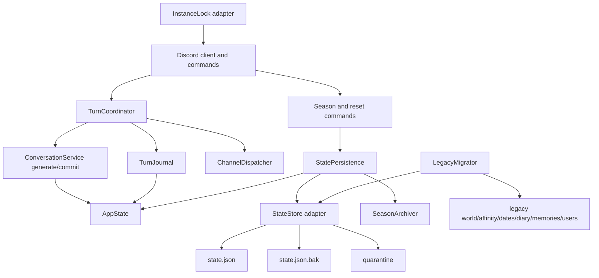
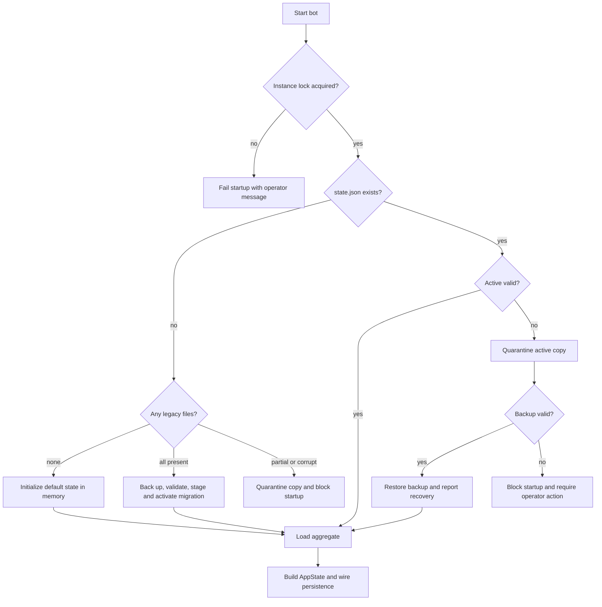
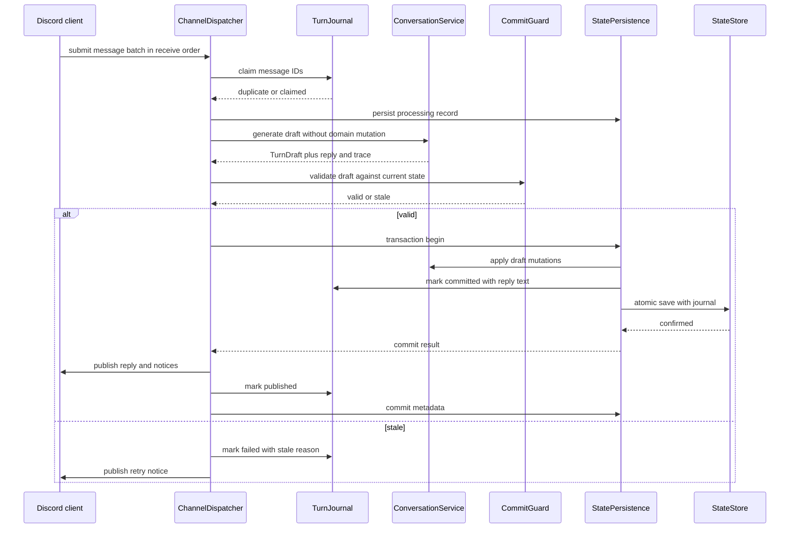
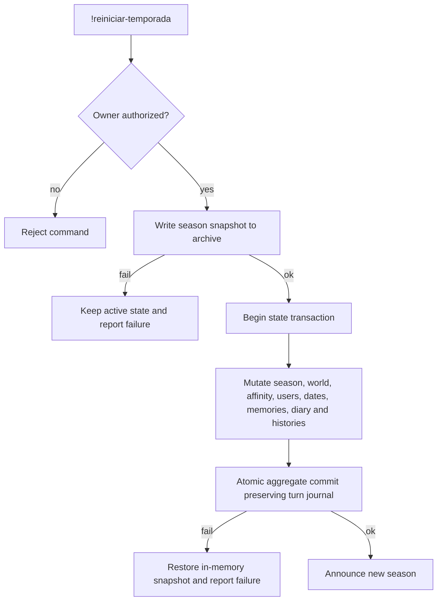
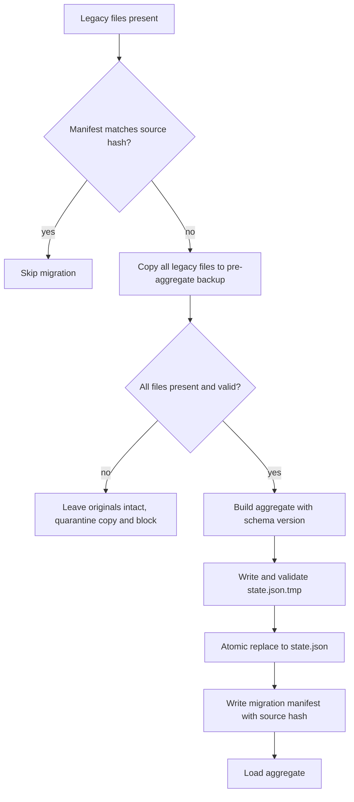
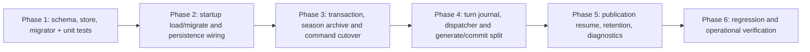

# Design Document

## Overview

**Purpose**: This feature delivers durable, recoverable and consistent state handling for Airi. A process crash, a damaged JSON file or two near-simultaneous events must not silently erase history, leave a partially applied season reset, or process the same conversation turn twice.

**Users**: The bot operator benefits from predictable recovery and actionable failures. Discord participants benefit from conversation continuity, ordered replies and the guarantee that Airi does not announce a change that was never persisted.

**Impact**: The current six-file persistence model is replaced by a canonical, versioned state aggregate managed by a dedicated persistence layer. The model generation path is separated from the state-mutation path so that slow LLM calls do not hold a global lock. A durable turn journal and a per-channel dispatcher are added. Legacy JSON files remain intact as the migration source and rollback baseline.

### Goals

- Make every committed state durable before its effects are announced.
- Recover the last valid state after corruption, or fail safely with an actionable operator message.
- Commit operations that touch multiple datasets as one logical result.
- Prevent duplicate turn processing after a restart and preserve per-channel order.
- Migrate existing `data/*.json` files without data loss and without introducing dependencies.
- Archive seasons before reset and bound backup growth.

### Non-Goals

- Multi-guild state isolation. `develop` remains a single authorized channel and a single logical state.
- Autonomous initiatives, Discord send reconciliation for initiatives, or any feature not present in `develop`.
- Personality, identity, romance or privacy-policy changes.
- A database engine, distributed transactions or multi-process federation.
- Recovery of GIF/embed formatting for a reply published after a crash. Text is preserved.

## Architecture

### Existing Architecture Analysis

The project follows a hexagonal structure:

- `domain/` contains pure rules and data transformations.
- `services/` orchestrates use cases without Discord imports.
- `adapters/` performs I/O.
- `discord_bot/` translates events and commands to Discord.
- `AppState` is a shared in-memory state object with injected `save_*` callbacks.

Current persistence constraints and debt:

- Production startup in `discord_bot/client.py` reads six JSON files directly and writes them with plain `open(..., "w")`.
- `adapters/json_repo.py` returns silent defaults for corrupt files and performs only `tmp + replace`, without schema validation, `fsync`, backups or quarantine.
- A single global `generation_lock` protects the whole turn, including the LLM network wait.
- `!reiniciar-temporada` writes world, affinity, users, dates, memories and diary independently. A failure can leave a mixed season.
- Histories and turn identity are not durable.
- There is no instance-level writer lock.
- No SDD steering files exist in `develop`; the branch's `.kiro/steering` documents are not part of the target architecture.

The design preserves the established dependency direction: domain has no I/O, services depend on ports, adapters implement ports, and Discord composition happens only in `discord_bot/client.py`.

### High-Level Architecture



**Architecture integration**:

- **Existing patterns preserved**: `AppState` remains the runtime boundary; `save_*` callbacks remain the mutation notification mechanism; services stay Discord-free; adapters own filesystem access.
- **New components rationale**:
  - `StateStore` centralizes validated atomic writes, backup rotation, quarantine and recovery.
  - `StatePersistence` converts `AppState` to and from the aggregate and provides multi-mutation transactions.
  - `TurnJournal` makes turn progress durable.
  - `ChannelDispatcher` enforces FIFO work per channel without a global generation lock.
  - `LegacyMigrator` performs a one-time, idempotent migration.
  - `SeasonArchiver` and `RetentionService` preserve and bound historical data.
  - `InstanceLock` prevents two processes from writing the same state.
- **Technology alignment**: Python 3.11 standard library only (`json`, `os`, `pathlib`, `fcntl`, `hashlib`, `dataclasses`, `enum`, `contextvars`). No new dependency is introduced.
- **Steering compliance**: no steering documents exist in `develop`; the design follows the repository's existing hexagonal conventions and `AGENTS.md` SDD workflow.

### Technology Alignment

| Concern | Current approach | Target approach | Alignment |
|---|---|---|---|
| State format | Six independent JSON files | One versioned aggregate `data/state.json` | Keeps JSON and current data shapes |
| Atomic write | `tmp + os.replace` | Validate, temp, `fsync`, rotate backup, `replace`, directory `fsync` | Extends existing primitive |
| Concurrency | One global `asyncio.Lock` | Per-channel FIFO + short commit lock | Removes unnecessary global wait |
| Deduplication | Debouncer in memory | Durable turn journal in the aggregate | Survives restart |
| Migration | None | Explicit, backed-up, idempotent migration | Preserves legacy files |
| Dependencies | Standard library | Standard library | No new dependencies |

### Key Design Decisions

#### Decision 1: Canonical single aggregate instead of a multi-file transaction

- **Context**: Requirement 3 needs all-or-nothing season resets, and requirement 4 needs a durable turn journal. The current six files cannot be replaced as one atomic operation; a journal spanning six files would require a write-ahead transaction coordinator.
- **Alternatives**:
  1. Keep six files and add a transaction manifest, staging directory and recovery replay.
  2. Replace JSON with SQLite.
  3. Consolidate the six datasets into one aggregate JSON.
- **Selected Approach**: Consolidate into `data/state.json`, with `state.json.bak` and quarantine. The JSON contains `world`, `affinity`, `dates`, `memories`, `diary`, `users`, `histories`, `turn_records` and metadata. Legacy files are read once by the migrator and then left untouched.
- **Rationale**: One file makes a domain commit a single atomic replacement. It removes the most failure-prone part of the current design without adding a database dependency. Data volume is small (well below a few hundred kilobytes), so full-file rewrites are acceptable.
- **Trade-offs**: Every save rewrites the whole state. This increases write cost compared with per-dataset files but simplifies correctness. SQLite would offer partial writes and stronger concurrency, but adds schema/migration complexity and changes the operability model.

#### Decision 2: Separate generation from commit, with a short commit lock

- **Context**: Requirement 5.3 forbids holding a global lock during a slow model call, but state mutations must not interleave or be applied against stale snapshots.
- **Alternatives**:
  1. Keep the existing global lock around the entire turn.
  2. Generate against a copy of the state and replace the state afterwards.
  3. Split the turn into a pure `generate` phase and a synchronous `commit` phase guarded by a state-version check.
- **Selected Approach**: `ConversationService` produces a `TurnDraft` without mutating domain state. `TurnCoordinator` then acquires a short-lived commit lock, validates the draft against the current state and applies all mutations plus the journal record in one persistence transaction. Discord publication occurs after the commit.
- **Rationale**: The model and network wait happen outside the mutation critical section. The commit lock is held only for synchronous in-memory changes and the atomic file write. A stale draft is rejected when the underlying date session or season changed while the model was running.
- **Trade-offs**: `ConversationService` must be refactored into generation and application steps. A rejected stale turn requires a user-visible retry message. The split must preserve trace information so replay continues to work.

#### Decision 3: Durable turn journal with at-least-once publication

- **Context**: Requirement 4 needs idempotency across restarts and a way to distinguish committed but unpublished replies. Discord and local storage cannot participate in a distributed transaction.
- **Alternatives**:
  1. Keep in-memory deduplication only.
  2. Use a separate database for turn records.
  3. Store turn records in the canonical aggregate and use a bounded publication outbox.
- **Selected Approach**: `TurnJournal` stores records in `state.json#turn_records` and indexes every contributing `message_id`. Statuses are `processing`, `committed`, `published` and `failed`. A committed record retains the reply text until publication is confirmed or the publication TTL expires. On startup, committed records within the TTL are republished to their original channel, then marked published.
- **Rationale**: The journal is committed in the same atomic write as the domain mutations. Duplicate messages are rejected before any model call. A crash between Discord send and the `published` mark can cause a rare duplicate publication, which is preferable to silently losing the reply.
- **Trade-offs**: Publication is at-least-once, not exactly-once. Resumed replies are text-only. Stale records are pruned and expired committed records are marked failed rather than published out of context.

## System Flows

### Startup, load and recovery



### Turn generation, commit and publication



### Season reset



### Legacy migration



## Requirements Traceability

| Requirement | Summary | Components | Interfaces | Flows |
|---|---|---|---|---|
| 1.1–1.5 | Safe writes, validation, durable distinction | `StatePersistence`, `StateStore`, `state_schema` | `save`, `commit`, `LoadResult` | Startup, turn commit |
| 2.1–2.5 | Corruption detection, quarantine, recovery | `StateStore`, diagnostics logging | `load`, `quarantine`, `StateBlockedError` | Startup recovery |
| 3.1–3.5 | Multi-dataset consistency and honest announcements | `StatePersistence`, `SeasonArchiver`, `TurnCoordinator` | `transaction`, `archive_and_reset` | Season reset, turn commit |
| 4.1–4.5 | FIFO order and durable idempotency | `ChannelDispatcher`, `TurnJournal`, `TurnCoordinator` | `submit`, `claim`, `mark_committed`, `mark_published` | Turn flow |
| 5.1–5.5 | Write concurrency, stale commit detection, single writer | `InstanceLock`, `StatePersistence`, `CommitGuard` | `acquire`, `transaction`, `validate` | Turn commit |
| 6.1–6.5 | Safe, idempotent migration and preservation | `LegacyMigrator`, `StateStore` | `plan`, `run`, `source_hash` | Migration |
| 7.1–7.4 | Archive, retention and traceability | `SeasonArchiver`, `RetentionService` | `archive`, `prune` | Season reset |

## Components and Interfaces

### Domain

#### State schema and validation (`domain/state_schema.py`)

**Responsibility & Boundaries**

- **Primary responsibility**: Define the canonical aggregate shape and validate loaded or staged data before it can become active.
- **Domain boundary**: Pure domain; no file access.
- **Data ownership**: Defines required keys, types and schema version rules.
- **Transaction boundary**: None; it is a validator.

**Contract definition**

```python
class ValidationResult:
    ok: bool
    errors: tuple[str, ...]

REQUIRED_STATE_KEYS: Mapping[str, type | tuple[type, ...]]
CURRENT_SCHEMA_VERSION: int

def validate_state(data: object) -> ValidationResult: ...
def validate_legacy_dataset(name: str, data: object) -> ValidationResult: ...
```

- **Preconditions**: `data` has been parsed from JSON.
- **Postconditions**: Every required key exists with the expected type; booleans are not accepted as integers; schema versions newer than the supported version are rejected.
- **Invariants**: Legacy dataset shapes remain interoperable: world/affinity/dates/memories/users are objects, diary is a list.

#### Turn records and draft contracts (`domain/turns.py`)

**Responsibility & Boundaries**

- **Primary responsibility**: Define turn statuses, keys, hashes and the immutable `TurnDraft` produced by generation.
- **Data ownership**: Status transitions and key construction; no persistence.
- **Transaction boundary**: Turn records are persisted by the aggregate store.

**State model**

```text
processing -> committed -> published
     |             |
     +-----------> failed
```

- `processing`: the message batch has been claimed and is being generated.
- `committed`: domain mutations and reply text are durable.
- `published`: Discord accepted the reply.
- `failed`: generation or validation failed, or a processing record was abandoned after a restart.

**Contract definition**

```python
class TurnStatus(str, Enum):
    PROCESSING = "processing"
    COMMITTED = "committed"
    PUBLISHED = "published"
    FAILED = "failed"

@dataclass(frozen=True)
class TurnRecord:
    turn_key: str
    channel_id: str
    message_ids: tuple[str, ...]
    status: TurnStatus
    reply_text: str
    created_at: float
    updated_at: float
    published_at: float | None
    failure_reason: str

class DateFingerprint(NamedTuple):
    scene: str
    started_at: float

@dataclass(frozen=True)
class TurnDraft:
    channel_id: str
    user_id: str
    messages: tuple[tuple[str, str], ...]
    history: tuple[Mapping[str, object], ...]
    season: int
    date_fingerprint: DateFingerprint | None
    answer: str
    output: ModelOutput
    gif_type: str
    gif_bytes: bytes | None
    web_context: str | None
    trace: TurnEvent

@dataclass(frozen=True)
class AppliedTurn:
    result: TurnResult
    notices: tuple[str, ...]
    date_event: str
    confession_winner: str
    trace: TurnEvent

def make_turn_key(channel_id: str, message_ids: Sequence[str]) -> str: ...
def hash_text(text: str) -> str: ...
def date_fingerprint(session: Mapping[str, object] | None) -> DateFingerprint | None: ...
```

The fingerprint uses the existing `scene` and `started_at` fields rather than adding a new persisted identifier to every date session. A reset, replacement or closure of the session changes the fingerprint or removes the session entirely, which makes the stale check deterministic without a date-schema migration.

#### Commit validation (`domain/turn_guard.py`)

**Responsibility & Boundaries**

- **Primary responsibility**: Decide whether a generated draft may be applied to the current state.
- **Data ownership**: No mutation.

**Contract definition**

```python
class GuardDecision(str, Enum):
    VALID = "valid"
    STALE_DATE = "stale_date"
    STALE_SEASON = "stale_season"

def validate_draft(draft: TurnDraft, state: AppState) -> GuardDecision: ...
```

- **Preconditions**: `draft` came from generation against the same user and channel.
- **Postconditions**: A stale date is detected when its session was closed or replaced; a stale season is detected when the season changed during generation.
- **Invariants**: The guard never mutates state.

### Services

#### `ConversationService` generation/application split (`services/conversation.py`)

**Responsibility & Boundaries**

- **Primary responsibility**: Generate a reply draft without mutating durable state, then apply the draft synchronously once the commit guard approves it.
- **Domain boundary**: Application service.
- **Data ownership**: Reads state to build the prompt; writes state only during application.
- **Transaction boundary**: Application runs inside the caller's state transaction.

**Contract definition**

```python
class StaleTurnError(RuntimeError): ...

class ConversationService:
    async def generate_turn(self, user: object, messages: Sequence[tuple[object, str]], ctx: TurnContext) -> TurnDraft: ...
    def apply_turn(self, draft: TurnDraft) -> AppliedTurn: ...
```

- **Preconditions**: `generate_turn` may read `AppState` but must not mutate any durable collection.
- **Postconditions**: `apply_turn` performs only synchronous in-memory mutations and returns the data required for Discord publication.
- **Invariants**:
  - During generation, user registration, default affinity creation, history append, memory writing, diary writing and date transitions are forbidden. The prompt uses read-only views of the current state and Discord display names.
  - `apply_turn` performs all domain mutations that previously occurred inside `run_turn`: user registration, affinity, memory, diary, history and date history.
  - Date advancement, date closure, diary close entries and relationship settlement move into the synchronous application step. Their user-visible notices and any confession text are returned for post-commit publication.
  - The memory-saved notice and search notice are separated. Search progress remains immediate; notices that assert a persisted effect are returned as `AppliedTurn.notices` and sent only after commit.
  - Trace snapshots continue to represent the pre-turn state, and the final trace is saved after the commit attempt.

#### `StatePersistence` (`services/persistence.py`)

**Responsibility & Boundaries**

- **Primary responsibility**: Own the bridge between `AppState`, the aggregate schema and `StateStore`.
- **Domain boundary**: Application service.
- **Data ownership**: Runtime snapshot and dirty/transaction state.
- **Transaction boundary**: A transaction covers all in-memory datasets and the durable aggregate write.

**Dependencies**

- **Inbound**: `discord_bot/client.py`, commands, `TurnCoordinator`.
- **Outbound**: `StateStorePort`, `StateSchema`, `AppState`.
- **External**: None.

**Contract definition**

```python
class SaveKind(str, Enum):
    DOMAIN = "domain"
    METADATA = "metadata"

class PersistenceError(RuntimeError): ...

class StatePersistence:
    def bind(self, state: AppState) -> None: ...
    def request_save(self) -> None: ...
    def transaction(self) -> ContextManager[None]: ...
    def save(self, *, kind: SaveKind = SaveKind.DOMAIN) -> None: ...
    def load(self) -> LoadResult: ...
```

- **Preconditions**: `bind` is called once during composition; the store is ready.
- **Postconditions**: A successful `save` writes a validated aggregate atomically. A failed save raises `PersistenceError` and leaves the previous state active.
- **Invariants**:
  - Outside a transaction, each `save_*` callback requests an immediate full-state save.
  - Inside a transaction, requests are coalesced and persisted once on success.
  - On transaction failure, the in-memory snapshot is restored and no write occurs.
  - `state_version` increments only for `DOMAIN` saves.
  - Metadata-only saves do not advance `state_version` but are still durable.
  - A transaction never spans an `await` and is entered only while holding the shared commit lock. This makes the context manager task-safe: no other task can mutate state during the critical section.
  - All direct mutations that previously called `save_*` are routed through `StatePersistence`; no production code writes state files directly.

#### `TurnJournal` (`services/turn_journal.py`)

**Responsibility & Boundaries**

- **Primary responsibility**: Own turn claims and status transitions in `AppState.turn_records`.
- **Data ownership**: Turn records and the message-index map.
- **Transaction boundary**: Journal mutations are included in the aggregate transaction performed by the caller.

**Contract definition**

```python
class ClaimResult(str, Enum):
    CLAIMED = "claimed"
    DUPLICATE = "duplicate"

class TurnJournal:
    def claim(self, channel_id: str, message_ids: Sequence[str], *, now: float) -> ClaimResult: ...
    def mark_committed(self, turn_key: str, reply_text: str, *, now: float) -> None: ...
    def mark_published(self, turn_key: str, *, now: float) -> None: ...
    def mark_failed(self, turn_key: str, reason: str, *, now: float) -> None: ...
    def pending_publications(self, *, now: float, ttl: float) -> tuple[TurnRecord, ...]: ...
    def abandon_stale_processing(self, *, now: float, ttl: float) -> int: ...
    def prune(self, *, now: float, retain_seconds: float) -> int: ...
```

- **Preconditions**: `claim` receives all message IDs in the batch.
- **Postconditions**: A duplicate batch is reported before any model call. A committed record always contains the exact text that will be published.
- **Invariants**:
  - `message_index[channel_id:message_id]` points to exactly one turn key.
  - A turn key is deterministic from the channel and the first message ID.
  - Published records may discard reply text after the configured retention period.
  - Processing records older than the TTL are never reprocessed automatically; they become `failed`.

#### `ChannelDispatcher` (`services/channel_queue.py`)

**Responsibility & Boundaries**

- **Primary responsibility**: Execute turn jobs in per-channel FIFO order and prevent duplicate submissions.
- **Data ownership**: In-memory queues; durable deduplication belongs to `TurnJournal`.
- **Transaction boundary**: None; it schedules work.

**Contract definition**

```python
class ChannelDispatcher:
    async def submit(self, channel_id: str, message_ids: Sequence[str], job: Callable[[], Awaitable[None]]) -> None: ...
    async def close(self, channel_id: str) -> None: ...
```

- **Preconditions**: Message IDs are unique Discord IDs.
- **Postconditions**: At most one job per channel executes at a time; jobs execute in submission order.
- **Invariants**: A failed job clears its queue slot and does not block later jobs indefinitely.

#### `TurnCoordinator` (`services/turn_coordinator.py`)

**Responsibility & Boundaries**

- **Primary responsibility**: Orchestrate claim, generate, validate, commit, publish and journal completion.
- **Domain boundary**: Application service; no Discord imports.
- **Transaction boundary**: Generation is outside the commit transaction; mutations and the journal commit are one transaction.

**Dependencies**

- **Inbound**: `discord_bot/turn.py`.
- **Outbound**: `TurnJournal`, `ConversationService`, `CommitGuard`, `StatePersistence`, publisher callback.
- **External**: None directly; the publisher callback is supplied by the Discord layer.

**Contract definition**

```python
@dataclass(frozen=True)
class CommittedTurn:
    turn_key: str
    reply_text: str
    gif_type: str
    notices: tuple[str, ...]
    trace: TurnEvent

class TurnCoordinator:
    async def execute(
        self,
        *,
        channel_id: str,
        user: object,
        messages: Sequence[tuple[object, str]],
        context: TurnContext,
        publisher: Callable[[CommittedTurn], Awaitable[None]],
    ) -> CommittedTurn | None: ...
```

- **Preconditions**: The caller already merged the debounce batch.
- **Postconditions**: Duplicate or stale turns do not mutate domain state. A successful turn has a durable `committed` record before `publisher` is called; afterwards it is marked `published`.
- **Invariants**: The commit lock is not held during generation or Discord network calls.

#### `LegacyMigrator` (`services/migration.py`)

**Responsibility & Boundaries**

- **Primary responsibility**: Convert the six legacy JSON files into the canonical aggregate exactly once.
- **Data ownership**: Migration manifest and backup location; legacy files remain read-only.
- **Transaction boundary**: Migration activation is a single atomic replacement of `state.json`.

**Contract definition**

```python
class MigrationStatus(str, Enum):
    MIGRATED = "migrated"
    ALREADY_MIGRATED = "already_migrated"
    NO_SOURCE = "no_source"
    BLOCKED = "blocked"

@dataclass(frozen=True)
class MigrationResult:
    status: MigrationStatus
    source_hash: str
    backup_dir: str
    quarantine_dir: str
    message: str

class LegacyMigrator:
    def plan(self) -> MigrationPlan: ...
    def run(self) -> MigrationResult: ...
```

- **Preconditions**: The instance lock is held and `state.json` is absent or invalid.
- **Postconditions**: On success, `state.json` is valid and loadable and all legacy originals are unchanged.
- **Invariants**: The same source hash is never migrated twice. Partial legacy datasets are not completed with inferred values.

#### `SeasonArchiver` and `RetentionService` (`services/season_archive.py`, `services/retention.py`)

**Responsibility & Boundaries**

- **Primary responsibility**: Snapshot a season before reset and prune old archives/backups within configured bounds.
- **Data ownership**: `data/archive/seasons/<season>/`.
- **Transaction boundary**: Archive creation must succeed before the active reset commit.

**Contract definition**

```python
class SeasonArchiver:
    def archive(self, *, season: int, aggregate: Mapping[str, object]) -> str: ...

class RetentionService:
    def prune(self, *, now: float | None = None) -> RetentionReport: ...
```

- **Preconditions**: The active state is loadable and the season number is known.
- **Postconditions**: The archive contains a complete valid snapshot and a metadata record.
- **Invariants**: Retention never deletes the active state, its `.bak`, the migration staging area or a pending publication record.

### Adapters

#### `StateStore` (`adapters/state_store.py`)

**Responsibility & Boundaries**

- **Primary responsibility**: Implement validated atomic reads, writes, backup rotation, quarantine and recovery.
- **Data ownership**: `state.json`, `state.json.bak`, `state.json.tmp`, quarantine files.
- **Transaction boundary**: One call to `save` is one atomic replacement.

**Contract definition**

```python
class LoadStatus(str, Enum):
    OK = "ok"
    MISSING = "missing"
    INVALID = "invalid"
    BLOCKED = "blocked"

@dataclass(frozen=True)
class LoadResult:
    status: LoadStatus
    data: Mapping[str, object] | None
    recovered: bool
    quarantine_path: str
    error: str

class SaveResult:
    ok: bool
    path: str
    state_version: int
    error: str

class StateStorePort(Protocol):
    def load(self) -> LoadResult: ...
    def save(self, aggregate: Mapping[str, object]) -> SaveResult: ...
    def quarantine(self, path: str) -> str: ...
```

**Algorithm requirements**

1. Validate the aggregate before touching the filesystem.
2. Write `state.json.tmp` with UTF-8 JSON, flush, and `os.fsync` the file descriptor.
3. If the active file is valid, write its exact bytes to `state.json.bak.tmp`, `fsync`, then `os.replace` to `.bak`.
4. `os.replace(state.json.tmp, state.json)`.
5. Best-effort `fsync` of the parent directory.
6. If any step fails, raise `AtomicWriteError` and leave the previous active file intact.
7. On load, an invalid active file is copied to quarantine before recovery is attempted.
8. If active and backup are both invalid, return `BLOCKED`; never return empty defaults for an existing file.

#### `InstanceLock` (`adapters/instance_lock.py`)

**Contract definition**

```python
class InstanceLock:
    def acquire(self) -> None: ...
    def release(self) -> None: ...
```

- Uses `fcntl.flock` with `LOCK_EX | LOCK_NB` on `data/.airi.lock`.
- Writes the current PID and start time after acquisition.
- Raises `InstanceAlreadyRunningError` with the owner PID when the lock is held.
- Releases in a `finally` block during shutdown.

#### Legacy reader (`adapters/legacy_state.py`)

- Reads `world.json`, `affinity.json`, `dates.json`, `diary.json`, `memories.json` and `users.json` from `data_dir`.
- Returns raw parsed values plus per-file diagnostics.
- Does not mutate or rename source files.
- Uses strict JSON parsing; malformed files produce an error, not a default.

#### Existing `json_repo.py`

- Remains available for non-state uses.
- Its silent-default behavior is not used by state loading. A deprecation note is added to the module docstring.
- Trace storage continues to use its existing atomic write path.

### Discord Layer

#### `discord_bot/client.py`

- Becomes the composition root for `Settings`, `InstanceLock`, `StateStore`, `LegacyMigrator`, `StatePersistence`, `TurnJournal`, `ChannelDispatcher` and `TurnCoordinator`.
- Replaces direct JSON reads and writes with `StatePersistence`.
- Builds `AppState` from the loaded aggregate.
- Wires each `save_*` callback to `persistence.request_save`.
- On ready, abandons stale processing records and resumes committed publications within the TTL.
- Releases the instance lock in a `finally` block.

#### `discord_bot/turn.py`

- Submits merged message batches to `ChannelDispatcher`.
- Uses `TurnCoordinator` for generation and commit.
- Sends the reply, GIF and post-commit notices only after the commit succeeds.
- On stale or persistence failure, sends an honest failure message rather than pretending the action happened.

#### `commands/season.py`

- Wraps the full reset in `StatePersistence.transaction`.
- Creates the season archive before mutating state.
- Announces the new season only after the commit succeeds.
- On failure, restores the in-memory snapshot and reports the error without changing the visible season.

## Data Models

### Canonical aggregate (`data/state.json`)

```text
StateAggregate
  schema_version: int
  state_version: int
  world: object
  affinity: object
  dates: object
  memories: object
  diary: list
  users: object
  histories: object
  turn_records: object
  message_index: object
  archive: object
```

- `schema_version` identifies the aggregate format.
- `state_version` increments on each domain commit.
- `histories` becomes durable.
- `turn_records` and `message_index` implement idempotency.
- `archive` records the last archived season and path, not the archive contents.

### Legacy mapping

| Legacy file | Aggregate field | Validation |
|---|---|---|
| `world.json` | `world` | object |
| `affinity.json` | `affinity` | object |
| `dates.json` | `dates` | object |
| `diary.json` | `diary` | list |
| `memories.json` | `memories` | object |
| `users.json` | `users` | object |
| not persisted | `histories` | empty object |
| new | `turn_records` | empty object |
| new | `message_index` | empty object |

No user, affinity or narrative record is rewritten during migration; the values are moved as-is.

### Turn record

```text
turn_key: "{channel_id}:{first_message_id}"
channel_id: string
message_ids: list of strings
status: processing | committed | published | failed
reply_text: string
reply_hash: string
created_at: float
updated_at: float
published_at: float | null
failure_reason: string
```

- Reply text is retained while status is `committed` and for a bounded audit window after `published`.
- The message index is keyed by `"{channel_id}:{message_id}"`.

### Files and directories

```text
data/
  state.json
  state.json.bak
  state.json.tmp
  migration.json
  .airi.lock
  backups/
    pre-aggregate-<timestamp>/
  quarantine/
    <timestamp>-<name>.json
  archive/
    seasons/
      <season>/
        state.json
        meta.json
```

### Error and recovery states

| Condition | Result | User/operator effect |
|---|---|---|
| Active valid | `OK` | Normal startup |
| Active missing, backup valid | `OK`, `recovered=true` | Restore backup, log warning |
| Active invalid, backup valid | `OK`, `recovered=true` | Quarantine active, restore backup |
| Active and backup invalid | `BLOCKED` | Startup fails; operator must inspect quarantine |
| Legacy complete and valid | `MIGRATED` | Aggregate activated; legacy files untouched |
| Legacy partial or corrupt | `BLOCKED` | Startup fails; no guessed values |
| Write failure | `AtomicWriteError` | Previous state remains active; caller reports failure |
| Second process | `InstanceAlreadyRunningError` | Startup fails with owner PID |
| Stale turn draft | `STALE_*` | No mutation; reply asks the user to repeat |
| Publication expired | `failed` | Reply is not published after the TTL |

## Error Handling

### Error strategy

Fail closed for state integrity. Never replace an unreadable existing state with defaults. Report failures at the layer that can act on them:

- The store raises typed errors with paths and causes.
- Persistence converts store failures into `PersistenceError`.
- Commands and turns catch `PersistenceError` and send an explicit failure message.
- Startup failures log a single actionable block with the quarantine/backup path and terminate cleanly.

### Error categories

| Category | Examples | Response |
|---|---|---|
| Missing on first run | All state files absent | Initialize in memory; persist on first mutation |
| Corruption | Invalid JSON, wrong types, newer schema | Quarantine, try backup, otherwise block |
| I/O failure | `OSError`, `fsync` failure, `replace` failure | Keep previous active file; raise |
| Concurrency | Instance lock busy, stale commit | Refuse second writer; reject stale draft |
| Migration | Partial legacy set, unsupported shape | Back up, quarantine, block without activation |
| Publication | Discord send failure, expired pending reply | Keep committed within TTL; retry on ready; expire to failed |
| Retention | Unable to remove old archive | Log and continue; never remove protected artifacts |

### Monitoring and diagnostics

- Startup logs: active path, schema/state version, recovered flag, quarantine path, migration status.
- Every write failure logs the operation kind, path and exception class.
- Every stale turn logs the turn key and guard decision.
- No diary, memory or reply contents are written to error logs.
- `!debug` may include aggregate path, schema version, state version, counts and pending publication count; it must not print private entries.
- Error reports include the quarantine and backup directory paths for operator recovery.

## Testing Strategy

### Unit tests

1. `test_state_schema.py`: valid aggregate; missing required key; wrong type; boolean rejected for integer; newer schema rejected; legacy dataset types.
2. `test_state_store.py`: successful atomic save; failure injected at temp write, backup rotation, `replace` and directory `fsync`; active state remains valid; corrupt active with valid backup restores and quarantines; both invalid returns `BLOCKED`.
3. `test_state_persistence.py`: immediate save outside transaction; coalesced single save inside transaction; rollback restores all datasets; domain vs metadata version behavior.
4. `test_migration.py`: full legacy migration; missing file blocks; corrupt file blocks and preserves originals; source hash prevents second migration; manifest mismatch re-plans safely.
5. `test_turn_journal.py`: claim, duplicate claim, message-index integrity, committed/published transitions, stale processing abandonment, TTL expiry and pruning.
6. `test_turn_guard.py`: valid draft; date session replaced; season changed.
7. `test_instance_lock.py`: second acquire fails; release allows reacquire; lock file contains owner PID.
8. `test_retention.py`: keeps newest archive count, never deletes active/bak/migration staging, idempotent rerun.

### Integration tests

1. Cold start with all six legacy files migrates to a valid aggregate and builds `AppState`; source files remain unchanged.
2. Restart with a committed turn record does not call the model again or duplicate history.
3. Crash simulation after commit and before publication: `on_ready` republishes the stored text once and marks it published.
4. Season reset archives first and commits one state version; a simulated write failure leaves the previous season and data intact and sends no success announcement.
5. Corrupt active with valid backup recovers at startup; both corrupt fail with an actionable error and no overwrite.
6. Concurrent channel jobs preserve per-channel order and do not block on a slow model call from another channel.
7. A season change during generation causes a stale guard decision and no date mutation.

### Regression and end-to-end

- All existing unit, integration and transcript regression tests must pass unchanged.
- Replay continues to reconstruct turns from persisted traces.
- The existing naturalness/date-question behavior is preserved.

### Test infrastructure

- Use `tmp_path` for all filesystem tests.
- Use a fake clock for TTL and retention.
- Inject a store spy to assert one write per transaction.
- Fault injection uses monkeypatching of `os.replace`, `os.fsync` and file writes; no real disk failure is required.

## Migration Strategy

### Phases



1. **Phase 1**: Add pure schema, domain turn records and the store adapter. No runtime wiring.
2. **Phase 2**: At startup, acquire the instance lock, load `state.json` or run migration, and build `AppState`. Keep legacy files untouched.
3. **Phase 3**: Switch `save_*` callbacks to the persistence layer. Wrap season reset in a transaction and add archiving.
4. **Phase 4**: Add the journal, dispatcher and the generate/commit split. The old global generation lock is removed.
5. **Phase 5**: Resume pending publications, enforce retention and expose storage diagnostics.
6. **Phase 6**: Run the full suite and a manual cold-start check against a copy of the current `data/` directory.

### Cutover checklist for direct mutation sites

The implementation must audit every direct state mutation before Phase 3 completes:

- `services/conversation.py`: user registration, affinity, memory, diary, history and date history.
- `services/date_service.py`: date advancement, last-chance affinity recovery and closure.
- `discord_bot/turn.py`: date question resolution and any direct saves.
- `discord_bot/client.py`: `settle_relationship`, confession and crown locking.
- `commands/season.py`: all season-reset datasets.
- `commands/memories.py`, `commands/gifts.py` and any other command that calls `save_*`.

Each site must either run inside `StatePersistence.transaction` or make exactly one explicit persistence request. No site may write state files directly.

### Rollback triggers and procedure

- **Trigger**: Any migration validation failure, startup block, or regression that cannot be resolved within the release.
- **Procedure**:
  1. Stop the bot.
  2. Restore the six legacy files from `data/backups/pre-aggregate-<timestamp>/` if they were changed manually.
  3. Revert the code to the pre-cutover commit.
  4. Start the old version; it reads the legacy files again.
- **Limitation**: Changes committed to `state.json` after cutover are not automatically reflected in legacy files. Rollback returns to the pre-migration snapshot plus any manual export. This limitation is documented for the operator.
- **Migration safety**: Originals remain untouched and a backup is verified before activation; a failed migration never activates a partial aggregate.

## Security Considerations

- The aggregate contains personal diary entries, memories and user identifiers. `state.json`, `.bak`, backups and quarantine files are created with owner-only permissions (`0600` where supported).
- Error logs and diagnostics never include private text; only paths, statuses and counts.
- Quarantine and backup directories are local; no remote copy is introduced.
- The instance lock prevents accidental concurrent writers but is not an authentication mechanism.
- Operational artifacts (`state.json`, its temporary/backup copies, migration manifest, quarantine, backups, archive and instance lock) are added to `.gitignore`; existing tracked legacy files are not removed by this feature.
- Retention limits the lifetime of archived personal data; deletion tooling is out of scope and must be coordinated with the existing `!olvidar` behavior in a later feature.

## Performance and Scalability

- The state is small enough for full-file rewrites. One domain commit per turn and one metadata commit after publication are acceptable.
- `fsync` adds latency at commit, not during model generation.
- FIFO queues are per channel, so a slow model in one channel does not block another channel in the design. The current deployment still configures one authorized channel.
- Turn-record pruning bounds the aggregate size. If the state grows beyond the configured operational threshold, the design can be revisited with a database; this is outside the current scope.
