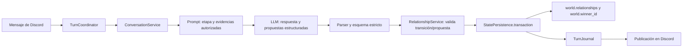
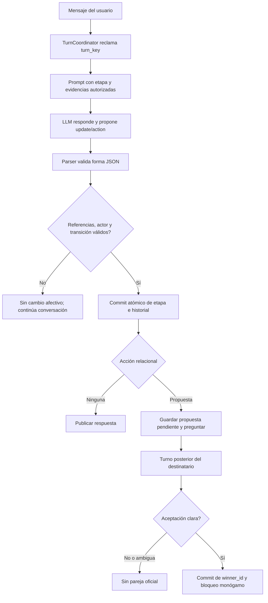

# Diseño técnico: relación romántica natural basada en evidencia

## Resumen

La feature permite que Airi mantenga conversación cotidiana sin perseguir una pareja y que sus sentimientos románticos evolucionen a partir de interacciones concretas que pueda recordar. La afinidad seguirá midiendo cercanía y podrá habilitar citas o una propuesta, pero no producirá por sí sola un cambio afectivo ni una pareja oficial.

El modelo propondrá cambios estructurados; el dominio decidirá si son admisibles y la persistencia existente confirmará el resultado. Las preguntas románticas de una cita serán opcionales. Una propuesta de pareja quedará pendiente hasta que la persona destinataria la acepte de forma explícita.

## Objetivos

- Separar la afinidad numérica, la etapa romántica por usuario y la pareja oficial.
- Vincular cada transición romántica con evidencia de interacciones recuperables y una razón breve.
- Mantener la conversación normal como comportamiento predeterminado y retirar la pregunta de cita forzada.
- Hacer que solo una aceptación recíproca establezca la pareja oficial.
- Reutilizar el agregado, las transacciones, el diario, el historial y el contrato JSON existentes.

## No objetivos

- Cambiar el modelo base, inyectar vectores de activación o añadir dependencias externas.
- Hacer que Airi piense o hable de romance en cada turno.
- Reemplazar el sistema completo de afinidad, citas, monogamia o persistencia.
- Convertir una transición narrativa en una afirmación de conciencia real: el sistema mantiene continuidad de personaje simulada.

## Análisis de la arquitectura existente

- `ConversationService.generate_turn` construye el prompt dinámico y parsea una respuesta JSON estricta. `apply_turn` aplica efectos de dominio.
- `TurnCoordinator` reclama el mensaje y, bajo `commit_lock` y `StatePersistence.transaction`, valida y confirma los efectos antes de publicar. Es el punto de consistencia que se reutilizará.
- `AppState.world` se persiste como parte del agregado `state.json`; actualmente contiene `winner_id` y `relationship_started_at`. `AppState.affinity` contiene una entrada numérica por usuario.
- `AFFINITY_LEVELS` mezcla niveles sociales con “Interés”, “Enamorada” y “Novios”; `can_date` depende de esos nombres. `maybe_crown_winner` selecciona automáticamente una pareja al alcanzar `CONFESS_THRESHOLD`, y `settle_relationship` publica la confesión.
- `DATE_QUESTION_FORCE_TURN` y `DATE_QUESTION_FALLBACK` fuerzan una pregunta decisiva durante una cita aunque Airi no la haya propuesto.
- `self_update` modifica la identidad global de Airi. Los sentimientos hacia una persona son estado relacional por usuario y no deben guardarse ahí.
- `TurnJournal` dispone de una clave estable por mensaje/canal, mientras que el historial conversacional es limitado. La relación conservará referencias y resúmenes compactos; no dependerá exclusivamente del historial reciente.
- No hay steering documents en `.kiro/steering/`; se respetan las capas y transacciones existentes del código.

## Arquitectura propuesta



El flujo conserva generación y efectos separados: el LLM propone en `generate_turn`; el dominio valida y modifica estado en `apply_turn`, dentro del commit existente. Un candidato rechazado no cambia la relación. La publicación de una confesión solo se reanuda desde un turno ya confirmado.

### Decisiones de diseño

#### 1. El estado romántico es distinto de afinidad e identidad

Se mantiene el mapa de afinidad numérica, pero se introduce una etapa romántica independiente por usuario dentro de `world.relationships[user_id]`. Las etapas iniciales propuestas son `none`, `curiosity`, `interest` y `enamored`. El estado formal de pareja continúa siendo `world.winner_id`, separado de esas etapas.

Los puntos podrán seguir sirviendo como condición de elegibilidad —por ejemplo, para iniciar una cita o permitir una propuesta—, pero nunca bastarán para avanzar una etapa o fijar `winner_id`. Los niveles visibles derivados de afinidad se limitarán a cercanía social; el tono romántico se guiará por la etapa separada.

#### 2. El LLM propone; el dominio valida

El contrato JSON añadirá dos objetos con sentinels neutros:

- `romantic_update`: etapa propuesta, `evidence_kind`, razón breve y referencias de evidencia. El sentinel representa “sin cambio”.
- `relationship_action`: acción `none`, `propose`, `accept`, `decline` o `unclear`, con razón y referencias. El sentinel representa “sin acción”.

El parser normaliza tipos, longitudes y catálogos. Un nuevo `RelationshipService` (fachada pequeña sobre funciones puras de `domain.relationships`) valida usuario, etapa vigente, referencias disponibles, elegibilidad y pareja oficial. La validación no interpreta `affinity_delta` como cambio de sentimientos. Un turno sin candidato válido continúa normalmente.

La transición solo puede avanzar un nivel por commit y debe traer al menos una evidencia autorizada y una razón no vacía. `evidence_kind` usa un catálogo de eventos significativos (por ejemplo, apoyo concreto, respeto de límites, detalle recordado, experiencia compartida o reconciliación). Mensajes de frecuencia, instrucciones para “enamorarse” y cumplidos genéricos no son categorías admisibles por sí solas. La validación mecánica comprueba catálogo, referencias, pertenencia y precondiciones; la calidad semántica de la clasificación se cubre con evaluaciones multi-turno y casos adversariales, ya que el código no puede demostrar por sí solo que una interpretación emocional sea genuina.

#### 3. Evidencia durable y mínima

Cada transición aceptada guarda, en el historial romántico de ese usuario:

- identificador de transición;
- etapa anterior y nueva;
- una o más referencias a turnos/eventos confirmados;
- resumen breve de lo vivido y razón de Airi;
- fecha y temporada.

`TurnCoordinator` pasará el `turn_key` reclamado a `TurnContext`; la vista del prompt ofrecerá ese identificador para anclar una evidencia del turno actual y los identificadores de evidencias románticas previas. El estado no guardará la transcripción completa de mensajes como duplicado. Las referencias se limitan al mismo usuario y al ámbito de estado configurado.

El resumen de evidencia debe describir un hecho recuperable, no inventar una biografía. Si no hay referencia válida o no se puede recuperar el contexto, el dominio rechaza la transición y Airi no afirma haber cambiado de sentimientos.

#### 4. La pareja formal requiere propuesta y aceptación

Una acción `propose` solo se acepta si Airi ya estaba en `enamored` antes del turno actual, existe evidencia válida y no hay otra pareja oficial. No se permite avanzar a `enamored` y proponer pareja en el mismo turno: la etapa afectiva debe existir antes de una decisión posterior de formalizar la relación. Se guarda una propuesta pendiente para el destinatario y se publica el mensaje de Airi; `winner_id` todavía no cambia.

En un turno posterior, `accept` solo es válido si hay propuesta pendiente para el autor actual y la respuesta expresa aceptación. `decline` cierra la propuesta sin pareja oficial; `unclear` o cualquier respuesta ajena a la propuesta no cambia el estado. Solo la aceptación válida confirma `winner_id` y activa el bloqueo monógamo existente. Una negativa no autoriza a Airi a insistir ni a presentar a la persona como pareja.

La comprobación semántica de aceptación la propone el LLM en el campo estructurado; el dominio impone la existencia de propuesta pendiente, identidad del destinatario y transición permitida. Si la respuesta es ambigua, no hay coronación.

#### 5. Afinidad y citas no fuerzan romance

`CONFESS_THRESHOLD` deja de disparar `maybe_crown_winner`; si se conserva, solo será un límite de elegibilidad junto con etapa y evidencia. Los llamadores de `settle_relationship` en turnos y regalos ya no coronan por puntuación.

Se mantiene la pregunta decisiva como una posibilidad de una sola vez por cita, pero se elimina el fallback automático por `DATE_QUESTION_FORCE_TURN`. `DateService` avanzará y cerrará la cita por sus límites actuales aunque no haya pregunta. Las sesiones antiguas se normalizan sin invalidar citas abiertas; los campos históricos de pregunta forzada se ignoran para nuevos turnos.

## Componentes e interfaces

### Dominio de relaciones: `airi.domain.relationships`

- **Responsabilidad:** catálogo de etapas, normalización de registros, construcción de transiciones y validación de propuestas/aceptaciones.
- **Estado:** puro; no importa Discord, HTTP ni filesystem.
- **Contratos conceptuales:**
  - `normalize_relationship(record) -> RelationshipState`
  - `validate_update(current, candidate, evidence_refs, context) -> RelationshipDecision`
  - `apply_update(current, decision, now) -> RelationshipState`
  - `validate_action(current, action, actor_id, evidence_refs) -> RelationshipDecision`
- **Invariantes:** etapa válida; evidencia no vacía para cambios; una sola etapa por transición; no hay pareja oficial antes de aceptación mutua.

### Orquestación: `ConversationService` y `RelationshipService`

- `ConversationService._generate` recibe la etapa y evidencias compactas del interlocutor actual y añade al prompt instrucciones de naturalidad/romance contextual.
- `ModelOutput` y `RESPONSE_SCHEMA` incluyen `romantic_update` y `relationship_action`, ambos con sentinels explícitos requeridos por el modo JSON estricto.
- `ConversationService.apply_turn` aplica afinidad como ahora y luego solicita validación de candidatos relacionales; solo aplica transiciones válidas y añade el resultado al `TurnResult`/traza.
- Los cambios, historial romántico y `winner_id` se confirman en la transacción existente de `TurnCoordinator`; no se escriben por separado.
- `TurnCoordinator` aporta `turn_key` a `TurnContext` y comprueba que el estado relacional usado durante la generación no cambió antes del commit. Si cambió, descarta el borrador mediante el guard de turno ya existente o su extensión.

### Persistencia: `AppState.world` y `StatePersistence`

Se añade un mapa opcional `world.relationships`, indexado por identificador de usuario. No se crea un almacén ni un archivo nuevos: `world` ya forma parte del agregado atómico. Se amplía la validación anidada del estado para validar etapas, historial de transiciones y propuestas pendientes.

Esquema conceptual por usuario:

```json
{
  "stage": "none",
  "history": [],
  "pending_proposal": null
}
```

Cada elemento de `history` guarda `id`, `from`, `to`, `evidence_kind`, `reason`, `evidence_refs`, `evidence_summary`, `season` y `created_at`. Una propuesta pendiente guarda `target_user_id`, `evidence_refs` y `created_at`. El dato de pareja oficial permanece en `world.winner_id`.

### Prompt y capa Discord

- `SYSTEM_PROMPT` se reescribe para describir a Airi como personaje/compañera cuya vida conversacional no tiene como objetivo conseguir pareja.
- `affinity_prompt_section` guía cercanía social, no enamoramiento. Una nueva `romantic_relationship_section` presenta etapa y evidencias de la persona actual sin exponer datos ajenos.
- `relationship_status_section` distingue soltería, etapa afectiva y pareja oficial; no afirma “abierta a conocer a alguien” como objetivo por defecto.
- `date_context_section` indica que la pregunta decisiva es opcional; `DATE_QUESTION_FORCE_TURN`, `should_force_question` y `DATE_QUESTION_FALLBACK` dejan de forzarla.
- `client.settle_relationship` se sustituye por la aplicación de acciones relacionales confirmadas; la emisión de la confesión se limita a una propuesta válida y la actualización de `winner_id` a una aceptación confirmada.

## Flujo relacional



## Trazabilidad de requisitos

| Requisito | Componentes principales | Verificación prevista |
|---|---|---|
| 1. Conversación no centrada en romance | `prompts.py`, `relationship_status_section` | escenarios casuales/factuales sin coqueteo ni preguntas románticas |
| 2. Separación de afinidad y pareja | `affinity.py`, `relationships.py`, `client.py` | cruzar umbral o regalar no altera etapa ni `winner_id` por sí solo |
| 3. Cambios con evidencia | `relationships.py`, `TurnJournal`, `ConversationService` | refs válidas permiten transición; refs ausentes/ajenas/generic-only la rechazan |
| 4. Pregunta opcional | `dates.py`, `DateService`, `turn.py`, prompts | la cita continúa y cierra sin fallback si no hay pregunta |
| 5. Continuidad | `AppState.world`, `StatePersistence`, prompt relacional | reinicio conserva etapa/evidencias; el modelo no inventa motivos |
| 6. Evaluación multi-turno | fixtures de narrativa y runner existente | 0 preguntas románticas en turnos neutrales marcados y 0 transiciones sin evidencia |

## Migración y compatibilidad

- Registros sin `world.relationships` se inicializan con etapa `none`; los puntos de afinidad heredados nunca se convierten automáticamente en interés o enamoramiento.
- Si ya existe `world.winner_id`, se conserva la pareja oficial existente y se inicializa su etapa como `enamored` con origen `legacy`, sin crear una transición ni fabricar un motivo/evidencia histórica. El prompt comunica que la pareja está confirmada, pero no inventa por qué surgió el enamoramiento.
- Sesiones de cita antiguas mantienen su pregunta ya pendiente; los campos `question_forced`/`question_asked_at` se toleran al cargar. Para citas nuevas no se crea pregunta de reserva.
- Reinicio de temporada integra el nuevo historial con el archivado existente, cancela propuestas pendientes y aplica la misma regla vigente de reinicio de pareja/afinidad. No se presenta una propuesta de temporada anterior como pendiente en la nueva.

## Manejo de errores y seguridad

- Candidato mal formado, referencia inexistente, referencia de otro usuario o transición ilegal: registrar diagnóstico en traza y continuar sin mutación relacional.
- Falla de persistencia durante el commit: la transacción revierte etapa, historial, propuesta y pareja; no se publica el cambio como confirmado.
- Solo se incluyen evidencias disponibles para la persona y ámbito de estado actuales. No se envían al modelo recuerdos privados de otras personas.
- No se publica que “somos pareja” antes de que `winner_id` se confirme. Si el texto afirma un estado formal incompatible, se revalida o repara antes de publicar.

## Estrategia de pruebas

### Unitarias

- Etapas válidas, orden de transición, default `none` y normalización de estados antiguos.
- Rechazo de transición sin motivo, sin evidencia, con evidencia inexistente o atribuida a otro usuario.
- Puntos de afinidad y etiquetas sociales no cambian `romantic_stage` ni `winner_id`.
- Una propuesta requiere etapa `enamored` ya confirmada antes del turno; no se combina la transición inicial a enamoramiento con la propuesta.
- Aceptar sin una propuesta pendiente se ignora.
- Respuestas ambiguas o negativas no establecen pareja; una aceptación válida solo cambia el ganador una vez.
- Parser/schema de `romantic_update` y `relationship_action`, incluidos sentinels.

### Integración

- `generate_turn` recibe solo estado/evidencia del usuario actual; `apply_turn` confirma una transición válida dentro de `StatePersistence.transaction`.
- Dos borradores concurrentes con la misma evidencia no duplican la transición; un borrador relacional obsoleto se rechaza.
- Reinicio conserva las transiciones confirmadas y la operación de temporada archiva/cancela lo que corresponda.
- Cita que termina sin pregunta, pregunta opcional única y aceptación/rechazo de propuesta por el destinatario correcto.

### Evaluación narrativa multi-turno

- Escenarios: conversación neutral, saludo, tema factual, halagos genéricos repetidos, petición directa de enamoramiento, apoyo concreto, recuerdo de una preferencia, desacuerdo y reconciliación, cita con y sin pregunta, propuesta aceptada, rechazada y ambigua.
- Mantener el mismo modelo, temperatura, prompts y número de repeticiones entre baseline y candidata.
- Reportar tasa de preguntas románticas no solicitadas en turnos neutrales, transiciones sin evidencia (debe ser 0), coherencia de etapa/razón, falsa declaración de pareja y naturalidad evaluada con revisión humana. El juicio automático no será la única evidencia de calidad.

## Decisiones y riesgos

- **No usar la afinidad como estado emocional:** evita el comportamiento actual que culmina en coronación automática por `CONFESS_THRESHOLD`; trade-off: la progresión requiere más estado y validación.
- **Estado en el agregado existente:** evita una segunda fuente de verdad y aprovecha el commit atómico; requiere ampliar validación anidada y migración del mundo.
- **Referencias estables más resumen mínimo:** permiten continuidad después de truncar historial sin duplicar transcripciones; `evidence_kind` y la referencia son datos propuestos por el LLM, por lo que se requiere evaluación para detectar clasificaciones semánticas erróneas.
- **Consentimiento de pareja interpretado en salida estructurada:** se valida contra una propuesta pendiente y el autor actual. El riesgo de clasificación errónea se mitiga dejando estados ambiguos sin cambio y probando respuestas naturales.
- El runtime actual autoriza un solo `CHANNEL_ID` y usa un único `AppState`/`world`. El diseño conserva una pareja por ese ámbito (que hoy equivale al servidor del canal autorizado); no añade ejecución multi-guild en una instancia. Si el producto requiere varios servidores por proceso, la partición por `guild_id` debe definirse como cambio separado antes de implementar este requisito.
