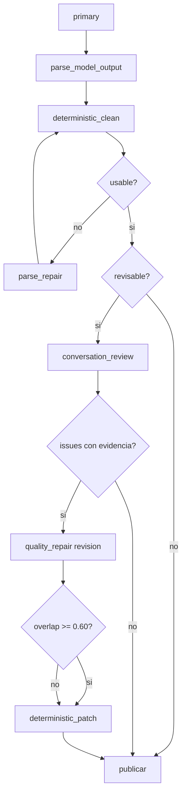
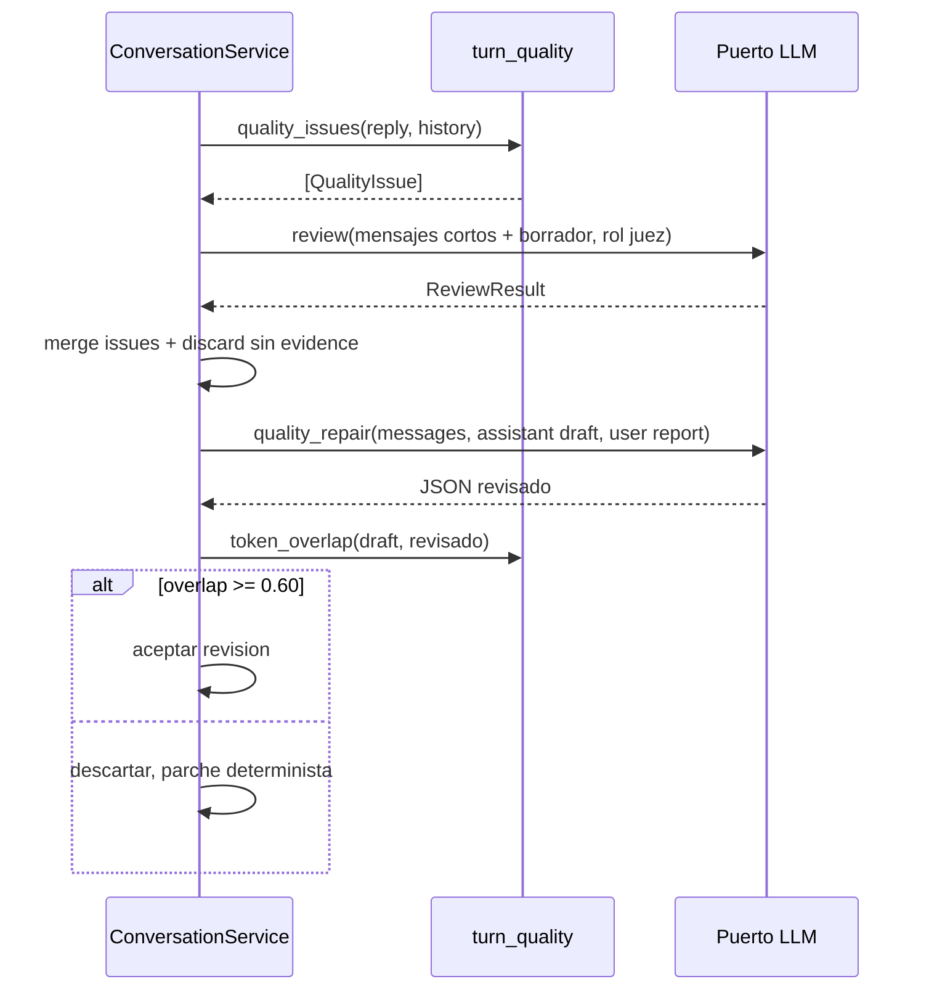
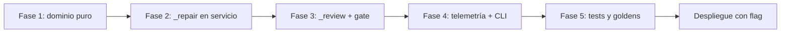

# Design Document

## Overview

**Purpose**: Sustituir las cinco reparaciones independientes del turno por dos políticas (`parse_repair`, `quality_repair`), añadir un verificador semántico (`conversation_review`) y un conjunto de parches deterministas, reduciendo el peor caso de latencia y cubriendo la coherencia del hilo conversacional.

**Users**: Los usuarios del canal de Discord perciben respuestas coherentes con el hilo y con el interlocutor correcto. El mantenedor obtiene un flujo de reparación único, testeable y observable.

**Impact**: `ConversationService.generate_turn` pierde cinco bloques de reparación y gana un pipeline lineal con presupuesto acotado. `domain/` gana `turn_quality.py`. `TurnEvent` gana campos de revisión. Se eliminan cinco constantes de prompt y se sustituyen por dos plantillas.

### Goals

- Peor caso de llamadas por turno: 1 primaria + 1 `parse_repair` + 1 `conversation_review` + 1 `quality_repair`.
- Un único punto de decisión de reparación, sin `try/except` duplicados.
- Coherencia de hilo verificada con evidencia literal, fail-open.
- Cero regresiones en silencio deliberado de modo sesión, citas y turnos rápidos.

### Non-Goals

- Reintentos de red o backoff en `http_llm.py`.
- Fallback en personaje cuando el servidor cae.
- Verificación de alucinaciones de memoria/RAG.
- Checks de tema por términos acoplados a `domain/web.py`.
- Mutación automática de prompts o reglas desde telemetría.

## Architecture

### Existing Architecture Analysis

El turno vive en `ConversationService.generate_turn` (`src/airi/services/conversation.py`), monolito de ~500 líneas con cinco ramas de reparación. Los filtros puros están en `domain/` (`text_filters.py`, `narrative_claims.py`, `llm_output.py`). La telemetría por llamada ya existe (`_record_call`, `TurnEvent.llm_calls`) y el cliente LLM ya aplica `strict_schema` con reintento a `json_object`.

Restricciones que se conservan:

- Dependencias hacia dentro: `services` → `domain`; sin `aiohttp`/`discord` en `domain/`.
- El estado mutable no cambia: las reparaciones no mutan `AppState`.
- `session_mode` con `reply == ""` es silencio válido y nunca dispara `parse_repair`.
- Citas y turnos rápidos quedan fuera de `conversation_review`.
- La traza debe seguir reflejando la última generación real (`raw`, `meta`).

### High-Level Architecture



**Architecture Integration**:

- Patrones existentes: puertos/adaptadores, dominio puro, eventos de traza, umbrales inyectables.
- Componentes nuevos: `domain/turn_quality.py` (checks y contrato del revisor) y un método privado `_repair` en el servicio.
- Sin dependencias nuevas: todo se resuelve con el puerto LLM existente.
- Steering: se respeta "filtros locales antes de gastar una llamada" (Req 3) y "todo cambio observable en `TurnEvent`" (Req 7).

## Technology Alignment

Se mantiene Python 3.11, `aiohttp` vía el puerto LLM, sin base de datos y con persistencia JSON intacta. No se añaden librerías: la similitud de tokens se calcula con `difflib`/conteo de tokens normalizados de la biblioteca estándar.

### Key Design Decisions

#### Decisión 1: Dos políticas, no dos llamadas

- **Context**: Cinco ramas independientes producen hasta 5 llamadas y duplican el manejo de errores.
- **Alternatives**: (a) mantener las cinco y solo renombrar; (b) agrupar por número de llamada; (c) agrupar por causa.
- **Selected Approach**: Agrupar por causa. `parse_repair` cubre "no hay salida usable"; `quality_repair` cubre "hay salida pero incumple". Cada una se ejecuta como máximo una vez.
- **Rationale**: La causa determina el modo de recuperación (regenerar vs revisar) y el criterio de éxito.
- **Trade-offs**: Se pierde granularidad en el nombre `purpose`; se recupera con `repair_reason`.

#### Decisión 2: Revisión del borrador validada por solapamiento

- **Context**: La regeneración a ciegas cambia toda la respuesta y puede introducir fallos nuevos.
- **Alternatives**: (a) regenerar con pista; (b) search/replace literal; (c) reescritura completa validada.
- **Selected Approach**: Enviar el borrador como `assistant` y pedir reescritura completa; aceptarla solo si comparte ≥60 % de tokens normalizados con el borrador (excluyendo los spans marcados). En borradores de menos de 25 tokens el umbral se desactiva y se exige únicamente que el texto no quede vacío.
- **Rationale**: El search/replace literal falla con modelos locales por acentos y comillas; el solapamiento impone "edición mínima" sin depender de copia verbatim.
- **Trade-offs**: Una revisión legítimamente profunda se descarta; se acepta porque el objetivo es corregir, no reescribir.

#### Decisión 3: El revisor dictamina, no reescribe, y es fail-open

- **Context**: Un modelo juzgando su propia salida tiende a aprobarla; un juez que además reescribe elimina la posibilidad de verificar.
- **Alternatives**: (a) juez que reescribe en una sola llamada; (b) juez separado con veredicto; (c) sin revisor.
- **Selected Approach**: Juez separado, sin personalidad, con `evidence` obligatoria e `impact` enum. Ante fallo, timeout o JSON inválido se publica el borrador limpio.
- **Rationale**: La evidencia obligatoria corta falsos positivos; el fail-open garantiza que el revisor nunca silencia un turno.
- **Trade-offs**: Un turno normal pasa de 1 a 2 llamadas (ver "Desviaciones de steering").

## System Flows

### Flujo de decisión del turno

```mermaid
flowchart TD
  S[primary + parse] --> C1[clean: artefactos, gestos]
  C1 --> U{reply usable}
  U -->|no| P1[parse_repair<br/>reason: truncation|empty|invalid_json]
  P1 --> C2[clean + strip_leaving]
  C2 --> U2{usable}
  U2 -->|no| D1[parche determinista + repair_exhausted]
  U2 -->|si| R{revisar}
  U -->|si| R
  R -->|quick/date/flag off| PUB[publicar]
  R -->|normal| RV[conversation_review]
  RV -->|fail| PUB
  RV -->|sin issues| PUB
  RV -->|issues| Q[quality_repair<br/>borrador + reporte]
  Q --> O{overlap >= 0.60}
  O -->|si| C3[clean + strip_leaving + preguntas]
  O -->|no| C3
  C3 --> PUB
  D1 --> PUB
```

### Secuencia de `quality_repair`



## Requirements Traceability

| Requirement | Summary | Components | Interfaces |
|---|---|---|---|
| 1.1–1.6 | Fusión en dos políticas | `ConversationService._repair` | `_repair(policy, symptom/issues)` |
| 2.1–2.4 | Revisión del borrador | `_repair` + `turn_quality.token_overlap` | `RepairOutcome` |
| 3.1–3.6 | Parches deterministas | `text_filters`, `narrative_claims`, `turn_quality` | `clean_reply`, `strip_leaving_claims`, `is_out_of_character` |
| 4.1–4.6 | Verificador semántico | `_review` + `turn_quality.parse_review` | `ReviewResult` |
| 5.1–5.3 | Activación y gate | `_should_review` | `AIRI_CONVERSATION_REVIEW` |
| 6.1–6.2 | Repetición de usuarios | `conversation.reply_repeats_history` | firma ampliada |
| 7.1–7.6 | Telemetría | `_record_call`, `TurnEvent`, CLI | `purpose`, `repair_reason`, `repair_exhausted` |
| 8.1–8.3 | Presupuesto y fail-open | `_repair`, `_review` | tope por turno |
| 9.1–9.4 | Fuera de alcance | — | — |
| 10.1–10.4 | Feedback offline | `observability/cli.py`, trazas | `airi-trace repairs` |

## Components and Interfaces

### Domain

#### `domain/turn_quality.py` (nuevo)

**Responsibility & Boundaries**

- Responsabilidad: checks puros de calidad y contrato del revisor semántico.
- Frontera: dominio; sin I/O, sin red, sin estado.
- Datos: ninguno persistido.

**Dependencies**

- Inbound: `ConversationService`.
- Outbound: `text_filters`, `narrative_claims` (solo funciones puras).
- External: ninguna.

**Contract Definition**

```python
QualityKind = Literal[
    "repeat", "repeat_user", "ooc", "question_close", "disconnect", "off_topic",
    "wrong_addressee", "nonsense", "self_reset",
]
Impact = Literal["breaks_thread", "wrong_person", "incoherent", "self_reset"]

@dataclass(frozen=True)
class QualityIssue:
    kind: QualityKind
    impact: Impact
    evidence: str
    origin: Literal["deterministic", "review"]

@dataclass(frozen=True)
class ReviewResult:
    on_topic: bool
    right_addressee: bool
    coherent: bool
    issues: tuple[QualityIssue, ...]
    valid: bool  # False => fail-open

def is_out_of_character(text: str) -> str | None: ...
def quality_issues(reply: str, history: Sequence[Mapping],
                   *, previous_closed_with_question: bool,
                   min_user_prefix: int = 60) -> list[QualityIssue]: ...
def token_overlap(draft: str, revised: str,
                  *, ignored: Sequence[str] = ()) -> float: ...
def parse_review(raw: str) -> ReviewResult: ...
```

- **Preconditions**: `reply` es `str`; `history` es una secuencia de mappings con `role`.
- **Postconditions**: `quality_issues` no lanza; devuelve lista vacía si no hay problemas.
- **Invariants**: `parse_review` devuelve `valid=False` ante cualquier anomalía y nunca lanza.

#### `domain/text_filters.py` (extensión)

- `MODEL_ARTIFACT_RE`: `<|im_end|>`, `<|im_start|>`, `<|endoftext|>`, `</s>`, `### Human:`, `### Assistant:`, y `User:`/`Assistant:` solo al inicio de línea.
- `strip_model_artifacts(text) -> str`, invocado dentro de `clean_reply`.
- Invariante: no elimina "User:" o "Assistant:" en mitad de una frase.

#### `domain/narrative_claims.py` (extensión)

- `strip_leaving_claims(reply) -> tuple[str, bool]`: devuelve el texto y si el recorte fue válido.
- Recorta por límite de oración, no por substring.
- Valida residuo: ≥20 caracteres, inicial mayúscula, puntuación terminal.
- Si el residuo no es válido devuelve `(reply, False)` para que el llamador decida.

### Services

#### `ConversationService._repair`

**Responsibility & Boundaries**

- Responsabilidad: ejecutar una reparación de una política concreta y decidir si se acepta.
- Frontera: servicio; usa el puerto LLM.
- Datos: no muta `AppState`.

**Contract Definition**

```python
RepairPolicy = Literal["parse", "quality"]

@dataclass(frozen=True)
class RepairOutcome:
    raw: str
    meta: LLMMeta
    output: ModelOutput
    stay_active: bool | None   # solo en session_mode
    accepted: bool
    reason: str

async def _repair(
    self, calls, policy: RepairPolicy, *,
    messages, schema, delta_max, max_tokens,
    session_mode: bool = False,
    symptom: str | None = None,
    issues: Sequence[QualityIssue] = (),
    draft: str | None = None,
    stream_llm: bool = False,
) -> RepairOutcome | None: ...
```

- **Preconditions**: `policy == "parse"` exige `symptom`; `policy == "quality"` exige `draft` e `issues`.
- **Postconditions**: registra exactamente una llamada en `calls` con `purpose` y `repair_reason`.
- **Invariants**: no se apilan reparaciones del mismo tipo; `None` significa "no hay mejora utilizable". En `session_mode` usa `parse_session_output` y conserva `stay_active`; un `reply == ""` sigue siendo silencio válido.

#### `ConversationService._review`

```python
async def _review(self, calls, *, history, draft, previous_closed_with_question) -> ReviewResult
```

- Construye un prompt corto (≤1200 tokens) con los últimos 8–10 turnos etiquetados.
- Rol juez, sin personalidad, `reasoning_budget_tokens=low`.
- Cualquier excepción se traduce a `ReviewResult(valid=False)`.

#### `ConversationService._should_review`

```python
def _should_review(self, *, in_date, quick, kind, reply) -> bool
```

- `False` si el flag está apagado, si es turno rápido, cita, o `kind` en `("date_action", "scene_select", "command")`.
- `False` si `reply` está vacío (silencio válido en espectador/activo).
- `True` en el resto: mensajes normales, regalos, espectador, activo y proactivo con texto publicado.
- No se excluye por número de interlocutores: el 1-a-1 también se revisa.

### Observability

- `TurnEvent` gana: `review_on_topic: bool | None`, `review_issues: list`, `review_ms: int | None`, `repair_exhausted: bool`.
- `llm_calls[*]` gana `repair_reason: str | None`.
- `observability/cli.py` gana el subcomando `repairs`: agrupa por `repair_reason`, lista `correlation_id` y cuenta `repair_exhausted`.

## Data Models

### `QualityIssue`

| Campo | Tipo | Regla |
|---|---|---|
| `kind` | enum | cerrado; valores del contrato |
| `impact` | enum | cerrado; obligatorio |
| `evidence` | `str` | cita literal del borrador; vacío ⇒ se descarta |
| `origin` | enum | `deterministic` o `review` |

### Metadatos de llamada

| Campo | Tipo | Regla |
|---|---|---|
| `purpose` | `str` | `primary`, `parse_repair`, `quality_repair`, `conversation_review` |
| `repair_reason` | `str \| None` | `truncation`, `empty`, `invalid_json`, `repeat`, `repeat_user`, `ooc`, `disconnect`, `off_topic`, `wrong_addressee`, `nonsense`, `self_reset`; multiple issues are joined deterministically with `+` |
| `status` | `str` | `ok` / `failed` |

## Error Handling

| Fallo | Respuesta | Efecto en el turno |
|---|---|---|
| `primary` lanza | se propaga | el coordinador marca el turno fallido (sin cambios) |
| `parse_repair` lanza o no mejora | se mantiene la salida previa | si no hay salida, parche determinista + `repair_exhausted` |
| `conversation_review` lanza/timeout/JSON inválido | `valid=False` | publica el borrador limpio (fail-open) |
| issue sin `evidence` | se descarta | no cuenta para el veredicto |
| `quality_repair` vacío o <50 % del borrador | se descarta | parche determinista |
| overlap < 0.60 | se descarta | parche determinista |
| `strip_leaving_claims` deja residuo inválido | no recorta; issue a `quality_repair` | si la reparación falla: texto original, `leave=false`, `repair_exhausted` |
| `quality_repair` reincide en un issue determinista (`repeat`, `ooc`, `disconnect`) | se aplica el parche determinista | publica y marca `repair_exhausted` |
| `quality_repair` reincide en un issue semántico (`off_topic`, `wrong_addressee`, `nonsense`, `self_reset`) | no existe parche determinista: fail-open | publica el borrador limpio y marca `repair_exhausted` |

Regla transversal: ninguna ruta de error puede producir un turno vacío en modo normal ni romper el silencio válido en modo sesión.

## Testing Strategy

### Unit Tests

- `strip_model_artifacts`: cada artefacto, y que no toca "User:" a mitad de frase.
- `is_out_of_character`: positivos y negativos (incluida "como persona real").
- `strip_leaving_claims`: recorte por oración, residuo corto, residuo sin puntuación, negaciones.
- `token_overlap`: idéntico = 1.0, reescritura total < 0.6, exclusión de spans marcados.
- `parse_review`: JSON válido, JSON inválido, issue sin evidence.

### Integration Tests

- Presupuesto: turno que dispara truncation + repeat + disconnect ⇒ `len(calls) <= 4`.
- Trazas: `purpose`, `repair_reason` y `repair_exhausted` presentes.
- Fail-open: LLM del revisor lanza ⇒ se publica el borrador.
- Orden: parse antes de quality; no se evalúa calidad sobre una salida vacía.
- Modo sesión: `reply == ""` no dispara `parse_repair`.
- Gate: flag apagado ⇒ 0 llamadas de `conversation_review`.

### Regression Tests

- Regenerar transcripts golden con `RECORD_TRANSCRIPTS=1`.
- Replay de trazas nuevas con `airi-replay` sin divergencias.

### Performance

- Prompt de revisión ≤1200 tokens y `reasoning_budget=low`.
- Medir `review_ms` y publicar p50/p95 en el benchmark.
- Criterio: el turno normal no supera +3 s de p95 respecto a la línea base.

## Performance & Scalability

| Escenario | Llamadas | Estimación |
|---|---|---|
| Turno normal 1-a-1 | primary + review | +1–3 s |
| Turno rápido | primary | sin cambio |
| Turno truncado | primary + parse_repair + review | +20–25 s |
| Turno con issues | primary + review + quality_repair | +3–25 s |
| Peor caso | 4 llamadas | acotado |

## Migration Strategy



- **Compatibilidad**: las trazas antiguas tienen `purpose` con los cinco nombres viejos; el CLI `repairs` los trata como `unknown` sin romper.
- **Rollback**: `AIRI_CONVERSATION_REVIEW=0` desactiva el revisor sin tocar código; el resto del pipeline es determinista.
- **Regeneración de goldens**: solo tras validar que los cambios de comportamiento son intencionados.

## Desviaciones de Steering (explícitas)

- `product.md` afirma "una sola llamada al LLM por turno". El revisor introduce una segunda llamada en turnos normales. Se acepta con estas mitigaciones: prompt corto, `low` reasoning, sin revisor en turnos rápidos/citas, flag de configuración y fail-open. Sin esta desviación no se puede cubrir el Requirement 4 sin heurísticas frágiles (descartadas en Requirement 9).
- Se actualizará `README.md` (configuración y coste) y `.kiro/specs/observabilidad-ttft-llama-server/design.md` (nuevos `purpose`) como parte de la implementación.
