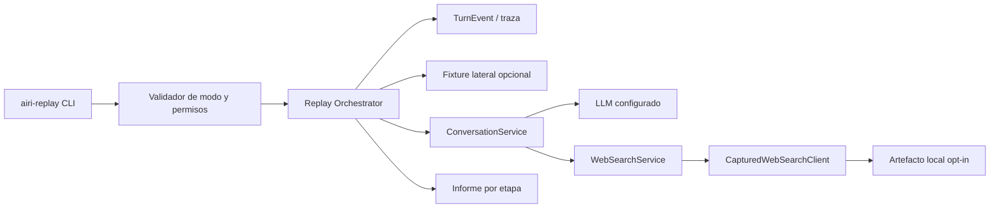
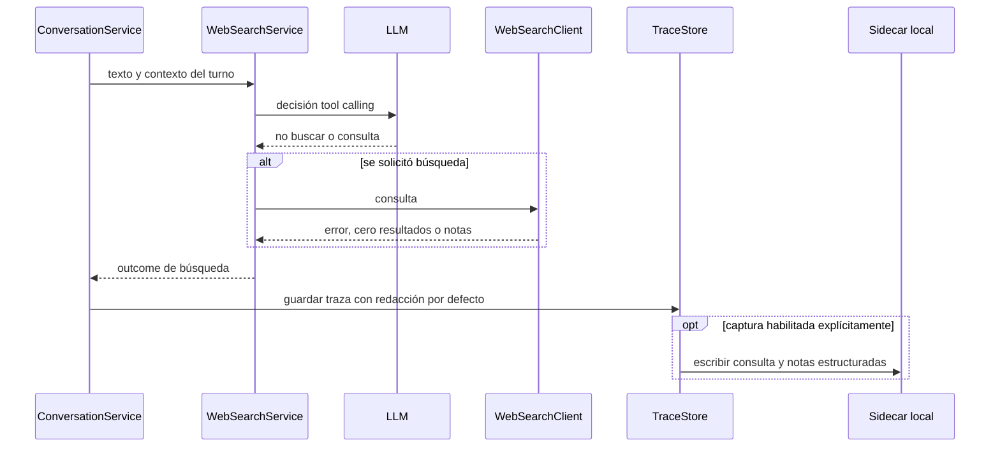
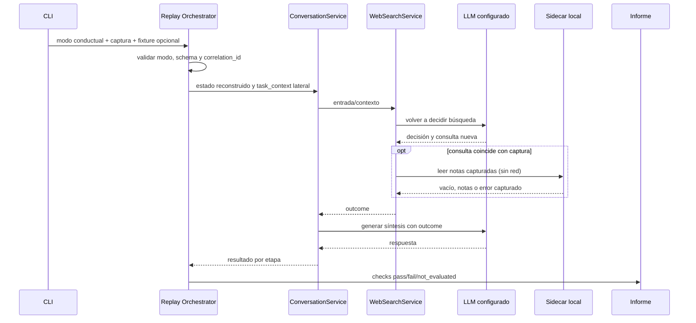
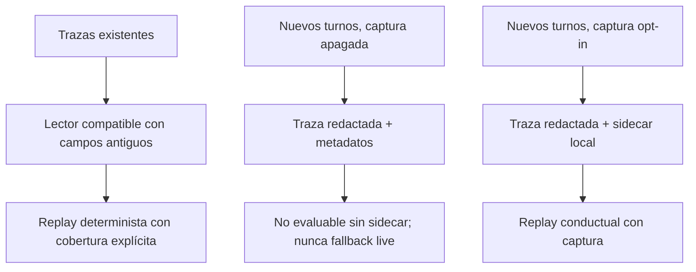

# Diseño técnico: Replay conductual

## Overview

La feature amplía `airi-replay` sin cambiar su modo predeterminado: las invocaciones sin modo siguen siendo deterministas, aisladas y basadas en la respuesta guardada. Los modos conductual y live vuelven a llamar al LLM configurado y por eso requieren opciones explícitas; el acceso a búsqueda web real requiere además un permiso independiente.

El replay conductual vuelve a recorrer la decisión de búsqueda y la generación con el LLM configurado, pero el puerto de búsqueda solo puede responder desde una captura local vinculada a la traza. La captura se habilita por configuración opt-in durante el turno original y se guarda en un artefacto separado. Un fixture externo puede aportar el contexto privado de tarea sin copiar su contenido a trazas ni a capturas.

## Goals

- Separar reproducción de salida guardada, reevaluación con evidencia capturada y ejecución con búsqueda live.
- Informar por etapa qué se comparó, qué divergió y qué no era verificable.
- Mantener sin red implícita las invocaciones predeterminadas y el modo conductual.
- Evitar persistir por defecto consultas/resultados web y contenido de contexto de tarea en trazas normales.
- Mantener legibles las trazas antiguas y permitir una regresión diagnóstica del caso `1380da81d040`.

## Non-Goals

- Convertir `airi-replay` en un servicio de publicación en Discord o en un entorno de simulación de Discord.
- Guardar fixtures privados de tarea junto a la traza o reconstruirlos automáticamente desde el historial.
- Garantizar que una inferencia nueva produzca el mismo texto; el modo conductual mide comportamiento, no determinismo del LLM.
- Cambiar las políticas de decisión de búsqueda del producto o hacer búsquedas automáticas en todos los turnos.

## Architecture

### Existing Architecture Analysis

- `src/airi/observability/replay.py` reconstruye `AppState` desde `TurnEvent`, usa `ReplayLLM` para devolver `raw_llm`, construye `ConversationService(search=None)` y fija `allow_web=False`. `run_live_trace` sustituye el LLM por `build_llm`, pero también usa `search=None` y `allow_web=False`.
- `ConversationService` ya orquesta el recorrido decisión → búsqueda → prompt de respuesta. `WebSearchService` decide con tool calling nativo y recibe una implementación del puerto `WebSearchClient` (`src/airi/ports/web_search.py`). Por tanto, la captura puede reproducirse inyectando un cliente local sin cambiar la lógica de decisión.
- `TurnEvent` actualmente posee `web_query`, `search_query` y `web_context`, y su serializador los persiste por defecto. La implementación debe cambiar el límite de privacidad: el evento en memoria puede contener datos de búsqueda para terminar el turno, pero la serialización normal los omite. Esto implica actualizar las expectativas existentes de `tests/integration/test_observability.py`.
- El contexto privado de tarea ya se normaliza y acota en `domain/conversation_task.py`, y `ConversationService` lo recibe mediante `TurnContext.task_context`. El replay debe reutilizar este contrato y no inventar una segunda representación.
- Los tests existentes usan `FakeLLM`, `FakeSearch`, fixtures JSON y `replay_trace`; no se requiere una dependencia externa nueva.

### High-Level Architecture



**Integración arquitectónica**

- Se conserva la arquitectura hexagonal: el adaptador de búsqueda capturada implementa `WebSearchClient`; el dominio y `ConversationService` no conocen rutas de archivos.
- `replay.py` mantiene la selección de modos, reconstrucción de estado y composición de dependencias.
- `events.py` mantiene compatibilidad de lectura y añade metadatos de cobertura; el serializador normal aplica redacción de contenido web/tarea.
- El mecanismo de captura se conecta al punto existente que guarda cada `TurnEvent`, condicionado por una configuración opt-in. El contenido de captura se escribe a un artefacto separado, no al JSON de traza.
- No se añaden paquetes ni servicios obligatorios. La búsqueda capturada no usa HTTP.

### Technology Alignment and Key Decisions

#### Decisión 1: Tres modos con permisos monotónicos

- **Decisión:** El modo predeterminado es determinista; el modo conductual requiere opción y captura; el modo live requiere opción propia. La búsqueda live requiere un permiso adicional y solo se acepta junto al modo live.
- **Contexto:** El replay actual es aislado por defecto y el modo `--live` existente solo activa el LLM; la búsqueda sigue apagada.
- **Alternativas:** Activar automáticamente la búsqueda por estar presente en la traza; hacer que `--live` habilite todos los servicios; reemplazar el modo predeterminado por inferencia nueva.
- **Enfoque seleccionado:** Mantener flags explícitos e independientes. Ninguna ausencia de captura puede provocar fallback a red. Las combinaciones inválidas fallan antes de ejecutar componentes.
- **Trade-offs:** Hay más opciones CLI, pero los efectos externos son previsibles y testeables.

#### Decisión 2: Sidecar local para datos de búsqueda y fixture independiente para tarea

- **Decisión:** Capturar, solo con opt-in durante el turno original, consulta y notas estructuradas en un JSON local separado referenciado por `correlation_id`. El fixture de tarea se suministra por separado al replay y nunca se copia al artefacto de búsqueda.
- **Contexto:** La traza normal debe dejar de persistir texto de consulta/resultados; el modo capturado necesita distinguir resultados vacíos de captura ausente.
- **Alternativas:** Mantener resultados en cada traza; guardar solo un hash; recuperar resultados consultando de nuevo al proveedor.
- **Enfoque seleccionado:** Configuración de captura apagada por defecto (por ejemplo, `AIRI_TRACE_WEB_CAPTURE_DIR` vacío/desactivado). Si se habilita, el artefacto se escribe de forma atómica, con permisos restrictivos locales y versionado. El replay recibe rutas explícitas para sidecar y fixture.
- **Trade-offs:** La captura es un artefacto sensible que requiere gestión local y retención deliberada; sin activarla, el replay conductual reporta esos checks no verificables.

#### Decisión 3: Evidencia capturada solo se usa ante coincidencia de consulta

- **Decisión:** `CapturedWebSearchClient` sirve la captura únicamente cuando el modelo vuelve a pedir búsqueda y la consulta coincide exactamente tras normalización conservadora (espacios y Unicode; sin equivalencia semántica). La captura conserva estados distintos: no solicitada, solicitud con cero resultados, resultados y error/no disponible.
- **Contexto:** Reutilizar resultados de una consulta anterior para una consulta distinta podría introducir evidencia incorrecta y ocultar una regresión de decisión.
- **Alternativas:** Responder siempre con el único resultado capturado; elegir por similitud fuzzy; fallar la ejecución completa ante cualquier cambio de consulta.
- **Enfoque seleccionado:** Coincidencia conservadora; consulta distinta se informa como `capture_mismatch` y no recibe resultados. La salida incluye tanto el resultado de la decisión como el estado de cobertura.
- **Trade-offs:** Variaciones pequeñas de formulación pueden quedar sin respuesta capturada; esto es preferible a falsear el grounding.

### System Flows

#### Captura durante el turno original



#### Ejecución conductual



## Requirements Traceability

| Requirement | Resumen | Componentes | Flujo |
|---|---|---|---|
| 1 | Replay determinista y cobertura explícita | Replay Orchestrator, ReplayReport | Predeterminado |
| 2 | Decisión reejecutada con búsqueda capturada | WebSearchService, CapturedWebSearchClient, Replay Orchestrator | Ejecución conductual |
| 3 | Captura local opt-in separada | TurnEvent, TraceStore, WebCaptureWriter | Captura original |
| 4 | LLM y búsqueda live bajo permisos distintos | CLI, ModeValidator, Replay Orchestrator | Selección del modo |
| 5 | Contexto privado por fixture lateral | TaskFixtureLoader, TurnContext | Ejecución conductual |
| 6 | Informe segmentado | ReplayReport | Ambos flujos de replay |
| 7 | Trazas antiguas y regresiones | TraceEvent loader, suite de replay | Tests |

## Components and Interfaces

### `airi.observability.replay`

**Responsabilidad y límites:** selección/validación del modo; montaje de estado desde la traza; inyección de LLM, búsqueda, fixture y reloj; agregación del informe. No publica en Discord ni guarda estado de producción.

**Contrato conceptual**

- `replay_trace(trace_path)` conserva el replay determinista y sigue siendo el destino de la invocación sin flags.
- `replay_behavioral(trace_path, capture_path, task_context_path=None)` exige captura y usa LLM configurado + búsqueda capturada.
- `run_live_trace(trace_path, repeat=1, web_live=False, task_context_path=None)` mantiene LLM live y solo conecta búsqueda real cuando `web_live=True`.
- `ReplayResult` añade modo, cobertura global (completa/parcial), estados de etapa y lista de campos no verificables. `matches_original` permanece como resumen de checks aplicables para compatibilidad, no como indicador de cobertura total.

### `CapturedWebSearchClient` (nuevo adaptador)

- Implementa `WebSearchClient.search(query)`.
- Recibe registros de captura validados; nunca tiene una sesión HTTP ni acceso a credenciales.
- Devuelve `WebSearchNotes(())` para una búsqueda capturada vacía, `None` para error/no disponibilidad según el contrato del puerto, y marca por separado la ausencia o discrepancia de captura para el informe.
- Solo permite consumir un registro compatible con la versión y `correlation_id` esperados.

### Captura y serialización en `events.py` / `trace_store.py`

- La traza estándar conserva metadatos de estado (`web_requested`, error/éxito, si hubo resultados) y redacciona `web_query`, `search_query` y `web_context` al serializar.
- El evento puede mantener la información necesaria en memoria durante el turno. El writer opt-in recibe consulta y `WebSearchNotes` estructuradas y genera un sidecar versionado, vinculado por `correlation_id`.
- El sidecar representa explícitamente el estado `not_requested`, `empty`, `results` o `error`; no confunde cero resultados con fallo de API o falta de captura.
- Trazas históricas con campos web se pueden leer, pero el replay no las reescribe ni asume que todas las trazas futuras contengan esos datos.

### `TaskFixtureLoader` (nuevo componente de observabilidad)

- Lee un JSON lateral indicado por CLI; valida la forma con el normalizador de `domain.conversation_task` y aplica los límites existentes.
- Entrega el marco solo a `TurnContext.task_context` en el replay.
- No escribe el fixture, objetivo, progreso ni restricciones en trace, sidecar web ni logs. Solo informa `task_context_available` y versión de schema.
- Un fixture inválido se rechaza antes de invocar el LLM; no se utiliza parcialmente.

### CLI `airi-replay`

Contrato de opciones propuesto:

| Opción | Efecto |
|---|---|
| Sin modo | Determinista; sin LLM ni web |
| `--behavioral --capture <archivo>` | Reejecuta LLM y decisión; búsqueda solo mediante captura local |
| `--task-context <archivo>` | Aporta fixture lateral a modo conductual o live |
| `--live` | Reejecuta con LLM; búsqueda web permanece apagada |
| `--live --web-live` | Autoriza además búsqueda web real |
| `--repeat N` | Permitido solo en modo con LLM; cada muestra se informa por separado |
| `--emit-test` | Se conserva para replay determinista y tests generados; combinaciones no compatibles se rechazan |

La salida JSON incorpora `mode`, `coverage`, `checks`, `not_evaluated` y el informe de web por etapa. Las opciones que pueden invocar un LLM identifican el backend configurado antes de la llamada; el flag explícito constituye la autorización de ejecutar esa inferencia, sin confirmación interactiva que rompa CI.

## Data Models

### Artefacto local `airi.web-capture.v1`

```json
{
  "schema": "airi.web-capture.v1",
  "correlation_id": "<id de la traza>",
  "status": "empty",
  "query": "<consulta capturada>",
  "results": []
}
```

`status` toma `not_requested`, `empty`, `results` o `error`. Cada resultado contiene solo `title` y `snippet`, tal como `WebResult`; el artefacto no guarda credenciales ni `task_context`. `query` y snippets se consideran datos potencialmente sensibles aunque se guarden localmente.

### Informe de replay

- `decision`: `passed`, `failed` o `not_evaluated` (si el modo no invocó decisión).
- `search`: `not_requested`, `captured_empty`, `captured_results`, `capture_missing`, `capture_mismatch`, `live_error` u otro estado explícito.
- `grounding`, `reply` y `task_context`: check con estado comparable y detalle acotado.
- `coverage`: `complete` o `partial`, además del modo de replay.
- `matches_original`: booleano de checks comparables; `coverage=partial` impide interpretarlo como verificación completa.

## Error Handling

- **Entrada inválida:** traza, captura o fixture ilegible; error CLI con ruta/campo, sin volcar contenido privado.
- **Captura ausente/desfasada:** no hay fallback de red; informar `capture_missing` o `capture_mismatch` y marcar grounding como no evaluable.
- **Captura vacía:** pasar notas vacías al flujo normal para que la síntesis se comporte como ante búsqueda sin resultados.
- **LLM no disponible:** terminar esa muestra como error de ejecución, diferenciado de divergencia del comportamiento. Las muestras previas conservan su resultado.
- **Permisos incompatibles:** rechazar antes de crear sesión LLM/web. `--web-live` sin `--live` es inválido.
- **Escritura sidecar:** escritura atómica; si falla, conservar traza normal redactada, emitir error de captura y no afirmar que el turno es reproducible con web.
- **Datos legacy:** deserialización tolerante de campos ausentes; el reporte etiqueta cobertura parcial en vez de fabricar valores.

## Security Considerations

- Captura web desactivada por defecto mediante configuración explícita; la traza normal no serializa query ni texto de resultados.
- Los sidecars son locales, separados, con permisos de archivo restrictivos y escritura atómica. No se imprimen query/resultados completos en errores ni logs de replay.
- Los artefactos de captura pueden incluir texto de mensajes en la consulta y contenido de terceros en snippets; documentación debe advertir sobre retención, revisión y no versionado.
- Los fixtures de tarea se tratan como datos no confiables: validación, límites existentes, sin ejecución de instrucciones o archivos referenciados, sin persistencia.
- El modo conductual no tiene puerto HTTP de búsqueda. El modo live no tiene escritura de Discord/estado productivo; el puerto web solo se construye con `--web-live`.
- Las pruebas deben comprobar que flags ausentes nunca construyen clientes de red y que el fixture/sidecar no aparece en JSON de traza ni logs.

## Testing Strategy

### Unitarias

- Validar esquema/estados del sidecar; búsqueda capturada vacía, con resultados y error.
- Coincidencia exacta normalizada de consulta, discrepancia y `correlation_id` incorrecto.
- Resolución de modos y rechazo de combinaciones incompatibles sin inicializar clientes.
- Redacción por defecto de `web_query`, `search_query`, `web_context` y contexto de tarea; compatibilidad con `TurnEvent.from_dict` antiguo.
- Clasificación del informe: `not_evaluated`, parcial/completo y coincidencia aplicable.

### Integración

- Flujo de captura opt-in desde `ConversationService` hasta sidecar; sin captura no se escribe sidecar y la traza queda redactada.
- Modo conductual: fake LLM solicita búsqueda, cliente capturado devuelve evidencia/cero resultados y generación recibe el contexto correspondiente; verificar cero requests HTTP.
- LLM que declina buscar y consulta divergente contra captura.
- Fixture lateral entra en decisión/generación y no se filtra a traza, sidecar ni logs.
- Modo live sin `--web-live` no busca; con ambas opciones usa cliente web real simulado; modo determinista no llama ni LLM ni web.

### Regresión

- Replay de fixture histórica `affinity_delta_without_reason.json` y de trazas v1/v2 sin campos de captura.
- Caso `1380da81d040` con artefacto lateral que representa query solicitada y resultado vacío; el informe debe distinguir resultado vacío de `grounded` no comparable en determinista.
- No incluir la traza original completa con contenido de usuario como fixture versionado. Construir fixture sintética/redactada con el mismo patrón de búsqueda vacía y mensajes no sensibles.

## Performance & Scalability

- El modo determinista no añade llamadas ni lecturas laterales salvo carga de la traza.
- La captura mantiene límites de tamaño alineados con `MAX_WEB_CONTEXT_CHARS` y límites de resultados del adaptador Brave; el writer no debe bloquear el turno ante error de disco.
- El modo conductual realiza la llamada de decisión y la generación que ya forman el flujo normal; no añade una llamada obligatoria de resumen.
- La lectura de sidecar y fixture es local y acotada; validar tamaño máximo antes de parsear.

## Migration Strategy



El cambio no migra ni borra archivos históricos. Los lectores siguen aceptando trazas existentes; las nuevas escrituras dejan de persistir el contenido web en la traza principal. El despliegue no activa captura automáticamente. Para probar modo conductual se habilita captura explícitamente para los turnos deseados y se conserva el sidecar con la misma política local de retención de trazas sensibles.
