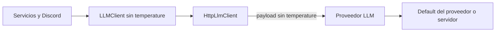

# Diseño técnico: Temperatura predeterminada del proveedor

## Resumen

Airi dejará de incluir el parámetro de muestreo `temperature` en las llamadas LLM. El proveedor configurado será responsable de elegir el valor efectivo; en llama.cpp se usará el default configurado en `llama-server`, salvo que otra capa externa lo cambie.

El cambio elimina temperatura del contrato interno, del adaptador HTTP, de los callsites que hoy fijan valores, de la configuración del entorno y de `.env.example`. El `.env` local del usuario no se modifica. Los demás parámetros de generación —por ejemplo `max_tokens`, formato de respuesta y presupuesto de reasoning— permanecen sin cambios.

## Objetivos y exclusiones

- Ninguna petición Chat Completions generada por Airi contiene `temperature`.
- Airi ya no tiene configuración ni valores específicos por operación para temperatura.
- Pruebas unitarias e integración verifican la omisión del campo.
- No cambiar la selección de top-p/top-k/min-p u otros parámetros del servidor.
- No modificar el `.env` local del usuario ni prometer que el modelo/servidor no aplica sus propios valores.

## Arquitectura e integración

Se preserva la arquitectura hexagonal: `LLMClient` en `ports/` expresa el contrato y `HttpLlmClient` en `adapters/` lo implementa. Los servicios y el glue de Discord dejan de pasar temperatura. El adaptador serializa únicamente parámetros aún soportados por Airi.

### Componentes

- `src/airi/ports/llm.py`: quitar `temperature` de `chat` y `chat_with_meta`.
- `src/airi/adapters/http_llm.py`: quitar `temperature`, `skip_temperature`, sus lecturas de entorno y su serialización. El payload no incluye la clave.
- `src/airi/discord_bot/client.py`, `src/airi/services/web_search.py` y `src/airi/evaluation/web_search.py`: quitar argumentos de temperatura de las llamadas.
- `src/airi/testing/fake_llm.py`: quitar temperatura de firmas y registros de invocaciones.
- `.env.example`: quitar `LLM_TEMPERATURE` y `LLM_SKIP_TEMPERATURE` y las descripciones asociadas.
- Pruebas: actualizar tests del adaptador, configuración, integración y fakes para asegurar ausencia total del campo y de las opciones de entorno.

El `.env` existente puede conservar esas entradas; al dejar de leerlas no tendrán efecto. No se migrará ni reescribirá el archivo local.

## Manejo y compatibilidad

Omitir `temperature` es válido para el endpoint Chat Completions y hace que el proveedor aplique sus propios defaults. En llama.cpp, Airi deja de sobreescribir el default del servidor. En proveedores remotos, la selección pasa igualmente al proveedor. No se agregan dependencias ni nuevas rutas de error.

La interfaz Python interna cambia: los consumidores que aún pasen `temperature=` deberán dejar de hacerlo. Dentro del repositorio se actualizarán todos los callsites y doubles de test en el mismo cambio.

## Estrategia de pruebas

1. Unit tests del adaptador: configurar variables antiguas no agrega `temperature`; el payload no contiene la clave en solicitudes normales y con streaming.
2. Unit tests de configuración: `LlmConfig` y `HttpLlmClient` ya no exponen opciones/valores de temperatura.
3. Tests de integración del glue y web search: llamadas con distintas finalidades continúan funcionando y el payload capturado omite `temperature`.
4. Suite completa y Ruff para localizar consumidores internos restantes.

## Riesgos y decisiones

- Los defaults de proveedores pueden diferir entre sí o cambiar por configuración externa; es la consecuencia intencional de delegar esa decisión.
- Las claves antiguas en `.env` no provocan error, pero se ignoran. `.env.example` las deja de sugerir.
- Se mantiene el control de los demás parámetros de inferencia; el alcance queda limitado exclusivamente a temperatura.
