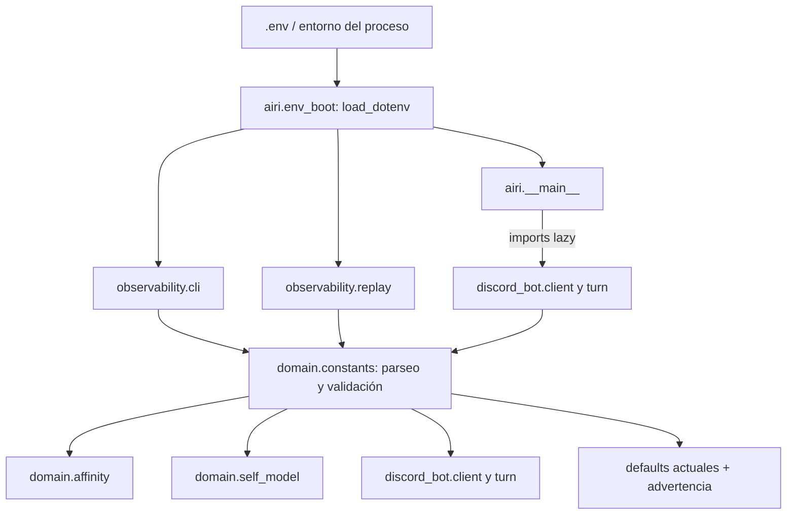

# Diseño técnico: configuración de negocio por entorno

## Panorama

La aplicación ya obtiene numerosos límites de `os.environ`, pero algunos valores de negocio siguen como tuplas o mapas en `airi.domain.constants`. Además, el comando `airi run` importa `airi.discord_bot.client` —que importa `turn` y constantes del dominio— antes de que `run_bot()` invoque `load_dotenv()`. Como las constantes se evalúan al importar el módulo, las opciones del `.env` pueden llegar demasiado tarde.

La solución conserva el patrón de constantes de dominio, añade parseo y validación JSON con la biblioteca estándar para las opciones compuestas y carga `.env` en el bootstrap antes de importar el bot. Las opciones ausentes o inválidas conservan los valores actuales. El límite `SELF_KEY_DAILY_LIMIT` pasa a controlar efectivamente cuántas actualizaciones de una misma clave caben en `SELF_KEY_DAILY_SECONDS`.

### Objetivos
- Externalizar niveles de afinidad, escenas de cita y rasgos permitidos/base sin nuevas dependencias.
- Asegurar que el `.env` local se cargue antes de evaluar las constantes de dominio.
- Preservar el comportamiento predeterminado y el formato de estado persistido.
- Hacer efectivo el límite diario ya documentado y probado con TDD.
- Documentar formato, propósito y valores predeterminados en `.env` y `.env.example`.

### Fuera de alcance
- Convertir estados, operaciones, esquemas JSON, claves internas o contratos de persistencia en variables de entorno.
- Cambiar el núcleo inmutable de identidad de Airi.
- Recargar configuración en caliente; los valores se fijan al arrancar el proceso.
- Añadir bibliotecas de configuración.

## Arquitectura

### Análisis de la arquitectura existente
- `src/airi/domain/constants.py` lee variables numéricas al importar y contiene `AFFINITY_LEVELS`, `DATE_SCENES`, `SELF_TRAITS_ALLOWLIST` y `SELF_BASE_TRAITS` como valores fijos.
- `src/airi/domain/affinity.py`, `src/airi/domain/self_model.py` y los módulos Discord importan esas constantes directamente; no existe un contenedor de settings inyectado en esas capas.
- `src/airi/__main__.py`, `src/airi/observability/cli.py` y `src/airi/observability/replay.py` son entrypoints distintos. Replay importa servicios y afinidad, que a su vez cargan `domain.constants`; trace y el bot también pueden cargar módulos de configuración durante sus imports.
- `src/airi/discord_bot/client.py` importa `DATE_DELTA_MAX` y `turn` al nivel de módulo. `turn.py` también importa constantes del dominio. La carga dotenv dentro de `run_bot()` ocurre después de esas evaluaciones.
- La aplicación ya usa `env_int`, `env_float` y `env_choice` con defaults y advertencias, así que los parsers nuevos deben seguir la misma política.

### Arquitectura propuesta

- **Patrones preservados:** módulos de dominio sin I/O de red, constantes evaluadas una vez, defaults en código, biblioteca estándar y acceso actual a constantes por import.
- **Integración:** `airi.env_boot` centraliza la llamada a `load_dotenv()`. Cada entrypoint importa este módulo antes de cualquier otro módulo `airi.*`; `__main__.py` conserva los imports de trace/replay dentro de sus handlers para evitar efectos de importación cruzada. Se retira la carga tardía de `run_bot`.
- **Carga única:** no hay recarga durante la ejecución. Las pruebas de parseo pueden llamar parsers puros; pruebas de integración verifican el bootstrap en un proceso aislado.

### Decisiones de diseño

1. **JSON para colecciones y mapas.** `AFFINITY_LEVELS`, `DATE_SCENES`, `SELF_TRAITS_ALLOWLIST` y `SELF_BASE_TRAITS` se representan como JSON válido en `.env`. Es explícito para cadenas Unicode y estructuras; evita parsers ad-hoc y dependencias externas. Las tuplas/maps resultantes conservan los tipos que esperan los consumidores actuales.
2. **Validación atómica y fallback por ajuste.** Cada colección independiente se valida completa y, si es inválida, se usa su default actual con warning. `SELF_TRAITS_ALLOWLIST` y `SELF_BASE_TRAITS` forman una unidad: deben proporcionarse juntos y sus claves deben coincidir; si no, ambos vuelven al conjunto default. No se registra el contenido de la variable en warnings.
3. **Elegibilidad de cita por orden de nivel, no por etiqueta visible.** El nivel mínimo de cita conserva la semántica actual de “Amiga” (séptimo nivel, índice 6) y se obtiene del umbral configurado de ese nivel. Así, renombrar etiquetas no rompe la regla. La validación exige al menos siete niveles ordenados. `can_date` deja de comparar etiquetas hardcodeadas.
4. **Conteo del límite por clave.** `SELF_KEY_DAILY_LIMIT` cuenta entradas del historial para la misma clave dentro de la ventana `SELF_KEY_DAILY_SECONDS`. Alcanzar el límite bloquea una actualización; el intervalo global `SELF_UPDATE_MIN_INTERVAL` se mantiene. El default 1 conserva el comportamiento actual.

## Componentes e interfaces

### Bootstrap de entorno — `airi.env_boot`
- **Responsabilidad:** cargar el `.env` una vez al importar el módulo, antes de que se evalúen las constantes de dominio.
- **Contrato:** `airi.__main__`, `airi.observability.cli` y `airi.observability.replay` importan `airi.env_boot` antes que cualquier otro módulo propio. `__main__` mantiene los handlers de trace/replay lazy.
- **Dependencias:** `python-dotenv` ya existente; no se agrega dependencia.

### Parseo de configuración de dominio — `airi.domain.constants`
- **Responsabilidad:** traducir variables de entorno a valores tipados, validados e inmutables para los consumidores.
- **Variables estructuradas:**
  - `AFFINITY_LEVELS`: lista JSON de pares `[umbral_entero, nombre]`; no vacía, umbrales estrictamente crecientes, nombres no vacíos y únicos, siete niveles como mínimo.
  - `DATE_SCENES`: lista JSON de cadenas no vacías; no vacía.
  - `SELF_TRAITS_ALLOWLIST`: lista JSON de cadenas no vacías y únicas.
  - `SELF_BASE_TRAITS`: objeto JSON de `nombre: entero`; claves exactamente iguales a la allowlist y valores dentro de `SELF_TRAIT_MIN..SELF_TRAIT_MAX`.
- **Fallback:** mantiene las tuplas/mapa actuales. Los ajustes compuestos inválidos producen una advertencia con el nombre de la variable y motivo general, sin imprimir su valor.
- **Tipos exportados:** `AFFINITY_LEVELS` y las listas expuestas siguen siendo tuplas; `SELF_BASE_TRAITS` sigue siendo un diccionario.

### Consumidores de dominio
- `affinity.py` usa umbrales y etiquetas configurados para determinar nivel y progreso; `can_date` compara puntos con el umbral del séptimo nivel configurado.
- `client.py` y `turn.py` usan `DATE_SCENES` para mostrar opciones y elegir una escena de reserva. La lista válida nunca está vacía.
- `self_model.py` usa allowlist y mapa base configurados al sembrar/normalizar identidad y autorizar mutaciones. Identidades existentes conservan sus valores actuales para rasgos que siguen permitidos; la allowlist continúa siendo el guardarraíl.
- `self_model.py` aplica `SELF_KEY_DAILY_LIMIT` sobre el historial retenido. Un límite no positivo se trata como configuración inválida y usa el default 1; los límites positivos se comparan con eventos de la ventana.

### Archivos de entorno
- `.env.example` documenta las cuatro opciones JSON con propósito, forma y defaults actuales.
- `.env` recibe las mismas claves y defaults como valores iniciales, preservando todos sus valores locales existentes, incluidos secretos.
- `SELF_KEY_DAILY_LIMIT` se conserva porque ahora tiene efecto; las claves de ambos archivos deben permanecer sincronizadas.

## Manejo de errores y compatibilidad
- JSON mal formado, tipo raíz incorrecto, datos vacíos o relaciones inconsistentes generan fallback al valor predeterminado y warning.
- Las variables existentes que no cambian mantienen la lectura actual.
- No se modifica el esquema ni se migra el estado persistido. Nuevas identidades usan los rasgos base configurados; al normalizar identidades existentes se conservan valores de rasgos permitidos y se descartan los que ya no estén en la allowlist, igual que la normalización actual conserva únicamente las claves autorizadas.
- Si un operador reduce o renombra la allowlist, los rasgos retirados dejan de ser mutables y pueden desaparecer al normalizar/guardar; esto debe quedar explicado en los comentarios de configuración.

## Trazabilidad

| Requisito | Componentes | Verificación |
|---|---|---|
| 1.1, 1.2 | `constants.py`, `affinity.py` | Defaults y niveles personalizados; elegibilidad independiente de etiquetas |
| 1.3, 1.6 | `constants.py`, `self_model.py` | Allowlist/base válidas, defaults y fallback por incompatibilidad |
| 1.4, 1.5 | `constants.py` | Variables ausentes, JSON inválido, tipos e invariantes |
| 2.1–2.3 | `self_model.py` | Límites 1 y 2 por ventana, intervalo global y default compatible |
| 3.1–3.4 | `.env`, `.env.example`, bootstrap | Claves sincronizadas, formatos documentados y entorno cargado antes de imports |
| 4.1–4.2 | módulos de dominio y tests | Constantes estructurales intactas; estado persistido mantiene su contrato |

## Estrategia de pruebas
- **Unitarias de parsers:** JSON válido, ausente, malformado, tipos equivocados, umbrales no crecientes, nombres duplicados, lista vacía y mapa de rasgos desparejado/fuera de rango.
- **Unitarias de dominio:** niveles y umbrales personalizados; `can_date` con etiqueta renombrada; escenas personalizadas; siembra, normalización y guardarraíles de rasgos configurados.
- **Unitarias del límite:** default 1 bloquea segundo cambio; límite 2 permite segundo y bloquea tercero dentro de la ventana; fuera de ventana permite; intervalo mínimo global sigue bloqueando.
- **Integración del arranque:** en procesos aislados, verificar que importar `airi`, `airi-trace` y `airi-replay` carga dotenv antes de constantes; comprobar que `__main__` mantiene sus handlers lazy y que los valores configurados llegan al consumidor.
- **Regresión:** ejecutar suite de tests existente para comprobar que los defaults preservan resultados actuales.

## Riesgos y mitigaciones
- **Formato JSON difícil de editar:** ejemplos copiables y comentarios con estructuras exactas en ambos archivos; validación con fallback.
- **Captura de configuración por import:** importar `airi.env_boot` primero en cada entrypoint; tests de proceso separado evitan contaminación de imports en pytest.
- **Cambio de allowlist en datos existentes:** documentar que la configuración es autoritativa y comprobar que no cambia la forma persistida del objeto.
- **Historial acotado:** el límite usa los eventos que conserva el historial existente; documentar que `SELF_KEY_DAILY_LIMIT` debe ser menor o igual que `SELF_HISTORY_MAX` para garantizar el conteo dentro de toda la ventana.
