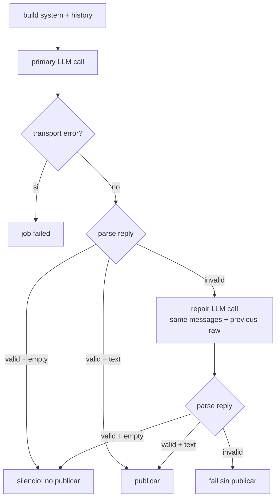

# Design Document

## Overview

**Purpose**: Recuperar una respuesta entre bots cuyo formato JSON no cumple el contrato de `peer_reply`, mediante un único intento de reparación acotado. Se conserva el silencio válido (`reply` vacío) y se evita publicar cualquier salida malformada.

**Users**: Los usuarios del canal ven a Airi y Luna completar una conversación en lugar de un turno perdido. El mantenedor obtiene un flujo acotado y testeable, sin reintentos de red ni bucles.

**Impact**: `src/airi/coordinator/worker.py` gana dos helpers privados y una constante de reparación. No cambia `ConversationService`, el adaptador LLM ni el coordinador. Se añaden pruebas unitarias del worker.

### Goals

- Máximo una llamada de reparación por respuesta entre bots.
- Mismo system prompt, persona e historial en la llamada primaria y en la reparación.
- Revalidación del contrato después de reparar.
- Silencio válido en cualquier fase: no publica, no falla, no repara.
- Fallo seguro: si la reparación no produce un contrato válido, el job falla sin publicar.
- Cero cambios en el camino de una respuesta válida.

### Non-Goals

- Reintentos de red o backoff en `adapters/http_llm.py`.
- Reutilizar `ConversationService._repair`, acoplado a `ModelOutput` y a políticas de parseo/calidad del turno normal.
- Reparar la decisión de participación (`participation_decision`): su contrato de fallo es silencio deliberado.
- Cambiar el esquema de jobs, el coordinador o la base de datos.

## Architecture

### Existing Architecture Analysis

`DiscordWorker.peer_reply` construye el system prompt (identidad, familia, participante y contexto proactivo), envía un único `chat_with_meta` con `schema` de `{reply: string}` y parsea con `extract_json_object`. Si el resultado no es un dict con `reply` string, lanza `ValueError("Invalid peer response")`; `execute` propaga y el job queda `failed`. El silencio ya es válido porque un `reply` vacío no envía nada.

Restricciones que se conservan:

- `coordinator/` puede usar `aiohttp`/`discord`; el dominio puro no se toca.
- El historial es público y no incluye memorias privadas.
- Un error de transporte del LLM no se convierte en reparación de formato.
- El contrato del job y sus estados (`generating`, `failed`, etc.) no cambian.

### High-Level Flow



### Key Design Decisions

#### Decisión 1: Reparación local en el worker, no reutilizar `ConversationService._repair`

- **Context**: `_repair` depende de `ModelOutput`, `session_mode`, `delta_max`, telemetría de turno y políticas de calidad ajenas a este flujo.
- **Selected Approach**: Dos helpers privados en `DiscordWorker`: uno construye/envía la petición y otro valida el contrato. La reparación reutiliza los mismos mensajes y añade el raw inválido como turno `assistant` más una instrucción `user`.
- **Rationale**: El contrato es mínimo (`{reply: string}`); reutilizar el pipeline normal introduciría acoplamiento y riesgo de silencio/telemetría inconsistente.
- **Trade-offs**: Hay dos implementaciones de reparación en el código; se acepta porque los contratos difieren. El helper compartido evita duplicar el envío dentro del worker.

#### Decisión 2: `None` significa inválido; `""` significa silencio válido

- **Context**: El silencio es un `reply` vacío legítimo y no debe confundirse con un fallo de formato.
- **Selected Approach**: El parser devuelve `str | None`: `None` para contrato inválido, `""` para silencio y texto para publicar. La reparación solo se dispara con `None`.
- **Rationale**: Hace explícita la diferencia y evita reparar un silencio deliberado.
- **Trade-offs**: El llamador debe comprobar `is None`, no la falsedad del string.

#### Decisión 3: Presupuesto de una sola reparación y fallo sin publicación

- **Context**: Un bucle de reparaciones encarece la respuesta y puede repetir el mismo error.
- **Selected Approach**: Una única llamada adicional. Si también falla el contrato, se registra un warning sin contenido y se lanza `ValueError("Invalid peer response after repair")`, conservando el manejo actual de jobs fallidos.
- **Rationale**: Cumple el límite y mantiene el comportamiento observable del coordinador.
- **Trade-offs**: Un modelo persistentemente incapaz de cumplir el esquema no publica; se prefiere al contenido malformado.

## Requirements Traceability

| Requirement | Summary | Components |
|---|---|---|
| 1.1–1.4 | Reparación única con mismo contexto | `_peer_completion`, `_repair_messages`, `PEER_REPAIR_PROMPT` |
| 1.5, 2.2 | Silencio válido | `_parse_peer_reply` |
| 2.1, 2.3 | Revalidación y fallo seguro | `peer_reply` |
| 2.4 | Tope de una reparación | `peer_reply` |
| 2.5 | Errores de transporte sin reparación | llamada fuera del bloque de validación |
| 3.1–3.3 | Publicación y diagnóstico sin contenido | `peer_reply`, `log.warning` |
| 3.4 | Sin reintentos de red | sin cambios en `http_llm` |
| 4.1–4.5 | Pruebas | `tests/unit/test_worker_peer_repair.py` |

## Components and Interfaces

### `DiscordWorker.peer_reply`

```python
async def peer_reply(self, channel, job):
    system = self._peer_system(job)
    messages = [
        {"role": "system", "content": system},
        {"role": "user", "content": json.dumps(job["history"], ensure_ascii=False)},
    ]
    async with aiohttp.ClientSession(trust_env=True) as session:
        llm = build_llm(session, timeout=int(os.getenv("REQUEST_TIMEOUT", "300")))
        raw = await self._peer_completion(llm, messages)
        text = self._parse_peer_reply(raw)
        if text is None:
            raw = await self._peer_completion(llm, self._repair_messages(messages, raw))
        text = self._parse_peer_reply(raw)
        if text is None:
            log.warning("Peer repair exhausted: bot=%s", self.bot)
            raise ValueError("Invalid peer response after repair")
    if text:
        for offset in range(0, min(len(text), 6000), 2000):
            await channel.send(text[offset : offset + 2000])
```

### Helpers

- `_peer_system(job) -> str`: extrae el prompt actual sin cambios de texto.
- `_peer_completion(llm, messages) -> str`: envía con el esquema existente y devuelve el raw usando el cliente ya construido. No captura excepciones. `peer_reply` abre una sola sesión y reutiliza el mismo cliente para primaria y reparación.
- `_parse_peer_reply(raw) -> str | None`: `extract_json_object`, exige dict con `reply` string y devuelve `reply.strip()`; `None` si no cumple.
- `_repair_messages(messages, raw) -> list[dict]`: `[*messages, {"role": "assistant", "content": raw}, {"role": "user", "content": PEER_REPAIR_PROMPT}]`.

`PEER_REPAIR_PROMPT` pide corregir únicamente el formato, no cambiar el contenido, y devolver solo el objeto JSON con `reply` (puede ser vacío).

### Observability

- `log.warning("Peer repair exhausted: bot=%s", self.bot)` sin prompt, historial ni respuesta.
- Se conserva el `ValueError` existente para que el coordinador marque el job `failed`.

## Error Handling

| Fallo | Respuesta | Efecto |
|---|---|---|
| Primaria inválida | una reparación | continúa |
| Primaria con error de transporte | se propaga | job failed, sin reparación |
| Reparación inválida | warning sin contenido + `ValueError` | job failed, sin publicación |
| Reparación con error de transporte | se propaga | job failed, sin reintento |
| `reply` vacío en primaria o reparación | silencio | no publica, no falla |
| Respuesta válida | publicación actual | una sola llamada |

## Testing Strategy

Nuevo `tests/unit/test_worker_peer_repair.py`, con `FakeLLM` y un `Channel` que acumula envíos:

1. Respuesta válida ⇒ una llamada, mismo texto publicado.
2. Primaria inválida + reparación válida ⇒ dos llamadas, segunda incluye `assistant` con el raw y `PEER_REPAIR_PROMPT`; publica el texto reparado.
3. Primaria con `reply` vacío ⇒ una llamada, sin envío.
4. Reparación con `reply` vacío ⇒ dos llamadas, sin envío.
5. Primaria y reparación inválidas ⇒ dos llamadas, `ValueError`, sin envío.
6. Error de transporte en la primaria ⇒ una llamada, propaga, sin reparación.
7. El system prompt de la reparación es idéntico al de la primaria.

Se ejecuta con `.venv/bin/python -m pytest tests/unit/test_worker_peer_repair.py` y luego la suite de worker/coordinator.

## Migration Strategy

No hay migración de datos ni flag: el cambio es aditivo sobre un flujo que hoy falla. Rollback = revertir el commit. Se mantiene compatibilidad total con respuestas válidas y con el contrato de jobs.
