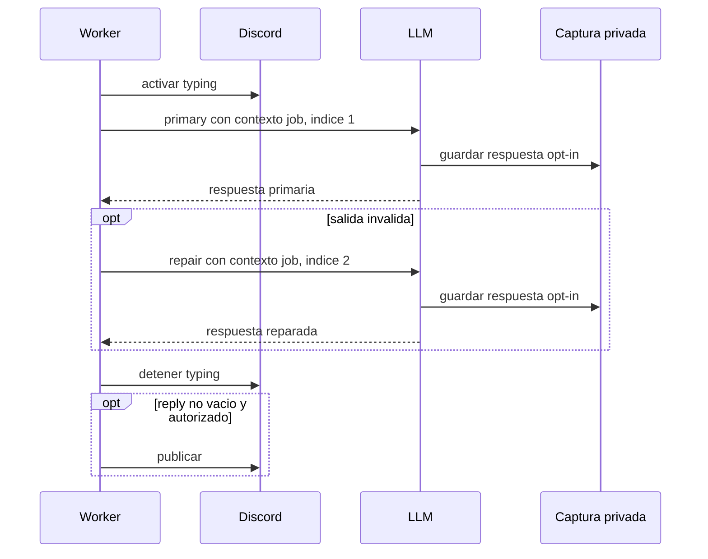
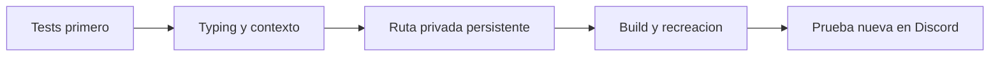

# Design Document

## Overview

Esta extensión permite ver que Airi o Luna están generando una continuación y, si el operador activa la captura, conservar la respuesta real del LLM en cada llamada de esa continuación. El indicador de escritura es transitorio; una respuesta vacía sigue siendo silencio y no publica nada.

El cambio se limita al worker coordinado, a la configuración de las rutas de captura opt-in y, si hace falta asegurar permisos, al almacenamiento local de artefactos. No altera los estados del coordinador, la decisión de participar ni el límite de una reparación.

### Goals

- Mostrar «escribiendo…» durante la generación peer/proactiva y retirarlo al salir incluso ante error o cancelación.
- Identificar por job la respuesta primaria y la de reparación en artefactos privados persistentes, **solo** cuando la captura esté configurada.
- Distinguir fallo de captura de fallo del modelo sin registrar respuesta ni petición en los logs habituales.

### Non-Goals

- Capturar retroactivamente las salidas del ensayo anterior.
- Activar «escribiendo…» durante la decisión de participación.
- Cambiar el contenido, el parser o el número de llamadas LLM.
- Volcar los artefactos al host o a logs públicos.

## Architecture

### Existing Architecture Analysis

- `src/airi/discord_bot/turn.py` usa `async with channel.typing()` durante la generación normal.
- `src/airi/coordinator/worker.py:peer_reply` ya hace una llamada primaria y, si el contrato es inválido, una reparación con el mismo cliente. Recibe un `CoordinatedChannel` cuyo acceso a `typing()` se delega al canal de Discord; solo `send()` autoriza la publicación frente al lease.
- `src/airi/adapters/http_llm.py` crea `LocalLlmPayloadCapture` cuando hay `TRACE_LLM_ARTIFACTS_DIR`, pero únicamente captura requests y respuestas al recibir `LLMCallContext` en `chat_with_meta`. `peer_reply` no lo pasa.
- Ambos bots tienen `AIRI_TRACE_DIR=/app/traces` mediante `compose.yaml`, con **volúmenes diferentes**. La variable opt-in actual `TRACE_LLM_ARTIFACTS_DIR=./private-llm-artifacts` apunta a `/app/private-llm-artifacts`: `/app` no es escribible por el proceso, y tampoco es volumen persistente.

### Flow

### Key Design Decisions

1. **Indicador limitado a generación**: envolver las llamadas LLM (primaria y reparación) en `async with channel.typing()`, fuera de `participation_decision`. El context manager se cierra también ante excepción/cancelación; `CoordinatedChannel.send()` conserva la autorización existente. No se presenta el indicador como prueba de que el modelo responderá.
2. **Contextos por llamada, no capturas nuevas**: pasar `LLMCallContext(correlation_id=job["id"], purpose="peer_primary"/"peer_parse_repair", call_index=1/2, model=llm.model)` a `chat_with_meta`. El adaptador existente gestiona escritura opt-in, metadatos y fallos de captura. No registrar el contenido crudo ni cambiar el esquema de jobs.
3. **Ruta privada persistente gestionada por Compose**: configurar `TRACE_LLM_ARTIFACTS_DIR: ${TRACE_LLM_ARTIFACTS_DIR-/app/traces/private-llm-artifacts}` en `x-bot-environment`. La ruta no vacía habilita la captura para ambos bots; `TRACE_LLM_ARTIFACTS_DIR=` en el entorno del proyecto Compose la desactiva explícitamente (se usa la expansión con `-`, no `:-`, para preservar el valor vacío). Retirar únicamente las líneas `TRACE_LLM_ARTIFACTS_DIR` de `.env.bot-a` y `.env.bot-b` para evitar dobles fuentes de verdad; Compose habría tenido precedencia incluso sin retirarlas. Asegurar que el directorio de artefactos se cree con permisos restrictivos `0700`, archivos con `0600` (ya creados con `mkstemp`), y no debilitar permisos de directorios existentes ajenos. Volúmenes de bot separados mantienen el aislamiento.

## Components and Interfaces

### `DiscordWorker.peer_reply` (`src/airi/coordinator/worker.py`)

- **Responsabilidad**: dar visibilidad temporal a la generación y asociar metadatos de llamada al job, sin cambiar la validación/publicación.
- **Precondición**: el worker ya reclamó un trabajo `peer`/`proactive` y obtuvo el canal.
- **Postcondición**: se cierra typing en todos los caminos, incluso si el modelo o su reparación falla. No se muestra typing en `participation_decision`.
- **Contrato de llamada**: `_peer_completion(llm, messages, *, call_context)` pasa el contexto al adaptador; devuelve `(raw, meta)` o permite inspeccionar el estado de captura sin exponer contenido. Se mantienen `schema` y máximo dos invocaciones LLM.
- **Diagnóstico**: si `meta.response_capture.status == "failed"`, emitir un warning con job, propósito y tipo de error de captura, nunca el cuerpo ni la ruta del artefacto. La respuesta funcional sigue su curso.

### `LocalLlmPayloadCapture` (`src/airi/observability/llm_payload_capture.py`)

- **Responsabilidad**: crear directorio de captura privado cuando no existe; los sidecars actuales siguen usando nombre único y archivo `0600`.
- **Compatibilidad**: no cambiar formato de artefactos ni claves de lectura; mantener comportamiento fail-open ante errores de disco. No aplicar chmod recursivo a archivos del usuario.

### Configuración (`compose.yaml`, `.env.bot-a`, `.env.bot-b`)

- `AIRI_TRACE_DIR=/app/traces` permanece como hoy en Compose, con volúmenes independientes.
- `x-bot-environment` añade `TRACE_LLM_ARTIFACTS_DIR` con valor predeterminado `/app/traces/private-llm-artifacts` para ambos bots; un valor vacío en el entorno de Compose lo desactiva. Retirar la entrada anterior de cada env file sin tocar otras variables ni imprimir valores sensibles. El cambio deja la captura activa por defecto para ambos bots hasta que el operador la desactive; documentar esta implicación de privacidad.
- La persistencia cubre nuevas capturas. No hay artefactos históricos de los fallos peer anteriores.

## Requirements Traceability

| Criterio | Componente |
|---|---|
| 1.1–1.4 | Context manager de typing en `peer_reply`, fuera de decisiones |
| 1.5 | `CoordinatedChannel.send` conserva autorización |
| 2.1–2.3 | `LLMCallContext` por llamada y captura existente opt-in |
| 2.4 | Warning seguro de fallo de captura; adapter fail-open |
| 2.5 | Reparación y parser actuales sin cambios |
| 3.1–3.3 | Opt-in en env por bot, volumen separado, directorio privado, logs sin contenido |
| 3.4 | Pruebas unitarias y de integración |

## Error Handling and Security

- **Fallo LLM**: typing termina; se conserva el fallo del job sin publicar salida inválida.
- **Fallo de captura**: se mantiene la respuesta LLM; warning sin prompt ni salida; el artefacto puede no existir.
- **Cancelación/superseded**: typing termina; `CoordinatedChannel.send` sigue validando el lease antes de publicar.
- **Privacidad**: el despliegue habilita la captura en Compose por decisión del operador y guarda **request, respuesta y posible reasoning**, datos potencialmente sensibles. Permisos restrictivos y volumen independiente por bot; apagarla con `TRACE_LLM_ARTIFACTS_DIR=` en el entorno Compose y recrear los bots tras el diagnóstico. No pegar artefactos en Discord ni en el chat de diagnóstico. Inspección futura solo bajo solicitud y con exposición mínima.
- **Límite**: la captura de disco no debe modificar `reply` ni el estado del job.

## Testing Strategy

- Test-first con `FakeLLM` y contexto de typing falso: comprobar entrada y salida durante una llamada válida, reparación, silencio, excepción y cancelación.
- Afirmar que ambos contextos llevan el mismo job id y propósitos/índices distintos; llamada de decisión sin typing.
- Ejercitar `LocalLlmPayloadCapture` en un directorio temporal para verificar dos artefactos de respuesta diferenciables, permisos y contenido; con la captura desactivada explícitamente no se genera ninguno. Verificar la expansión de Compose con variable ausente y con variable vacía, sin publicar configuración completa que contenga secretos.
- Probar fallo de captura (p. ej. permiso denegado) sin alterar la respuesta funcional ni registrar contenido.
- Ejecutar tests del worker/coordinador, suite total y lint; después reconstruir imagen y recrear los bots. Validar `health`, conexión Discord y que las rutas efectivas apuntan al volumen sin imprimir el contenido.

## Migration and Rollback

No hay migración de datos. La captura se desactiva con `TRACE_LLM_ARTIFACTS_DIR=` en el entorno Compose y recreando los bots; el rollback del código reconstruye la versión previa del worker. Los artefactos ya escritos permanecen en el volumen privado y requieren decisión separada de retención/borrado.
