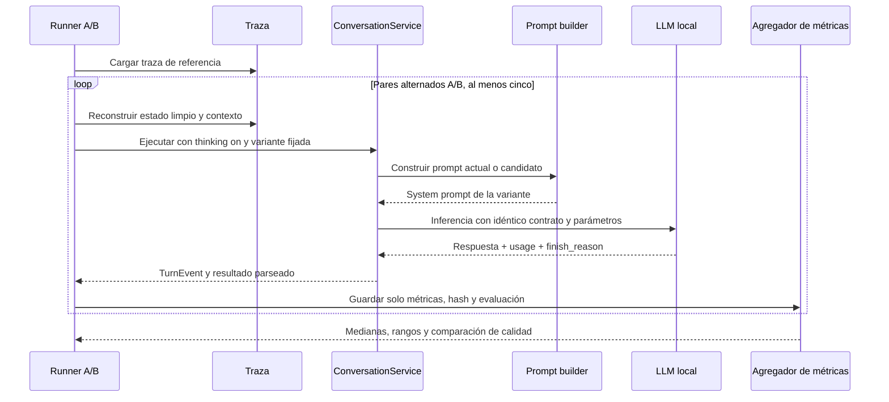

# Diseño técnico: experimento A/B del system prompt

## Resumen

El experimento añadirá una variante de system prompt compacta y coherente junto al prompt vigente y un runner de evaluación live basado en la reconstrucción aislada de una traza. Las dos variantes se ejecutarán secuencialmente sobre el mismo modelo, mensaje, historial, estado inicial, contrato de salida, límites y parámetros, con thinking activado. La variante experimental solo se habilitará desde el runner; el bot normal seguirá usando el prompt vigente.

El primer caso será `traces/2026-10-26/722f84144006.json`. Se ejecutarán al menos cinco pares en orden alternado. El informe comparará medianas y rangos de tokens y tiempos, junto a resultados de calidad. No se guardarán mensajes ni respuestas en el artefacto agregado. La primera ejecución live de referencia (50.299 ms, 4.800 prompt tokens y 2.717 completion tokens) es exploratoria y no se incluirá como miembro de un par controlado.

### Objetivos

- Separar el efecto de longitud/organización del prompt del de historial, thinking, contrato y generación.
- Detectar si una reducción se observa en prompt tokens/TTFT (prefill), completion tokens/tiempo de generación o ambos.
- Asegurar que la variante compacta conserva reglas esenciales y calidad de respuesta.
- Mantener reproducibilidad y privacidad de la traza.

### Fuera de alcance

- Cambiar el prompt predeterminado de producción o adoptar el candidato automáticamente.
- Desactivar thinking, cambiar el modelo, sampling, historial, schema o topes de tokens.
- Implementar streaming solo para obtener TTFT. El backend no-streaming actual no ofrece TTFT; se reportará como no disponible.
- Optimizar la generación mediante límites de tokens en esta evaluación.

## Arquitectura

### Arquitectura existente relevante

- `domain/prompts.py` contiene `SYSTEM_PROMPT`, instrucciones comunes y `build_system_prompt`. Su argumento `compact` actual cambia el contrato de salida (`GIF_DECISION_PROMPT` frente a `COMPACT_OUTPUT_PROMPT`); **no** debe reutilizarse como selector del candidato de este experimento.
- `ConversationService` calcula `quick`, que afecta historia visible, contrato/topes y `disable_thinking`. El modo del cliente HTTP `LLM_THINKING_MODE=on` prevalece sobre esa petición de desactivación. El runner debe mantener fija la misma clasificación `quick` en los dos brazos y verificar el modo efectivo `on` antes de iniciar.
- `TurnEvent` ya conserva prompt, latencia, `LLMMeta.usage`, `finish_reason` y timings. `HttpLlmClient` realiza una petición no-streaming; TTFT no está disponible en la interfaz actual.
- `run_live_trace` reconstruye estado y conversación para cada muestra, no publica en Discord y no persiste los cambios del turno. Es el punto de partida para el runner, pero hoy su CLI imprime respuesta en vez de un informe de métricas.

### Diagrama de flujo

### Alineación tecnológica

El diseño reutiliza Python, `ConversationService`, `TurnContext`, `TurnEvent`, el adaptador HTTP y las utilidades de evaluación existentes. No añade dependencias. Mantiene arquitectura hexagonal y el patrón de fakes para pruebas unitarias; las llamadas al modelo real son una evaluación manual/operativa, no parte de pytest.

### Decisiones de diseño

1. **Selector experimental independiente de `quick` y del contrato.** El contexto del turno permitirá seleccionar `current` o `compact_candidate`; por defecto será `current`. El selector solo reemplaza el texto base de personalidad. Las secciones dinámicas, schema, contrato largo/corto y clasificación `quick` serán idénticos entre los brazos.
2. **Variante candidata separada con activación opt-in.** Se conservará el prompt actual como baseline y se compondrá el candidato en el dominio de prompts, consolidando redundancias y aclarando prioridades sin eliminar reglas esenciales. El candidato no se convierte en predeterminado por el resultado del benchmark.
3. **Runner secuencial y salidas agregadas.** Se ejecutan cinco pares A/B con orden alternado AB/BA, reconstruyendo estado antes de cada inferencia. No se paralelizan solicitudes para evitar contención en el servidor local. Se omiten del reporte textos de entrada, historial, prompts y respuestas.
4. **Thinking verificado por configuración efectiva.** El benchmark exige que el cliente resuelva `thinking_mode == "on"`; si no puede confirmarlo, aborta antes de generar. No basta con pasar `disable_thinking=False`, ya que hoy `quick` puede solicitar lo contrario.

### Centralización semántica de reacciones visuales

- El constructor del system prompt emitirá una sola sección `=== REACCIONES VISUALES Y SELECCIÓN DE GIF ===` en las variantes que incluyan el contrato de producción. Esa sección será la fuente semántica única y distinguirá intención conversacional, ánimo interno y gesto/expresión/acción visible.
- El catálogo cubrirá cada identificador canónico de `ALLOWED_GIF_TYPES` salvo `none`, que es el sentinel de ausencia/no reacción y no una reacción visual. Los significados observables aprobados por el usuario se conservarán en su intención; no se añaden aliases al enum ni se cambia la API.
- La descripción JSON de `gif` mantendrá todos los valores permitidos y solo indicará que acompaña `reply` y que debe seguir el catálogo central. La sección heredada `Guía de GIFs` se elimina.
- El render de `ÁNIMO DE ESTE TURNO` describirá ánimo mediante tono/actitud e indicará independencia con respecto a `mood.label`; eliminará la selección de GIF y conservará intactas las reglas de afinidad/cercanía social.
- Las versiones compacta, candidatas y `previous_current_candidate` se inspeccionarán para evitar que una variante todavía inyecte definiciones duplicadas o ejemplos contradictorios. Si se conserva una variante de rollback, su diferencia no podrá revivir la guía semántica obsoleta.
- Las pruebas unitarias compararán el catálogo del prompt con los IDs canónicos, contarán una sección semántica por prompt renderizado y comprobarán que los fragmentos dinámicos no fuerzan GIFs. La validación live utilizará el mismo modelo/settings para los seis escenarios con repeticiones, capturará request/response reales y reportará JSON/finish/content, latencia/tokens, deliberación observable y coherencia. Sin un baseline equivalente, los resultados serán descriptivos, no causales.

#### Límites preservados

No se modifica el schema JSON, personalidad, afinidad, romance, memoria, parámetros de llama.cpp, parser, retry/repair, modo thinking ni API. No se crean reglas por keyword ni instrucciones de razonamiento paso a paso.

## Componentes e interfaces

### Dominio de prompts

#### Constructor de system prompt

- **Responsabilidad:** ensamblar el system prompt actual o el candidato y añadir las mismas secciones dinámicas/contrato que corresponden al turno.
- **Límite:** no decide si el turno es quick, no cambia el schema ni toca parámetros de inferencia.
- **Contrato conceptual:** `build_system_prompt(..., compact: bool = False, variant: PromptVariant = "current") -> str`, donde `PromptVariant` es un tipo explícito equivalente a `Literal["current", "compact_candidate"]`.
- **Invariante:** `variant="current"` conserva byte por byte el prompt de producción vigente; el default siempre es `current`.

### Servicio conversacional

#### Contexto de turno experimental

- **Responsabilidad:** transportar la variante solicitada hasta `_generate` sin acoplarla a `quick`.
- **Contrato conceptual:** campo `system_prompt_variant` con tipo `Literal["current", "compact_candidate"]` y default `"current"` en `TurnContext`.
- **Invariante:** los turnos sin selector explícito siguen el camino actual sin cambio de comportamiento.

### Evaluación

#### Runner de benchmark de prompt

- **Responsabilidad:** validar la traza y el modo thinking, ejecutar repeticiones alternadas con estado reconstruido por muestra, y producir un reporte local agregado.
- **Entrada:** ruta de traza, número de pares (mínimo cinco), semilla/orden fijo de variantes y configuración del cliente.
- **Salida:** reporte JSON sin contenido conversacional, con ID de traza, variante, número/orden de muestra, hash y caracteres del system prompt, `prompt_tokens`, `completion_tokens`, `total_tokens`, `finish_reason`, `llm_ms`, `total_ms`, TTFT, tasa de salida cuando sea calculable y resultado de checks de calidad.
- **Error:** falta de traza/usage se representa explícitamente; configuración thinking no confirmada detiene la corrida; fallo de inferencia marca la muestra como fallida y no se inventan métricas.
- **Aislamiento:** ni Discord ni los repositorios de estado persistente se montan. Cada muestra obtiene un estado nuevo reconstruido desde la misma traza.

#### Agregador y evaluación de calidad

- **Responsabilidad:** calcular mediana, mínimo y máximo por variante y diferencia pareada; acompañar esos resultados de checks de salida.
- **Checks automáticos:** parseo/schema correcto, `finish_reason` no truncado y reglas esenciales verificables en la salida.
- **Revisión semántica:** registrar evaluación de relevancia, coherencia, proporcionalidad y cumplimiento de personalidad sin guardar el texto evaluado en el artefacto de métricas.
- **Interpretación:** separar tokens/latencia de entrada (prefill) de generación. Completion tokens constantes no descartan una mejora de prefill; menor latencia no es éxito si falla calidad.

### Modelo del reporte

Cada muestra tendrá campos tipados y opcionales donde el backend puede no ofrecer dato:

| Campo | Tipo | Descripción |
|---|---|---|
| `trace_id` | string | ID de correlación de la traza de origen |
| `variant` | `current` / `compact_candidate` | Brazo experimental |
| `pair_index`, `order` | entero, string | Pareja y secuencia AB o BA |
| `prompt_sha256`, `prompt_chars` | string, entero | Identificación del prompt sin guardar su texto |
| `llm_ms`, `total_ms` | entero o null | Latencia de inferencia y turno |
| `prompt_tokens`, `completion_tokens`, `total_tokens` | entero o null | Usage reportado por el servidor |
| `ttft_ms`, `output_tokens_per_second` | número o null | TTFT ausente si no hay streaming; tasa calculada solo con denominador válido |
| `finish_reason`, `parse_ok` | string/bool | Terminación y validez estructural |
| `quality_checks` | mapa de criterios a resultado | No incluye texto generado |

El reporte agregado incluye número de muestras válidas/fallidas, mediana y rango por variante, diferencia pareada y limitaciones. Las métricas faltantes permanecen `null` y se explican.

## Manejo de errores

- Traza inexistente, ilegible o sin contexto necesario: abortar antes de invocar el LLM e informar ruta/campo faltante.
- Thinking mode distinto de `on` o no verificable: abortar antes de la primera muestra.
- Usage incompleto: continuar y dejar campos afectados como `null`.
- Inferencia fallida o timeout: registrar muestra fallida sin respuesta cruda; continuar solo con la siguiente muestra independiente y reportar el número de pares completos.
- Respuesta truncada, parseo inválido o incumplimiento esencial: marcar check fallido; no clasificar candidato como aceptable aunque sea más rápido.

## Estrategia de pruebas

### Unitarias

- El constructor `current` devuelve el mismo prompt que el comportamiento vigente.
- El candidato es más corto que el baseline y conserva las reglas esenciales comprobables.
- Elegir variante no modifica schema, secciones dinámicas, historial ni topes.
- Estadísticos de mediana/rango/diferencia pareada manejan valores ausentes y muestras fallidas.
- El serializador del reporte excluye prompt, historial, mensajes y respuesta cruda.

### Integración con fakes

- Con la misma traza/state y fake LLM, ambas variantes producen requests iguales salvo el contenido system.
- El selector default sigue usando `current`; turnos de producción no cambian.
- El runner rechaza modo thinking no confirmado y nunca monta servicios Discord/persistencia.
- Cálculo de métricas y fallos parciales se conservan en el artefacto agregado sin datos conversacionales.

### Evaluación live

- Ejecutar al menos cinco pares alternados con la traza `722f84144006` y thinking efectivo `on`.
- Comparar medianas/rangos de `prompt_tokens`, `completion_tokens`, `llm_ms`, `total_ms` y TTFT/tasa si disponibles.
- Revisar calidad junto con rendimiento; cualquier infracción esencial bloquea adoptar el prompt candidato.
- La ejecución live queda fuera de pytest y requiere acceso voluntario al llama-server local.

## Rendimiento, privacidad y riesgos

- Diez inferencias secuenciales pueden tardar varios minutos; no se paralelizan para no contaminar latencias por competencia de GPU/CPU.
- La variabilidad del modelo local y cachés térmicas/servidor se reducen alternando orden, pero no se eliminan; resultados son comparativos exploratorios, no significancia estadística.
- El system prompt reorganizado podría alterar calidad o número de tokens de razonamiento. El baseline permanece disponible y el candidato es opt-in.
- El reporte local retiene métricas, hashes, IDs de muestra y calificaciones, pero nunca texto de usuario, historial, prompt completo o respuesta.
- TTFT no está disponible por la llamada HTTP no-streaming actual; habilitar streaming sería un trabajo separado.

## Adenda: candidata focalizada contra indecisión

Se añade `decision_light_candidate` como variante opt-in para evaluar una interacción cotidiana sencilla. No reemplaza ni modifica `current`, `compact_candidate` u otras variantes experimentales.

- La guía de GIF se formula por la acción o emoción observable de `reply`; no contrapone ejemplos concretos ni obliga a igualar el GIF con `mood.label`. Los valores permitidos y el schema permanecen idénticos.
- La descripción de `reply` aclara que los gestos narrativos son opcionales. La instrucción de redacción es positiva y proporcionada, sin exigir enumerar alternativas ni revisar borradores.
- El selector cambia únicamente el texto de orientación del prompt. Modelo, configuración de generación, contexto, contrato, historial y límites permanecen fijos entre brazos.
- El análisis registra la latencia y el uso de la llamada `primary` separadamente de parse-repair y conversation-review; las llamadas posteriores no se atribuyen a la latencia de generación primaria.

La comparación live debe usar la misma traza y configuración de modelo para `current` y `decision_light_candidate`, con varias repeticiones. Una salida truncada o una reparación se informa como tal y no se oculta dentro del tiempo de `primary`.

## Adenda: promoción aprobada a `current`

El usuario solicita promover las tres guías de `decision_light_candidate` al prompt predeterminado `current`: selección del GIF por reacción observable usando exclusivamente categorías canónicas; respuesta cotidiana directa y proporcionada; y gestos narrativos opcionales. El constructor default debe reflejar esa guía y la candidata se conserva temporalmente para rollback/comparación.

La normalización del harness permanece independiente: `smile` se convierte a `happy` y `neutral` a `nod` antes de validar la salida. No se agregan aliases a `ALLOWED_GIF_TYPES` ni a `GIF_CATEGORIES`. Esta capa evita perder el GIF por un alias, pero no cambia el razonamiento del modelo ni sustituye `parse_repair` cuando el JSON o `reply` son inválidos/truncados.

La promoción preserva el schema estricto, valores permitidos canónicos, claves obligatorias, parámetros de inferencia y política de reparación. Se mantienen pruebas para el prompt anterior/candidata hasta cerrar la comparación y la verificación de rollback.
