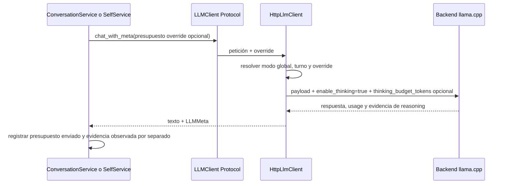

# Diseño técnico: presupuestos de razonamiento LLM

## Resumen

La feature reemplaza el apagado de razonamiento por los presets `auto`, `low`, `medium` y `high`. Los tres niveles graduados son topes fijos de tokens por petición: `low=256`, `medium=1024`, `high=4096`; no se pueden alterar mediante variables de entorno independientes. `auto` mantiene reasoning en todos los turnos, usando el preset low en turnos rápidos y el default del servidor en turnos normales. Reparaciones e introspecciones estructuradas solicitan low.

El presupuesto registrado es el límite resuelto y enviado por el cliente, no una afirmación de que el servidor lo obedeció. La evidencia observada continúa registrándose por separado mediante `reasoning_present`, `reasoning_tokens` y usage. El cliente nunca envía `enable_thinking=false` ni cambia la configuración del servidor.

### Objetivos

- Mantener reasoning activo en todas las llamadas a llama, incluidos turnos rápidos.
- Graduar el coste mediante topes de tokens de razonamiento por petición.
- Mantener compatibilidad de proveedores y el comportamiento histórico de `auto`.
- Aplicar presupuestos bajos a reparaciones sin eliminar razonamiento.
- Hacer auditable el presupuesto solicitado junto a los resultados observados.

### Fuera de alcance

- Cambios a argumentos/configuración de arranque del servidor.
- Garantizar que cada build/template respete el presupuesto enviado.
- Cambiar la estrategia de streaming, el formato JSON o los límites de tokens de salida.
- Enviar extensiones de razonamiento a proveedores distintos de `llama`.

## Arquitectura

### Arquitectura existente e integración

Se conserva la arquitectura hexagonal y se extienden las capas existentes, sin introducir dependencias nuevas:

- `airi.ports.llm`: contrato de parámetros de petición y campos tipados de `LLMMeta`.
- `airi.adapters.http_llm`: normalización de configuración y resolución final de modo/presupuesto antes de serializar el payload.
- `airi.services.conversation`: selección del override según llamada primaria o reparación, y registro por llamada.
- `airi.services.self_service`: presupuesto `low` para introspección estructurada.
- `airi.observability.prompt_benchmark`: aceptar los modos nuevos y guardar el modo solicitado en los resultados.

La fábrica continúa leyendo `LLM_THINKING_MODE` en `LlmConfig`. El valor se resuelve al construir el cliente; no se modifica durante una llamada. El adaptador agrega los campos propietarios de llama únicamente al payload del proveedor `llama`.

### Flujo de resolución por llamada

### Decisiones de diseño

1. **Decisión — representar límites por presupuesto y prohibir el apagado.** El puerto recibe `reasoning_budget_tokens: int | None` como override local y `quick_turn: bool` como clasificación. Se retira `disable_thinking`/`force_disable_thinking`; el adaptador fija `enable_thinking=true` para `llama` en todas las llamadas. El presupuesto local es por petición y no altera el modo global.

2. **Decisión — resolver presupuesto por preset y propósito.** En `llama`, override local prevalece solo para esa petición. `low/medium/high` resuelven a los valores fijos agrupados 256/1024/4096; `auto` rápido resuelve al preset low y `auto` normal deja presupuesto sin especificar para usar el default del servidor. Reparaciones y `self_service` fuerzan el preset low localmente. En todos los casos reasoning sigue activo. Otros proveedores no reciben campos propietarios y metadatos de presupuesto son nulos.

3. **Decisión — registrar límite enviado, no inferir cumplimiento.** `LLMMeta` y el registro de llamada exponen `reasoning_budget_tokens` como presupuesto resuelto/enviado por el cliente. `reasoning_present` y `reasoning_tokens` son evidencia independiente. Se añade un campo nullable a `llm_calls`, sin guardar texto sensible.

### Alineación tecnológica

El diseño usa Python, el `Protocol` existente, el adaptador `aiohttp`, configuración por entorno y pruebas pytest. Respeta la separación port/adapters, TDD y la regla de privacidad: nunca se almacena prompt, contenido de respuesta ni contenido de reasoning.

## Componentes e interfaces

### Puerto y metadatos (`src/airi/ports/llm.py`)

- Aceptar `reasoning_budget_tokens` y `quick_turn` en `LLMClient.chat` y `chat_with_meta`.
- Añadir a `LLMMeta` el límite resuelto/enviado, nullable para proveedores o peticiones donde no aplique.
- Mantener todos los metadatos actuales de usage, streaming y evidencia de razonamiento.

### Configuración y adaptador (`src/airi/adapters/http_llm.py`)

- `LLM_THINKING_MODES` será `("auto", "low", "medium", "high")`; `on`, `off` y cualquier valor inválido recaen en `auto` con warning.
- Un mapa inmutable y agrupado define `low/medium/high` como topes fijos de 256/1024/4096 tokens; las variables de entorno de presupuestos y de reserva dejan de configurar esos valores. La reserva de salida es fija en 512 tokens.
- `auto` mantiene reasoning activo: turnos rápidos usan 256 tokens y turnos normales usan el default del servidor.
- En `llama`, enviar `chat_template_kwargs.enable_thinking=true` y, cuando haya límite, `thinking_budget_tokens` por petición. No enviar `reasoning_effort`.
- Resolver precedencia: override local, presupuesto del modo, luego default del servidor. Rechazar overrides negativos antes del POST.
- En proveedores `openai` y `openai-compatible`, omitir campos propietarios y exponer presupuesto nulo.

**Validación live:** en el servidor activo Qwen3.5-9B, `thinking_budget_tokens=64` y `128` devolvieron HTTP 200 con reasoning y respuestas; los completion tokens observados fueron 67 y 230 respectivamente. La ruta de producción del adaptador con `low=256` también devolvió `reasoning_present=true`. El backend no informó `reasoning_tokens`, así que no se conoce el consumo exacto ni se generaliza el resultado a otras builds/modelos. La petición no reinició ni reconfiguró el servidor. Si se fija `--reasoning-budget` al arrancar, upstream indica que puede impedir el override por petición. Un presupuesto es un tope y puede cortar reasoning abruptamente.

### Orquestación (`src/airi/services/conversation.py`, `src/airi/services/self_service.py`)

- La llamada primaria pasa su clasificación como `quick_turn`; en `auto`, rápido resuelve presupuesto 256 sin desactivar reasoning.
- Las llamadas no primarias de reparación (`question_close`, respuesta vacía/repetida, truncamiento, incoherencia de desconexión y reintento de formato) usan presupuesto 256.
- La introspección estructurada de `self_service` usa presupuesto 256.
- `_record_call` registra el presupuesto resuelto enviado junto con la evidencia observada.
- Sustituir `_thinking_effective` por resolución de presupuesto nullable; no confundir límite pedido con cumplimiento.
- Los clientes/fakes de prueba se actualizan con el nuevo contrato y conservan soporte de metadatos.

### Benchmark y configuración

- `run_prompt_benchmark` valida `auto`, `low`, `medium`, `high` y que coincida con `llm.thinking_mode`.
- Las muestras/resúmenes del benchmark conservan el modo global seleccionado y metadatos por llamada sin añadir contenido sensible.
- Actualizar `.env.example` y README; `.env` local no se modifica automáticamente para evitar reemplazar configuración personal.

## Manejo de errores y límites

- Modo global inválido: warning y fallback a `auto`.
- Override de presupuesto inválido o negativo: error antes de I/O.
- Backend que ignora/no soporta el campo: registrar límite enviado y evidencia devuelta, sin fallback a `enable_thinking=false`.
- Proveedor no llama: omitir extensión propietaria y registrar presupuesto nulo.
- Fallo de POST: registrar presupuesto resuelto y error, sin prompt/contenido.

## Estrategia de pruebas

### Unitarias

- Normalización y rechazo de modos, incluyendo fallback de `off` a `auto`.
- Matriz de resolución de modo global, turno rápido, override de presupuesto y precedencia.
- Payload por proveedor: razonamiento siempre activo en `llama`, presupuesto por modo y ausencia de campos propietarios en otros proveedores.
- Métodos `chat`/`chat_with_meta`, streaming, metadatos nullable y errores de override.
- Resolución/registro del presupuesto en llamadas primarias, reparaciones y `self_service`.

### Integración

- Modos de cliente y payloads efectivos en `test_llm_modes.py`.
- Metadatos de llamada que distinguen `reasoning_budget_tokens` de `reasoning_present` y `reasoning_tokens`.
- Turnos rápidos en `auto`, reparaciones con `low` y outputs estructurados de `self_service`.
- Benchmark acepta modos nuevos, rechaza discrepancias y conserva modo/presupuesto en resultados.
- Actualizar pruebas de fecha/glue que actualmente esperan apagado de reasoning.

### Validación live opcional, no destructiva

La validación live ya comprobó `thinking_budget_tokens` con límites pequeños y la ruta del adaptador con low/medium/high. No reiniciar el servidor, cambiar argumentos de arranque ni modificar configuración en disco. No imprimir ni persistir `reasoning_content`.

## Rendimiento y riesgos

El presupuesto es un tope cuantitativo, no un nivel cognitivo ni una garantía de calidad. Cinco comprobaciones live breves con el modelo activo produjeron respuestas utilizables una vez reservado espacio de salida. Dos intentos iniciales con `max_tokens=1024` y presupuesto medio/alto terminaron en `length` sin contenido; el adaptador ahora eleva el tope total a `max(pedido, presupuesto + 512)`. Latencia y calidad varían por modelo/template y esos cinco ejemplos no sustituyen una evaluación de producción más amplia.
