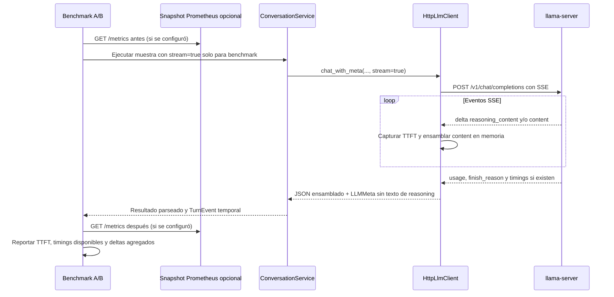

# Diseño técnico: TTFT y timings de llama-server

## Resumen

La extensión añade un modo de inferencia streaming exclusivo del benchmark. El cliente medirá TTFT desde el inicio de la petición hasta el primer delta con texto generado (de razonamiento o respuesta) y, por separado, hasta el primer delta visible de `content`. La respuesta se ensamblará en memoria para que el pipeline actual de parseo siga validando el mismo JSON; nunca se registrarán los fragmentos ni el texto final en el reporte.

El adaptador conservará `usage`, `finish_reason` y el objeto `timings` cuando el backend los entregue. El benchmark podrá consultar `/metrics` antes/después de cada muestra cuando el usuario configure la URL. Dado que Prometheus normalmente publica contadores agregados y no garantiza correlación por request, el reporte etiquetará sus deltas como agregados. El modo streaming queda apagado por defecto y la conversación habitual continúa usando `stream: false`.

### Objetivos

- Medir TTFT de extremo a extremo y primer contenido visible por separado.
- Capturar timings internos `prompt_n/prompt_ms/prompt_per_second` y `predicted_n/predicted_ms/predicted_per_second` cuando estén presentes.
- Capturar `reasoning_content` solo durante el procesamiento; registrar presencia y recuento explícito de tokens si el servidor lo informa, nunca su texto.
- Correlacionar snapshots Prometheus de solo lectura sin presentar deltas globales como una medición exacta por inferencia.
- Mantener las condiciones A/B y el comportamiento productivo no-streaming sin cambios.

### Fuera de alcance

- Reiniciar, iniciar, detener o reconfigurar llama-server desde Airi.
- Cambiar la política global de `thinking`, presupuesto de razonamiento, modelo, límites, sampling, schema, historial o prompt. Excepción: el override per-call de thinking se permite únicamente en llamadas clasificadas como reparación, como se especifica en la sección «Override de thinking en reparaciones».
- Habilitar streaming en el camino normal de Airi.
- Usar `--expert-stats` como sustituto de tiempos de inferencia.
- Cambiar el contrato JSON del modelo o guardar reasoning/respuestas para diagnóstico.

## Arquitectura

### Arquitectura existente relevante

- `HttpLlmClient.chat_with_meta` construye hoy `stream: false`, lee `choices[0].message.content` y guarda `usage` y `finish_reason` en `LLMMeta`.
- `ConversationService._generate` usa `chat_with_meta`, parsea el JSON y conserva metadata en `TurnEvent`; `TurnContext` ya tiene selectores experimentales de variante del system prompt.
- `airi-prompt-benchmark` ejecuta solicitudes secuenciales y serializa solo métricas. Su opción `--review` muestra texto localmente, pero no lo persiste.
- `llama-server` upstream documenta `--perf` para timings internos, `--metrics` para habilitar `/metrics`, streaming SSE y campos `timings` en respuestas no-streaming. El build instalado por el usuario no está disponible en este workspace, por tanto los campos de streaming y flags concretos requieren comprobación local con `--help` y una petición de prueba.

### Flujo de datos

### Alineación tecnológica

Se reutilizan Python 3.11+, `aiohttp`, el puerto `LLMClient`, `LLMMeta`, `TurnEvent` y el runner de evaluación existente. No se añade una librería de streaming ni de Prometheus: SSE se consume con el parser incremental del cliente HTTP y el endpoint Prometheus se consulta como texto HTTP para evitar una dependencia nueva. El benchmark es el único consumidor del modo streaming y la conexión de métricas es opcional.

### Decisiones de diseño

1. **Streaming opt-in a través del puerto LLM.** `chat_with_meta` acepta un parámetro de transporte `stream=False` por defecto. El benchmark lo solicita explícitamente; los callers existentes no cambian. El adaptador mide con reloj monotónico alrededor de la petición.
2. **Separar TTFT total y primer contenido visible.** `ttft_ms` comienza con el primer delta no vacío de `reasoning_content` o `content`. `first_content_ms` comienza con el primer delta no vacío de `content`. Los campos diferencian “el modelo empezó a razonar” de “Airi empezó a emitir su respuesta”, si el formato del servidor los separa.
3. **Ensamblar solo `content` para el parseo.** Los fragmentos de reasoning se descartan después de registrar un indicador de presencia; nunca se mezclan en el JSON de Airi ni se escriben en `TurnEvent`, logs o reporte. La respuesta `content` se ensambla en memoria y pasa al parseo normal.
4. **Timings y usage son best-effort explícito.** `LLMMeta` porta campos opcionales: `ttft_ms`, `first_content_ms`, `server_timings`, `reasoning_present` y `reasoning_tokens` si usage entrega un valor explícito. No se estima conteo de reasoning desde caracteres ni se asume que SSE entrega `usage`/`timings`.
5. **Prometheus opcional y etiquetado como agregado.** `--metrics-url` permite fijar explícitamente el endpoint. Se toma snapshot inmediatamente antes/después de cada request secuencial. Solo se restan series de tipo counter/gauge numérico compatibles; histogramas/summaries se preservan como muestra/delta con nombre y no se convierten a latencia por-request. Un fallo del endpoint no falla la inferencia.
6. **Sin fallback silencioso en streaming.** Si el endpoint rechaza streaming o SSE está malformado, esa muestra se marca fallida. No se reintenta en no-streaming porque eso quitaría TTFT y rompería la comparación. El siguiente sample puede continuar con estado reconstruido.
7. **No enviar cambios implícitos de chat template.** El benchmark no establece `reasoning_format`, `reasoning_budget` ni `chat_template_kwargs` adicionales. Si el servidor ya está configurado para `reasoning_content`, el parser lo mide; de otro modo `reasoning_present=false/null` y la respuesta visible sigue compatible.

## Componentes e interfaces

### Puerto y adaptador LLM

#### `LLMMeta`

Agrega campos opcionales y tipados:

| Campo | Tipo | Semántica |
|---|---|---|
| `ttft_ms` | `int \| None` | Tiempo desde antes del POST hasta primer delta de reasoning o content |
| `first_content_ms` | `int \| None` | Tiempo hasta primer delta de `content` visible |
| `server_timings` | `dict[str, int \| float] \| None` | Copia numérica filtrada del objeto `timings` si el servidor la devuelve |
| `reasoning_present` | `bool \| None` | `true` si se recibió algún delta no vacío `reasoning_content`; `null` si el formato no permite saberlo |
| `reasoning_tokens` | `int \| None` | Solo un conteo explícito suministrado por el proveedor; nunca estimado |

#### `HttpLlmClient.chat_with_meta`

- **Responsabilidad:** mantener el request no-streaming existente por defecto y soportar SSE solo si `stream=True`.
- **Parser SSE:** leer líneas/eventos incrementalmente, admitir chunks de red partidos, procesar `data: {...}` y `[DONE]`, ignorar keepalives/metadatos sin delta de texto, propagar errores HTTP/event-stream como error tipado.
- **Campos:** unir solo fragmentos de `delta.content` para devolver el mismo tipo `str` que hoy; calcular tiempos del cliente al primer texto; extraer `usage`, `finish_reason`, `timings` y presencia/recuentos explícitos de reasoning.
- **Privacidad:** no escribir deltas, `reasoning_content` ni mensajes en logs; `server_timings` se restringe a valores numéricos conocidos/serializables.
- **Compatibilidad:** el valor `stream=False` crea exactamente el payload no-streaming existente y mantiene su respuesta/errores.

#### Prometheus snapshot reader

- **Responsabilidad:** solicitar un endpoint configurado de lectura, analizar líneas exposition de Prometheus y retornar nombres/labels/tipos/valores numéricos.
- **Seguridad:** solo `GET`, nunca proxies a endpoints de control; URL no se deriva de forma ambigua de `LLM_BASE_URL`; timeout corto; no registrar cabeceras ni contenido arbitrario.
- **Diferencias:** calcula deltas solamente para series presentes antes y después con mismo nombre y labels. Counters que disminuyen (reset/restart) se marcan reset/no disponibles, nunca delta negativo como trabajo válido.
- **Ausencia:** URL vacía, status distinto de 200, parse parcial o timeout se informa en metadata sin cancelar el A/B.

### Runner del benchmark

- Añade `--metrics-url` opcional al comando actual; omitirlo desactiva snapshots.
- Mantiene cinco pares secuenciales alternados, `thinking_mode=on`, mismo modelo/contexto/schema/límites y variante de prompt.
- Crea un snapshot pre/post por cada inferencia si el endpoint está configurado.
- Agrega a cada `BenchmarkSample` TTFT, first content, timings del servidor, indicador/recuento de reasoning y delta Prometheus.
- Reporte JSON incluye muestras/medianas/rangos, `metrics_scope="aggregate_snapshot_delta"` para Prometheus, estado/errores sanitizados y campos no disponibles como `null`.
- No incluye texto de entrada, historial, prompt, contenido, reasoning o respuestas en el reporte.
- La opción de salida de evaluación `--review` sigue siendo separada; esta extensión no la activa por defecto.

### `TurnEvent`

Los timings opt-in se conservarán en campos nuevos opcionales de la traza en memoria y serialización forward-compatible. Las trazas históricas sin esos campos se cargan sin cambios. No se guardará texto de reasoning ni telemetría Prometheus extensa dentro de cada evento de producción; el reporte del benchmark es su dueño.

### Metadatos por llamada

`TurnEvent.llm_calls` guarda una lista de diccionarios, uno por invocación real al modelo. Sustituye la inferencia indirecta (`llm_ms − prompt_ms − predicted_ms`) por evidencia directa y evita que una reparación invisible duplique la latencia sin rastro.

| Campo | Tipo | Semántica |
|---|---|---|
| `purpose` | `str` | `primary`, `truncation_repair`, `question_close_repair`, `empty_reply_repair`, `repeat_reply_repair`, `disconnect_repair`, o el sufijo `:json_object_retry` |
| `status` | `str` | `ok` o `failed` |
| `duration_ms` | `int` | Reloj monotónico alrededor de la petición completa |
| `finish_reason` | `str \| None` | El de esa llamada, no el agregado del turno |
| `usage`, `server_timings` | `dict \| None` | Copias filtradas a valores numéricos |
| `ttft_ms`, `first_content_ms` | `int \| None` | Solo en streaming |
| `reasoning_present`, `reasoning_tokens` | `bool/int \| None` | Solo conteo explícito del servidor |
| `reasoning_deltas`, `content_deltas` | `int \| None` | Deltas SSE por canal; proxy, no tokens exactos |
| `max_tokens` | `int \| None` | Tope efectivo aplicado (incluye el default del adaptador) |
| `thinking_requested_off` | `bool` | Lo que pidió el servicio en esa llamada |
| `thinking_effective` | `bool` | Lo que realmente aplicará `LLM_THINKING_MODE` |
| `error_type` | `str \| None` | Clase de la excepción, nunca su mensaje |

Decisiones:

1. **Un único helper `_chat`** centraliza la llamada, el reintento de `json_schema` a `json_object` y el registro. Los seis puntos de invocación de `_generate` pasan propósito explícito; ninguno inventa métricas.
2. **`finish_reason` dual.** El agregado histórico (`llm_finish_reason`) sigue describiendo la respuesta usada; `llm_calls[0].finish_reason` conserva el corte real de la primera llamada.
3. **`usage` en streaming.** El perfil `llama` (y `openai`) añade `stream_options: {include_usage: true}` solo cuando `stream=True`; el perfil `openai-compatible` no lo envía para no romper servidores que rechacen el campo. La ruta de producción sigue en no-streaming.
4. **Privacidad por lista blanca.** `prompt_benchmark` copia únicamente `CALL_METADATA_FIELDS`, de modo que un cambio futuro en el registro no puede arrastrar texto al reporte.
5. **`thinking_effective` documenta la neutralización.** Con `LLM_THINKING_MODE=on`, una reparación que pide `disable_thinking=True` sigue razonando; el registro lo hace visible en vez de silenciarlo.

### Override de thinking en reparaciones

La política global sigue gobernando las llamadas primarias. Para una llamada marcada explícitamente como reparación, el servicio puede solicitar un override per-call que desactive thinking incluso cuando `LLM_THINKING_MODE=on`. El override no cambia el modo global, no persiste fuera de esa petición y no se aplica a la llamada primaria. Con `LLM_THINKING_MODE=off`, thinking permanece apagado en todas las llamadas; con `auto`, las llamadas primarias conservan el comportamiento actual y las reparaciones respetan el override solicitado.

La clasificación de reparación incluye truncamiento, respuesta vacía, repetición, cierre interrogativo, coherencia y el fallback de esquema que forme parte de esa llamada reparadora. `thinking_requested_off` describe la solicitud del servicio y `thinking_effective` debe reflejar el valor realmente enviado en `chat_template_kwargs`, no una predicción derivada solo del modo global. No se altera el prompt, el presupuesto global, los parámetros de generación ni la configuración del servidor.

La prueba de integración debe inspeccionar los payloads: llamada primaria con thinking on conserva `enable_thinking` no forzado a false; reparación bajo modo on envía `enable_thinking=false` solo para la reparación; modo off mantiene el razonamiento apagado; modo auto conserva la semántica actual salvo override explícito de reparación. Cubrir tanto streaming como no-streaming y el fallback `json_schema` → `json_object`.

## Errores y recuperación

- SSE malformado, HTTP error o desconexión antes del primer delta: muestra fallida con `error_type` y TTFT nulo; no se almacena `str(exception)`.
- Stream finaliza sin `[DONE]` pero contiene `finish_reason`: usar el dato suministrado, etiquetar cierre incompleto si el protocolo permite detectarlo y no inventar uso/timings ausentes.
- Error de Prometheus: continuar el A/B, incluir estado `unavailable` y causa de clase (sin body libre).
- Falta `usage`/`timings` en el último chunk: dejar los campos nulos; no reintentar con una segunda inferencia.
- El servidor devuelve reasoning en `content` como tags en vez de `reasoning_content`: no quitar ni reinterpretar tags en este scope; se registra `reasoning_present=null` si no se distingue con certeza.
- Límite de timeout de cliente: conserva el valor configurado y etiqueta el sample timeout; el modo streaming no lo amplía silenciosamente.

## Estrategia de pruebas

### Unitarias

- Parser SSE procesa múltiples eventos y chunks JSON arbitrariamente fragmentados, ignora keepalive/role vacío y detecta `[DONE]`.
- Reloj falso verifica TTFT al primer token y `first_content_ms` posterior si reasoning llega antes.
- `stream=False` conserva payload y retorno no-streaming byte-for-byte a nivel contrato.
- Extracción de usage/timings/reasoning solo conserva tipos explícitos; campos ausentes permanecen `None`.
- Parser Prometheus conserva labels, filtra datos no numéricos, diffs series y detecta reset.
- Serializer del benchmark no emite `content`, prompts, mensajes o reasoning.

### Integración con fakes

- Conversación benchmark usa stream=True y normal usa stream=False.
- Respuesta SSE con JSON estructurado ensamblado pasa el parser existente igual que respuesta no-stream.
- Falla de SSE marca la muestra sin fallback y continúa el siguiente estado limpio.
- Prometheus pre/post suma deltas en un sample y los etiqueta como agregados; endpoint caído no bloquea el A/B.
- Sin campos de timings/usage, todos los números ausentes quedan nulos.

### Prueba operativa local

- Antes de una corrida, el operador verifica `./build/bin/llama-server --version` y `--help` del binario exacto; el programa no inicia ni reinicia el server.
- Con servidor levantado con `--perf --metrics`, verificar por `GET /metrics` que el endpoint existe.
- En una petición de muestra, verificar presencia de SSE y qué campos `usage`, `timings` y `reasoning_content` realmente emite esa versión/template. Las incompatibilidades se informan; no se asumen por versión upstream.
- Ejecutar el benchmark completo de cinco pares secuenciales y comparar tiempos client-side con estadísticas de server-side, declarando Prometheus agregado.

## Rendimiento y privacidad

- Streaming mide time-to-first-data en el cliente e incluye cola/HTTP; timings internos del server omiten o separan parte de esa espera según build. No deben tratarse como métricas intercambiables.
- Scraping antes/después por inferencia añade una pequeña petición HTTP al servidor. Si se configura, mantenerlo secuencial y usar un timeout bajo para no distorsionar la inferencia.
- Con otros clientes concurrentes, deltas Prometheus no son atribuibles al benchmark; el reporte debe advertirlo.
- Pensamiento puede preceder al contenido visible; por ello TTFT de generación y primer content se reportan separados.
- `--perf` y `--metrics` son flags de inicio del servidor y requieren reinicio manual del operador para habilitarlos; esta feature no administra ese ciclo de vida. Confirmar la disponibilidad de flags en el `--help` del build local.
- La documentación upstream consultada lista tipos de cache K diferentes de `turbo4`; el tipo indicado por el usuario puede ser build-specific y queda fuera del diseño hasta validar el binario exacto.
